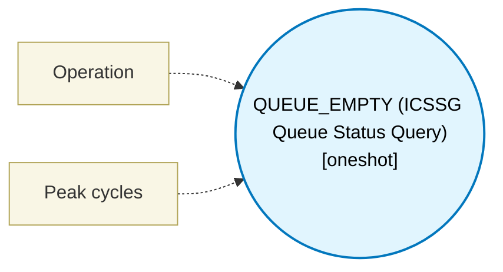

# QUEUE_EMPTY (ICSSG Queue Status Query) (`queue_empty_block`) — Design Document

> Generated by `build_block_docs.js` from `.metadata/sysconfig/.meta/pru_blocks/pru_io_blocks/queue_empty_block.syscfg.js`. Do not edit by hand; re-run `node build_block_docs.js`.

## Purpose

Queries queue empty status through the ICSSG QUEUE_EMPTY broadside unit (SPRUIM2J 6.4, Table 6-60 Broadside ID 0xF0 / 240). Device 0xF0 is a shared XIN-only hardware status interface reachable from all six cores (PRU0/1, RTU_PRU0/1, TX_PRU0/1). It reads the 32-bit queue empty bitmask in 1 cycle into the allocated output register. XOUT on device 0xF0 is not supported by hardware. ICSSG only (AM64x/AM243x); absent on ICSSM (AM261x/AM263Px). Maturity is 'simulator-tested': simulated via XIN device 0xF0 handling in scripts/simulator.js.

## Block Diagram




## Classification

- **Block id:** `queue_empty_block`
- **Category:** I/O & Protocol
- **Execution model (inferred):** `oneshot`
- **Macro / opcode:** `m_queue_empty`
- **Data ports:** 0 in / 1 out · **Cycles:** `1`

## Parameter schema

| Parameter | Display name | Default | Options |
|---|---|---|---|
| `operation` | Operation | `query` | `query` |
| `noOfCycles` | Peak cycles | `1` | — |

## Ports

| Port | Type |
|---|---|
| `prev` | `IO_PREV` |
| `next` | `IO_NEXT` |
| `output1` | `output32` |

## Validation rules

- QUEUE_EMPTY operation must be 'query' (SPRUIM2J Table 6-60).
- QUEUE_EMPTY device 0xF0 is XIN-only (SPRUIM2J Table 6-60). Writing or XOUT is not supported on this device.

## Generated macro (`.xdt` equivalent)

```asm
m_queue_empty .macro RES
    ; ICSSG QUEUE_EMPTY status query (SPRUIM2J 6.4, Table 6-60 Broadside ID 0xF0).
    ; 0xF0 is a shared XIN-only broadside device reachable from all six cores.
    ; Reads the 32-bit queue empty status word directly into allocator destination register RES.
    xin   240, &RES, 4
    .endm
```

## Device portability

> **Source of truth:** `.metadata/sysconfig/.meta/pru_blocks/common/pru_device_caps.js` (TRM SPRUIM2J §6.4.1.1 / SPRUJB6 §7.3.1.1). Regenerated by `node build_block_docs.js` — do not edit by hand.

- **Required widget(s):** `queue_empty`
- **Validator:** `pru_blocks_static_module` raises a SysConfig **ERROR** naming both widget and device when a required widget is absent.

| Device (SoC) | Supported |
|---|---|
| `am243x` | ✅ |
| `am261x` | ❌ queue_empty |
| `am263px` | ❌ queue_empty |
| `am263x` | ❌ queue_empty |
| `am64x` | ✅ |

## Outstanding TODO / VERIFY items

- None flagged in source.
