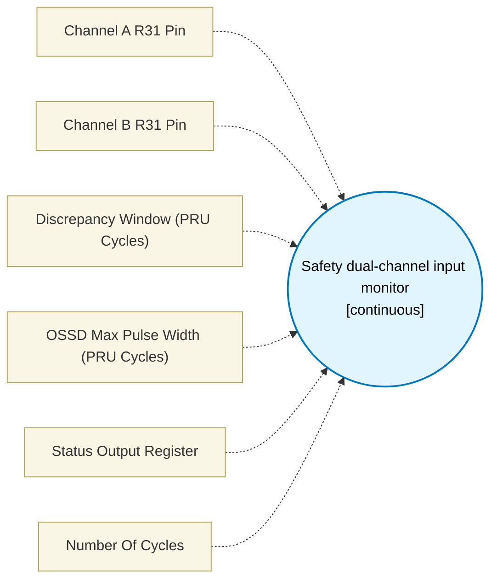

# Safety dual-channel input monitor (`safety_dual_monitor_block`) — Design Document

> Generated by `build_block_docs.js` from `.metadata/sysconfig/.meta/pru_blocks/pru_io_blocks/safety_dual_monitor_block.syscfg.js`. Do not edit by hand; re-run `node build_block_docs.js`.

## Purpose


## Safety Dual-Channel Input Monitor ? NOT A CERTIFIED SAFETY FUNCTION

**WARNING: This PRU block is NOT a certified safety function.** It is only a
monitor / pre-filter that feeds a certified safety path (e.g. a safety PLC,
safety relay, or qualified MCU safety island). Do NOT use its output as the
sole safety decision. A certified safety function requires qualified hardware,
systematic capability (e.g. IEC 61508 / ISO 13849) and independent validation
beyond what the PRU No-Code simulator can prove. Keep this disclaimer with
any design that instantiates the block and preserve it in generated docs.

### Purpose
Monitors two normally-high safety channels (e.g. OSSD outputs from a light
curtain). Tolerates short OSSD test pulses (typically 100 us to 1 ms,
20k-200k PRU cycles at 200 MHz) while treating longer LOW as a genuine trip.
Detects channel disagreement persisting beyond a bounded discrepancy timer
as a fault. Outputs a status word for the certified safety path to consume.

### How it works (2-TEMP_REG pattern)
The block uses **TEMP_REG1 (R28)** and **TEMP_REG2 (R29)** as the two
scratch registers:

* **Pulse-width discrimination (TEMP_REG2):** when a channel goes LOW the
  firmware counts LOW cycles in TEMP_REG2 and compares against OSSD_MAX.
  Width <= OSSD_MAX is tolerated as an OSSD test pulse; width > OSSD_MAX
  is classified as a trip.
* **Bounded discrepancy timer (TEMP_REG1):** when channels disagree
  (A != B) a countdown of DISC_CYCLES is started in TEMP_REG1. If
  agreement returns before expiry the event is judged by the pulse width;
  if the timer expires while still disagreeing a discrepancy fault is
  raised.
* The two timers run together: a short disagreeing pulse within both
  limits is accepted as an OSSD pulse; a long disagreement or a long
  LOW beyond OSSD_MAX drives STATUS non-zero.

### Output (STATUS register)
* `0` ? SAFE: both channels HIGH, or a tolerable OSSD pulse was seen
  and channels have re-agreed within the windows.
* `1` ? TRIP: prolonged LOW beyond OSSD_MAX (genuine demand).
* `2` ? DISCREPANCY_FAULT: channels disagreed longer than DISC_CYCLES.

The monitor is single-pass: each invocation samples, applies the timers,
and writes STATUS. For continuous monitoring place it in a loop or poll
it from the main sequence.

### Configuration
* **CH_A / CH_B** ? the two GPI pins (R31 bits) carrying the safety channels.
* **Discrepancy cycles** ? bounded window during which disagreement is tolerated.
* **OSSD max cycles** ? longest LOW still treated as an OSSD test pulse.
* **Status register** ? 32-bit PRU register receiving 0/1/2.

### Generated assembly
Uses only base PRU instructions (qbbs/qbbc, ldi, add, sub, qbgt, qbeq) and
the two TEMP_REGs, so the headless simulator and the TI pru-simulator
execute the same binary. No MULL/XIN/XOUT.

### Residual gaps
* Exact PRU cycle cost of the counting loops is not hardware-validated;
  thresholds should be characterised on silicon and margined (see
  dual-oracle method).
* The block does not implement debouncing beyond the two timers; external
  filtering may be needed for noisy wiring.
* Not certified: see warning above.

### Simulating
Use Simulation Settings (device mode `ossd` on the two pins) or drive
R31 via the Python model `pru_device_models/ossd_emitter.DualOssdEmitter` and the
independent oracle `pru_device_models/buscosim.decode_ossd`. Focused tests are in
`tests/test_ossd.py` (accepted OSSD, genuine trip, disagreement
within/beyond window, boundary cases).


## Block Diagram




## Classification

- **Block id:** `safety_dual_monitor_block`
- **Category:** I/O & Protocol
- **Execution model (inferred):** `continuous`
- **Macro / opcode:** `m_safety_dual_monitor`
- **Data ports:** 0 in / 1 out · **Cycles:** `1`

## Parameter schema

| Parameter | Display name | Default | Options |
|---|---|---|---|
| `chAPin` | Channel A R31 Pin | `0` | `0`, `1`, `2`, `3`, `4`, `5`, `6`, `7`, `8`, `9`, `10`, `11`, `12`, `13`, `14`, `15`, `16`, `17`, `18`, `19` |
| `chBPin` | Channel B R31 Pin | `1` | `0`, `1`, `2`, `3`, `4`, `5`, `6`, `7`, `8`, `9`, `10`, `11`, `12`, `13`, `14`, `15`, `16`, `17`, `18`, `19` |
| `discrepancyCycles` | Discrepancy Window (PRU Cycles) | `500` | — |
| `ossdMaxCycles` | OSSD Max Pulse Width (PRU Cycles) | `400` | — |
| `statusRegister` | Status Output Register | `R4` | — |
| `noOfCycles` | Number Of Cycles | `1` | — |

## Ports

| Port | Type |
|---|---|
| `output1` | `output32` |
| `prev` | `IO_PREV` |
| `next` | `IO_NEXT` |

## Validation rules

- chAPin and chBPin must differ
- discrepancyCycles must be >= 1
- ossdMaxCycles must be >= 1

## Generated macro (`.xdt` equivalent)

```asm
m_safety_dual_monitor .macro RES, CH_A, CH_B, DISC_CYCLES, OSSD_MAX
    ; NOT A CERTIFIED SAFETY FUNCTION - monitor only, feeds certified path
    ldi RES, 0
    ; fast path: both high -> safe
    qbbc sd_a_low?, R31, CH_A
    qbbc sd_b_low_a_high?, R31, CH_B
    qba sd_done?
sd_a_low?:
    qbbs sd_disagree?, R31, CH_B
    ; both low -> measure combined low width in TEMP_REG2
    ldi TEMP_REG2, 0
sd_both_low_loop?:
    add TEMP_REG2, TEMP_REG2, 1
    ; check if still both low
    qbbs sd_both_low_end?, R31, CH_A
    qbbs sd_both_low_end?, R31, CH_B
    ; still both low: have we exceeded OSSD_MAX?
    ldi32 TEMP_REG1, OSSD_MAX
    qbgt sd_trip?, TEMP_REG1, TEMP_REG2
    qba sd_both_low_loop?
sd_both_low_end?:
    ; ended because at least one went high; classify by width
    ldi32 TEMP_REG1, OSSD_MAX
    qbgt sd_trip?, TEMP_REG1, TEMP_REG2
    qba sd_done?
sd_b_low_a_high?:
sd_disagree?:
    ; channels disagree: bounded discrepancy timer in TEMP_REG1, pulse width in TEMP_REG2
    ldi32 TEMP_REG1, DISC_CYCLES
    ldi TEMP_REG2, 0
sd_disc_loop?:
    add TEMP_REG2, TEMP_REG2, 1
    sub TEMP_REG1, TEMP_REG1, 1
    qbeq sd_disc_fault?, TEMP_REG1, 0
    ; check if disagreement resolved (A==B)
    qbbc sd_a_still_low?, R31, CH_A
    ; A high
    qbbs sd_resolved?, R31, CH_B
    qba sd_disc_loop?
sd_a_still_low?:
    qbbs sd_disc_loop?, R31, CH_B
    ; A low, B low -> both low now (agreed low) -> check width
    ldi32 TEMP_REG1, OSSD_MAX
    qbgt sd_trip?, TEMP_REG1, TEMP_REG2
    qba sd_done?
sd_resolved?:
    ; A high, B high -> both high again (agreed high) -> classify pulse width
    ldi32 TEMP_REG1, OSSD_MAX
    qbgt sd_trip?, TEMP_REG1, TEMP_REG2
    qba sd_done?
sd_disc_fault?:
    ldi RES, 2
    qba sd_done?
sd_trip?:
    ldi RES, 1
sd_done?:
    .endm
```

## Device portability

> **Source of truth:** `.metadata/sysconfig/.meta/pru_blocks/common/pru_device_caps.js` (TRM SPRUIM2J §6.4.1.1 / SPRUJB6 §7.3.1.1). Regenerated by `node build_block_docs.js` — do not edit by hand.

- **Required widget(s):** _(none)_
- **Validator:** `pru_blocks_static_module` raises a SysConfig **ERROR** naming both widget and device when a required widget is absent.

| Device (SoC) | Supported |
|---|---|
| `am243x` | ✅ |
| `am261x` | ✅ |
| `am263px` | ✅ |
| `am263x` | ✅ |
| `am64x` | ✅ |

## Outstanding TODO / VERIFY items

- None flagged in source.
