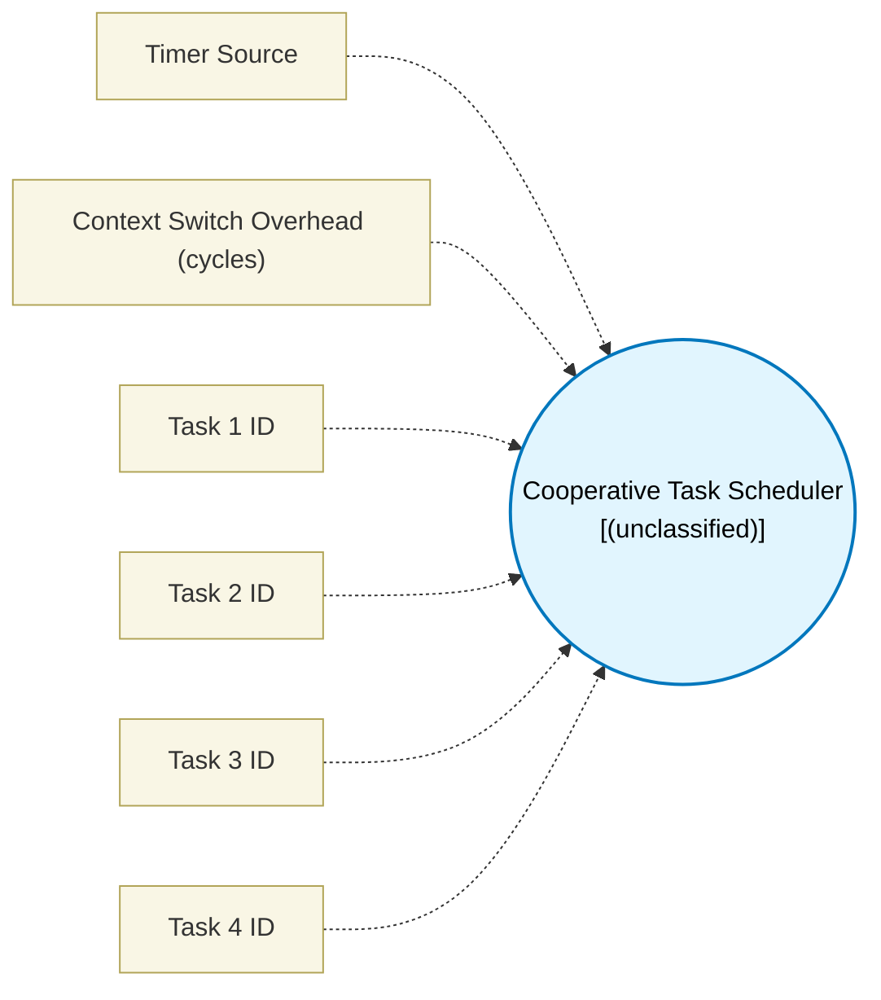

# Cooperative Task Scheduler (`scheduler_block`) — Design Document

> Generated by `build_block_docs.js` on 2026-10-21 from `.metadata/sysconfig/.meta/pru_blocks/program_control/scheduler_block.syscfg.js`. Do not edit by hand; re-run `node build_block_docs.js`.

## Purpose

_(no description in module)_

## Block Diagram




## Classification

- **Block id:** `scheduler_block`
- **Category:** Program Control
- **Execution model (inferred):** `(unclassified)`
- **Macro / opcode:** `m_scheduler_block`
- **Data ports:** 0 in / 0 out · **Cycles:** `100`

## Parameter schema

| Parameter | Display name | Default | Options |
|---|---|---|---|
| `timerSource` | Timer Source | `iep` | `iep`, `external` |
| `contextSwitchOverhead` | Context Switch Overhead (cycles) | `10` | — |
| `task1_id` | Task 1 ID | `0` | — |
| `task2_id` | Task 2 ID | `1` | — |
| `task3_id` | Task 3 ID | `255` | — |
| `task4_id` | Task 4 ID | `255` | — |

## Ports

| Port | Type |
|---|---|
| `prev` | `PREV` |

## Validation rules

- contextSwitchOverhead must be >= 0
- task1_id must be 0..31 or 255

## Generated macro (`.xdt` equivalent)

```asm
m_scheduler_block	.macro RES, task1, task2, task3, task4
    ; Parameters: task1..4 (255 means unused)

    .asg c26, CONST_IEP
    .asg 0x10, IEP_TMR_CNT ; IEP_COUNT_REG0 (0x0C is IEP_SLOW_COMPEN_REG)
    .asg 200000, TASK_0_PERIOD
    .asg 400000, TASK_1_PERIOD
    .asg 600000, TASK_2_PERIOD
    .asg 800000, TASK_3_PERIOD
    ; Initialize periods
    ldi32 R5, TASK_0_PERIOD
    ldi32 R6, TASK_1_PERIOD
    ldi32 R7, TASK_2_PERIOD
    ldi32 R8, TASK_3_PERIOD

    .asg "task1", t1_p
    .asg "task2", t2_p
    .asg "task3", t3_p
    .asg "task4", t4_p

scheduler_init?:
    ; Initialize task last-run registers (R10-R13)
    zero  &R10, 16

scheduler_loop?:
    .if (task1 < 32)
    ; Task 1 check (QBGT label, a, b branches when b > a: skip while delta < period)
    lbco  &R2, CONST_IEP, IEP_TMR_CNT, 4
    sub   R3, R2, R10            ; delta = current - last_0
    ldi32 R5, TASK_0_PERIOD
    qbgt  skip_task_0?, R3, R5
    mov   R10, R2                ; last_0 = current
    
    ; Dispatch Task (cooperative subroutine call)
    .if (task1 == 0)
    jal R29.w0, task_0_start
    .endif
    .if (task1 == 1)
    jal R29.w0, task_1_start
    .endif
    .if (task1 == 2)
    jal R29.w0, task_2_start
    .endif
    .if (task1 == 3)
    jal R29.w0, task_3_start
    .endif
    .if (task1 == 4)
    jal R29.w0, task_4_start
    .endif
    .if (task1 == 5)
    jal R29.w0, task_5_start
    .endif
    .if (task1 == 6)
    jal R29.w0, task_6_start
    .endif
    .if (task1 == 7)
    jal R29.w0, task_7_start
    .endif
    .if (task1 == 8)
    jal R29.w0, task_8_start
    .endif
    .if (task1 == 9)
    jal R29.w0, task_9_start
    .endif
    .if (task1 == 10)
    jal R29.w0, task_10_start
    .endif
    .if (task1 == 11)
    jal R29.w0, task_11_start
    .endif
    .if (task1 == 12)
    jal R29.w0, task_12_start
    .endif
    .if (task1 == 13)
    jal R29.w0, task_13_start
    .endif
    .if (task1 == 14)
    jal R29.w0, task_14_start
    .endif
    .if (task1 == 15)
    jal R29.w0, task_15_start
    .endif
    .if (task1 == 16)
    jal R29.w0, task_16_start
    .endif
    .if (task1 == 17)
    jal R29.w0, task_17_start
    .endif
    .if (task1 == 18)
    jal R29.w0, task_18_start
    .endif
    .if (task1 == 19)
    jal R29.w0, task_19_start
    .endif
    .if (task1 == 20)
    jal R29.w0, task_20_start
    .endif
    .if (task1 == 21)
    jal R29.w0, task_21_start
    .endif
    .if (task1 == 22)
    jal R29.w0, task_22_start
    .endif
    .if (task1 == 23)
    jal R29.w0, task_23_start
    .endif
    .if (task1 == 24)
    jal R29.w0, task_24_start
    .endif
    .if (task1 == 25)
    jal R29.w0, task_25_start
    .endif
    .if (task1 == 26)
    jal R29.w0, task_26_start
    .endif
    .if (task1 == 27)
    jal R29.w0, task_27_start
    .endif
    .if (task1 == 28)
    jal R29.w0, task_28_start
    .endif
    .if (task1 == 29)
    jal R29.w0, task_29_start
    .endif
    .if (task1 == 30)
    jal R29.w0, task_30_start
    .endif
    .if (task1 == 31)
    jal R29.w0, task_31_start
    .endif

skip_task_0?:
    .endif

    .if (task2 < 32)
    ; Task 2 check
    lbco  &R2, CONST_IEP, IEP_TMR_CNT, 4
    sub   R3, R2, R11            ; delta = current - last_1
    ldi32 R5, TASK_1_PERIOD
    qbgt  skip_task_1?, R3, R5
    mov   R11, R2                ; last_1 = current
    
    .if (task2 == 0)
    jal R29.w0, task_0_start
    .endif
    .if (task2 == 1)
    jal R29.w0, task_1_start
    .endif
    .if (task2 == 2)
    jal R29.w0, task_2_start
    .endif
    .if (task2 == 3)
    jal R29.w0, task_3_start
    .endif
    .if (task2 == 4)
    jal R29.w0, task_4_start
    .endif
    .if (task2 == 5)
    jal R29.w0, task_5_start
    .endif
    .if (task2 == 6)
    jal R29.w0, task_6_start
    .endif
    .if (task2 == 7)
    jal R29.w0, task_7_start
    .endif
    .if (task2 == 8)
    jal R29.w0, task_8_start
    .endif
    .if (task2 == 9)
    jal R29.w0, task_9_start
    .endif
    .if (task2 == 10)
    jal R29.w0, task_10_start
    .endif
    .if (task2 == 11)
    jal R29.w0, task_11_start
    .endif
    .if (task2 == 12)
    jal R29.w0, task_12_start
    .endif
    .if (task2 == 13)
    jal R29.w0, task_13_start
    .endif
    .if (task2 == 14)
    jal R29.w0, task_14_start
    .endif
    .if (task2 == 15)
    jal R29.w0, task_15_start
    .endif
    .if (task2 == 16)
    jal R29.w0, task_16_start
    .endif
    .if (task2 == 17)
    jal R29.w0, task_17_start
    .endif
    .if (task2 == 18)
    jal R29.w0, task_18_start
    .endif
    .if (task2 == 19)
    jal R29.w0, task_19_start
    .endif
    .if (task2 == 20)
    jal R29.w0, task_20_start
    .endif
    .if (task2 == 21)
    jal R29.w0, task_21_start
    .endif
    .if (task2 == 22)
    jal R29.w0, task_22_start
    .endif
    .if (task2 == 23)
    jal R29.w0, task_23_start
    .endif
    .if (task2 == 24)
    jal R29.w0, task_24_start
    .endif
    .if (task2 == 25)
    jal R29.w0, task_25_start
    .endif
    .if (task2 == 26)
    jal R29.w0, task_26_start
    .endif
    .if (task2 == 27)
    jal R29.w0, task_27_start
    .endif
    .if (task2 == 28)
    jal R29.w0, task_28_start
    .endif
    .if (task2 == 29)
    jal R29.w0, task_29_start
    .endif
    .if (task2 == 30)
    jal R29.w0, task_30_start
    .endif
    .if (task2 == 31)
    jal R29.w0, task_31_start
    .endif

skip_task_1?:
    .endif

    .if (task3 < 32)
    ; Task 3 check
    lbco  &R2, CONST_IEP, IEP_TMR_CNT, 4
    sub   R3, R2, R12            ; delta = current - last_2
    ldi32 R5, TASK_2_PERIOD
    qbgt  skip_task_2?, R3, R5
    mov   R12, R2                ; last_2 = current
    
    .if (task3 == 0)
    jal R29.w0, task_0_start
    .endif
    .if (task3 == 1)
    jal R29.w0, task_1_start
    .endif
    .if (task3 == 2)
    jal R29.w0, task_2_start
    .endif
    .if (task3 == 3)
    jal R29.w0, task_3_start
    .endif
    .if (task3 == 4)
    jal R29.w0, task_4_start
    .endif
    .if (task3 == 5)
    jal R29.w0, task_5_start
    .endif
    .if (task3 == 6)
    jal R29.w0, task_6_start
    .endif
    .if (task3 == 7)
    jal R29.w0, task_7_start
    .endif
    .if (task3 == 8)
    jal R29.w0, task_8_start
    .endif
    .if (task3 == 9)
    jal R29.w0, task_9_start
    .endif
    .if (task3 == 10)
    jal R29.w0, task_10_start
    .endif
    .if (task3 == 11)
    jal R29.w0, task_11_start
    .endif
    .if (task3 == 12)
    jal R29.w0, task_12_start
    .endif
    .if (task3 == 13)
    jal R29.w0, task_13_start
    .endif
    .if (task3 == 14)
    jal R29.w0, task_14_start
    .endif
    .if (task3 == 15)
    jal R29.w0, task_15_start
    .endif
    .if (task3 == 16)
    jal R29.w0, task_16_start
    .endif
    .if (task3 == 17)
    jal R29.w0, task_17_start
    .endif
    .if (task3 == 18)
    jal R29.w0, task_18_start
    .endif
    .if (task3 == 19)
    jal R29.w0, task_19_start
    .endif
    .if (task3 == 20)
    jal R29.w0, task_20_start
    .endif
    .if (task3 == 21)
    jal R29.w0, task_21_start
    .endif
    .if (task3 == 22)
    jal R29.w0, task_22_start
    .endif
    .if (task3 == 23)
    jal R29.w0, task_23_start
    .endif
    .if (task3 == 24)
    jal R29.w0, task_24_start
    .endif
    .if (task3 == 25)
    jal R29.w0, task_25_start
    .endif
    .if (task3 == 26)
    jal R29.w0, task_26_start
    .endif
    .if (task3 == 27)
    jal R29.w0, task_27_start
    .endif
    .if (task3 == 28)
    jal R29.w0, task_28_start
    .endif
    .if (task3 == 29)
    jal R29.w0, task_29_start
    .endif
    .if (task3 == 30)
    jal R29.w0, task_30_start
    .endif
    .if (task3 == 31)
    jal R29.w0, task_31_start
    .endif

skip_task_2?:
    .endif

    .if (task4 < 32)
    ; Task 4 check
    lbco  &R2, CONST_IEP, IEP_TMR_CNT, 4
    sub   R3, R2, R13            ; delta = current - last_3
    ldi32 R5, TASK_3_PERIOD
    qbgt  skip_task_3?, R3, R5
    mov   R13, R2                ; last_3 = current
    
    .if (task4 == 0)
    jal R29.w0, task_0_start
    .endif
    .if (task4 == 1)
    jal R29.w0, task_1_start
    .endif
    .if (task4 == 2)
    jal R29.w0, task_2_start
    .endif
    .if (task4 == 3)
    jal R29.w0, task_3_start
    .endif
    .if (task4 == 4)
    jal R29.w0, task_4_start
    .endif
    .if (task4 == 5)
    jal R29.w0, task_5_start
    .endif
    .if (task4 == 6)
    jal R29.w0, task_6_start
    .endif
    .if (task4 == 7)
    jal R29.w0, task_7_start
    .endif
    .if (task4 == 8)
    jal R29.w0, task_8_start
    .endif
    .if (task4 == 9)
    jal R29.w0, task_9_start
    .endif
    .if (task4 == 10)
    jal R29.w0, task_10_start
    .endif
    .if (task4 == 11)
    jal R29.w0, task_11_start
    .endif
    .if (task4 == 12)
    jal R29.w0, task_12_start
    .endif
    .if (task4 == 13)
    jal R29.w0, task_13_start
    .endif
    .if (task4 == 14)
    jal R29.w0, task_14_start
    .endif
    .if (task4 == 15)
    jal R29.w0, task_15_start
    .endif
    .if (task4 == 16)
    jal R29.w0, task_16_start
    .endif
    .if (task4 == 17)
    jal R29.w0, task_17_start
    .endif
    .if (task4 == 18)
    jal R29.w0, task_18_start
    .endif
    .if (task4 == 19)
    jal R29.w0, task_19_start
    .endif
    .if (task4 == 20)
    jal R29.w0, task_20_start
    .endif
    .if (task4 == 21)
    jal R29.w0, task_21_start
    .endif
    .if (task4 == 22)
    jal R29.w0, task_22_start
    .endif
    .if (task4 == 23)
    jal R29.w0, task_23_start
    .endif
    .if (task4 == 24)
    jal R29.w0, task_24_start
    .endif
    .if (task4 == 25)
    jal R29.w0, task_25_start
    .endif
    .if (task4 == 26)
    jal R29.w0, task_26_start
    .endif
    .if (task4 == 27)
    jal R29.w0, task_27_start
    .endif
    .if (task4 == 28)
    jal R29.w0, task_28_start
    .endif
    .if (task4 == 29)
    jal R29.w0, task_29_start
    .endif
    .if (task4 == 30)
    jal R29.w0, task_30_start
    .endif
    .if (task4 == 31)
    jal R29.w0, task_31_start
    .endif

skip_task_3?:
    .endif

    ; Cooperative yield loop delay to prevent busy looping
    ldi   R0, 100
yield_delay?:
    sub   R0, R0, 1
    qbne  yield_delay?, R0, 0
    qba   scheduler_loop?

    .endm
```

## Device portability

> **Source of truth:** `.metadata/sysconfig/.meta/pru_blocks/common/pru_device_caps.js` (TRM SPRUIM2J §6.4.1.1 / SPRUJB6 §7.3.1.1). Regenerated by `node build_block_docs.js` — do not edit by hand.

- **Required widget(s):** _(none)_
- **Validator:** `pru_blocks_static_module` raises a SysConfig **ERROR** naming both widget and device when a required widget is absent.

| Device (SoC) | Supported |
|---|---|
| `am243x` | ✅ |
| `am261x` | ✅ |
| `am263px` | ✅ |
| `am263x` | ✅ |
| `am64x` | ✅ |

## Outstanding TODO / VERIFY items

- None flagged in source.
