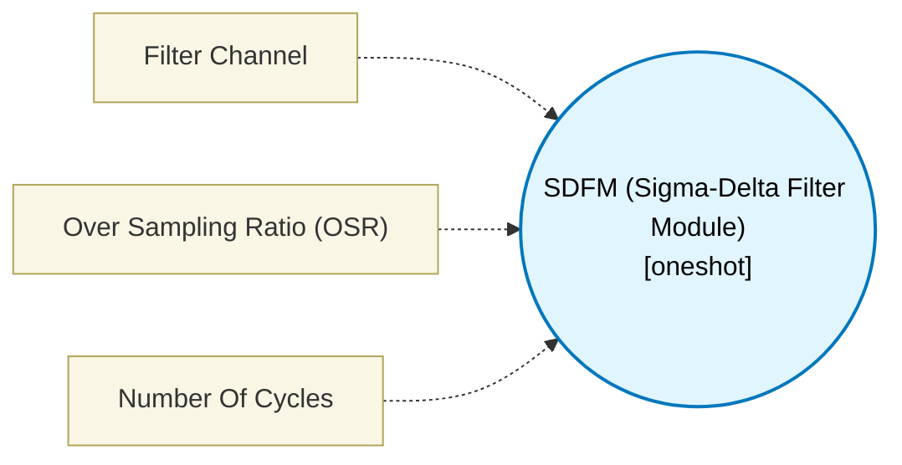

# SDFM (Sigma-Delta Filter Module) (`sdfm_block`) — Design Document

> Generated by `build_block_docs.js` on 2026-10-21 from `.metadata/sysconfig/.meta/pru_blocks/pru_io_blocks/sdfm_block.syscfg.js`. Do not edit by hand; re-run `node build_block_docs.js`.

## Purpose

Interfaces with the SDFM peripheral to read phase currents for motor control loops.

## Block Diagram




## Classification

- **Block id:** `sdfm_block`
- **Category:** I/O & Protocol
- **Execution model (inferred):** `oneshot`
- **Macro / opcode:** `m_sdfm_read`
- **Data ports:** 0 in / 0 out · **Cycles:** `10`

## Parameter schema

| Parameter | Display name | Default | Options |
|---|---|---|---|
| `filterChannel` | Filter Channel | `0` | `0`, `1`, `2`, `3` |
| `osr` | Over Sampling Ratio (OSR) | `64` | — |
| `noOfCycles` | Number Of Cycles | `10` | — |

## Ports

| Port | Type |
|---|---|
| `prev` | `IO_PREV` |
| `next` | `IO_NEXT` |
| `output1` | `output32` |

## Validation rules

- _(no explicit validate() rules)_

## Generated macro (`.xdt` equivalent)

```asm
m_sdfm_read .macro RES, CHANNEL
    ; --- SDFM Configurable MMIO Read ---
    ; Exact AM243x PRU-ICSSG SD register map is not available locally.
    ; This is a configurable MMIO read slice that computes offset from base.
    ; Assume base 0x0C080000, reading channel offset (CHANNEL * 4).
    ldi32 TEMP_REG1, 0x0C080000
    ldi   TEMP_REG2.w0, CHANNEL
    lsl   TEMP_REG2.w0, TEMP_REG2.w0, 2
    add   TEMP_REG1, TEMP_REG1, TEMP_REG2.w0
    lbbo  &RES, TEMP_REG1, 0, 4
    .endm
```

## Device portability

> **Source of truth:** `.metadata/sysconfig/.meta/pru_blocks/common/pru_device_caps.js` (TRM SPRUIM2J §6.4.1.1 / SPRUJB6 §7.3.1.1). Regenerated by `node build_block_docs.js` — do not edit by hand.

- **Required widget(s):** _(none)_
- **Validator:** `pru_blocks_static_module` raises a SysConfig **ERROR** naming both widget and device when a required widget is absent.

| Device (SoC) | Supported |
|---|---|
| `am243x` | ✅ |
| `am261x` | ✅ |
| `am263px` | ✅ |
| `am263x` | ✅ |
| `am64x` | ✅ |

## Outstanding TODO / VERIFY items

- None flagged in source.
