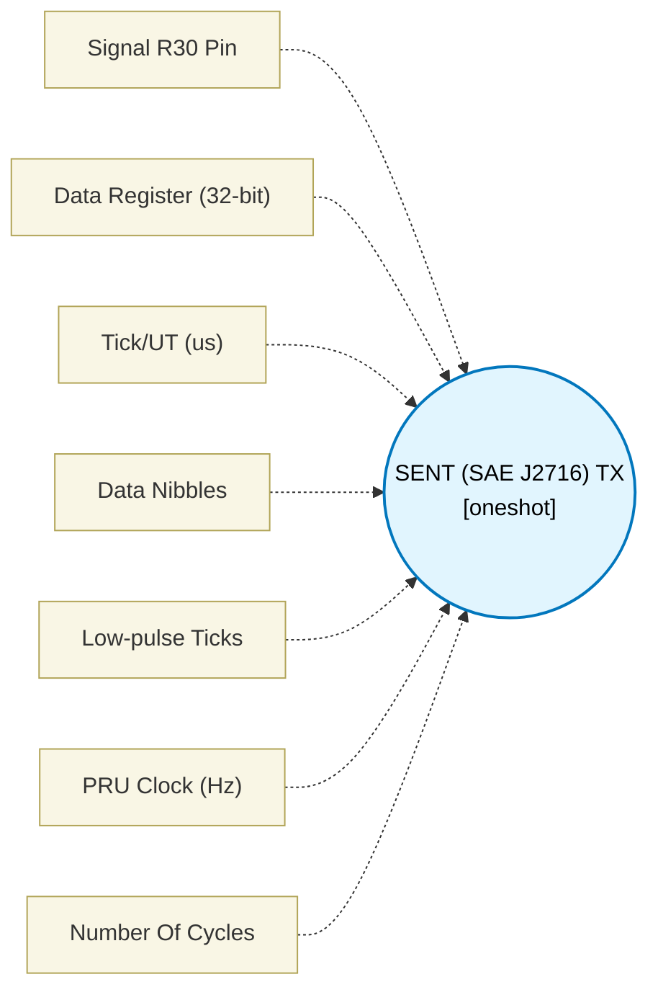

# SENT (SAE J2716) TX (`sent_block`) — Design Document

> Generated by `build_block_docs.js` from `.metadata/sysconfig/.meta/pru_blocks/pru_io_blocks/sent_block.syscfg.js`. Do not edit by hand; re-run `node build_block_docs.js`.

## Purpose

Transmits a SENT frame using edge timing. Each nibble is encoded as the time between successive falling edges, so the CRC nibble is closed by a final falling edge (a low pulse of lowTicks, then the pin is released high). Chaining: the macro returns the pin high straight after that closing low, so a second frame started immediately re-asserts low only a few cycles later (a ~15 ns high runt between two low pulses). Separate back-to-back frames by at least one tick of idle high (for example a Delay block), or the receiver may see the closing low and the next sync pulse merge.

## Block Diagram




## Classification

- **Block id:** `sent_block`
- **Category:** I/O & Protocol
- **Execution model (inferred):** `oneshot`
- **Macro / opcode:** `m_sent_tx`
- **Data ports:** 0 in / 1 out · **Cycles:** `1`

## Parameter schema

| Parameter | Display name | Default | Options |
|---|---|---|---|
| `signalPin` | Signal R30 Pin | `10` | `0`, `1`, `2`, `3`, `4`, `5`, `6`, `7`, `8`, `9`, `10`, `11`, `12`, `13`, `14`, `15`, `16`, `17`, `18`, `19` |
| `dataRegister` | Data Register (32-bit) | `R5` | — |
| `tickUs` | Tick/UT (us) | `3` | — |
| `numDataNibbles` | Data Nibbles | `6` | — |
| `lowTicks` | Low-pulse Ticks | `5` | — |
| `clkHz` | PRU Clock (Hz) | `200000000` | — |
| `noOfCycles` | Number Of Cycles | `1` | — |

## Ports

| Port | Type |
|---|---|
| `output1` | `output32` |
| `prev` | `IO_PREV` |
| `next` | `IO_NEXT` |

## Validation rules

- tickUs must be 3..90
- numDataNibbles must be 1..6
- lowTicks must be 4..11
- clkHz must be > 0

## Generated macro (`.xdt` equivalent)

```asm
m_sent_tx .macro RES, PIN, DATA_REG, TICK_CYC, SYNC_HIGH_CYC, NIBBLE_BASE_HIGH_CYC, LOW_CYC, NIBBLE_COUNT
    clr   R30, R30, PIN
    ldi32 TEMP_REG1, LOW_CYC
    lsr   TEMP_REG1, TEMP_REG1, 1
sn_sl?:
    sub   TEMP_REG1, TEMP_REG1, 1
    qbne  sn_sl?, TEMP_REG1, 0
    set   R30, R30, PIN
    ldi32 TEMP_REG1, SYNC_HIGH_CYC
    lsr   TEMP_REG1, TEMP_REG1, 1
sn_sh?:
    sub   TEMP_REG1, TEMP_REG1, 1
    qbne  sn_sh?, TEMP_REG1, 0
    ldi   TEMP_REG2.b1, NIBBLE_COUNT
sn_n?:
    and   TEMP_REG2.b0, DATA_REG, 0x0F
    lsr   DATA_REG, DATA_REG, 4
    clr   R30, R30, PIN
    ldi32 TEMP_REG1, LOW_CYC
    lsr   TEMP_REG1, TEMP_REG1, 1
sn_nl?:
    sub   TEMP_REG1, TEMP_REG1, 1
    qbne  sn_nl?, TEMP_REG1, 0
    set   R30, R30, PIN
    ldi32 TEMP_REG1, NIBBLE_BASE_HIGH_CYC
    ldi TEMP_REG2.w2, TICK_CYC
sn_m?:
    qbeq  sn_md?, TEMP_REG2.b0, 0
    add   TEMP_REG1, TEMP_REG1, TEMP_REG2.w2
    sub   TEMP_REG2.b0, TEMP_REG2.b0, 1
    qba   sn_m?
sn_md?:
    lsr   TEMP_REG1, TEMP_REG1, 1
sn_nh?:
    sub   TEMP_REG1, TEMP_REG1, 1
    qbne  sn_nh?, TEMP_REG1, 0
    sub   TEMP_REG2.b1, TEMP_REG2.b1, 1
    qbne  sn_n?, TEMP_REG2.b1, 0
    clr   R30, R30, PIN
    ldi32 TEMP_REG1, LOW_CYC
    lsr   TEMP_REG1, TEMP_REG1, 1
sn_cl?:
    sub   TEMP_REG1, TEMP_REG1, 1
    qbne  sn_cl?, TEMP_REG1, 0
    set   R30, R30, PIN
    .endm
```

## Device portability

> **Source of truth:** `.metadata/sysconfig/.meta/pru_blocks/common/pru_device_caps.js` (TRM SPRUIM2J §6.4.1.1 / SPRUJB6 §7.3.1.1). Regenerated by `node build_block_docs.js` — do not edit by hand.

- **Required widget(s):** _(none)_
- **Validator:** `pru_blocks_static_module` raises a SysConfig **ERROR** naming both widget and device when a required widget is absent.

| Device (SoC) | Supported |
|---|---|
| `am243x` | ✅ |
| `am261x` | ✅ |
| `am263px` | ✅ |
| `am263x` | ✅ |
| `am64x` | ✅ |

## Outstanding TODO / VERIFY items

- None flagged in source.
