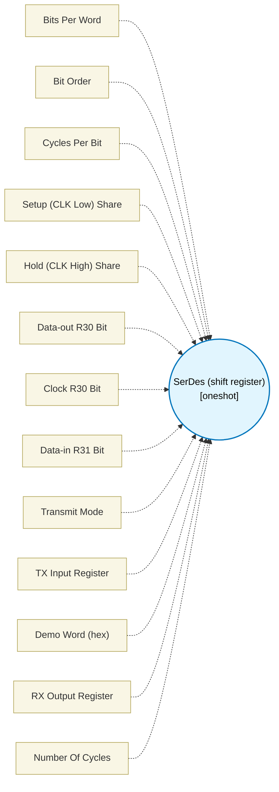

# SerDes (shift register) (`serdes_block`) — Design Document

> Generated by `build_block_docs.js` from `.metadata/sysconfig/.meta/pru_blocks/pru_io_blocks/serdes_block.syscfg.js`. Do not edit by hand; re-run `node build_block_docs.js`.

## Purpose


## SerDes (shift register)

Shifts a WIDTH-bit word out on DOUT and samples DIN into the RX output register, one bit per CLK period, MSB- or LSB-first.
Each bit: DOUT is driven while CLK is low, CLK rises, DIN is sampled on the next cycle, CLK falls.

### Technical Details (Additional Information)

**Bit period.** The CLK period is exactly **bitCycles** PRU cycles, for both bit orders, on every bit and for every
data value (no instruction in the bit loop branches on data). The block derives the delay loop counts from bitCycles:

- CLK-low phase fixed cost: 9 cycles (clr CLK, shift TX word, loop decrement, loop branch, take TX bit, mask, clr DOUT, shift, or into R30).
- CLK-high phase fixed cost: 6 cycles for both bit orders (set CLK, read R31, mask, then MSB-first: shift RX word, or, nop; LSB-first: shift RX word, move the bit to 7, or into the top byte).
- Each phase adds a delay of D cycles: an `ldi` plus TRIPS two-cycle (sub, qbne) trips, then 0..2 `nop`s.
  D < 3 is D nops; otherwise TRIPS = floor((D - 1) / 2) and one `nop` when D is even.
- Minimum bitCycles = 15 for both bit orders. A smaller value is rejected. The maximum is set by the 16-bit trip counter (65535 trips per phase).

**Setup / hold shares (preCycles / postCycles).** They do not count delay-loop trips; they set the CLK phase split within the bit:
the CLK-low (setup) phase is round(bitCycles * preCycles / (preCycles + postCycles)) cycles and the CLK-high (hold) phase is the rest.
When that request does not fit the fixed cost of a phase, the split is clamped (CLK low at least 9 cycles, CLK high at least 6)
and SysConfig warns with the split actually generated. The defaults 4 / 4 give a 50% split (17 low / 16 high at bitCycles 33).

**Migration.** Before bitCycles was ignored: the period was 17 + 2 * (preCycles + postCycles) cycles MSB-first and one more
LSB-first, so a saved design with the defaults (33 / 4 / 4) keeps a 33-cycle period MSB-first and goes from 34 to 33 LSB-first;
any other preCycles / postCycles now produce the configured bitCycles instead of the old trip-derived period.

**Verification.** The CLK period was measured from R30 edges on the TI pru-simulator running the real SysConfig + clpru
ELF at bitCycles 14..64, both bit orders, against the configured number. NOT hardware validated.


## Block Diagram




## Classification

- **Block id:** `serdes_block`
- **Category:** I/O & Protocol
- **Execution model (inferred):** `oneshot`
- **Macro / opcode:** `m_serdes_run`
- **Data ports:** 0 in / 1 out · **Cycles:** `1`

## Parameter schema

| Parameter | Display name | Default | Options |
|---|---|---|---|
| `width` | Bits Per Word | `8` | — |
| `bitOrder` | Bit Order | `MSB` | `MSB`, `LSB` |
| `bitCycles` | Cycles Per Bit | `33` | — |
| `preCycles` | Setup (CLK Low) Share | `4` | — |
| `postCycles` | Hold (CLK High) Share | `4` | — |
| `doutBit` | Data-out R30 Bit | `0` | `0`, `1`, `2`, `3`, `4`, `5`, `6`, `7`, `8`, `9`, `10`, `11`, `12`, `13`, `14`, `15`, `16`, `17`, `18`, `19` |
| `clkBit` | Clock R30 Bit | `1` | `0`, `1`, `2`, `3`, `4`, `5`, `6`, `7`, `8`, `9`, `10`, `11`, `12`, `13`, `14`, `15`, `16`, `17`, `18`, `19` |
| `dinBit` | Data-in R31 Bit | `2` | `0`, `1`, `2`, `3`, `4`, `5`, `6`, `7`, `8`, `9`, `10`, `11`, `12`, `13`, `14`, `15`, `16`, `17`, `18`, `19` |
| `txMode` | Transmit Mode | `constant` | `constant`, `register` |
| `txRegister` | TX Input Register | `R2` | — |
| `demoWord` | Demo Word (hex) | `0xA5` | — |
| `dataRegister` | RX Output Register | `R1` | — |
| `noOfCycles` | Number Of Cycles | `1` | — |

## Ports

| Port | Type |
|---|---|
| `output1` | `output32` |
| `prev` | `IO_PREV` |
| `next` | `IO_NEXT` |

## Validation rules

- width must be 1..32
- doutBit and clkBit must differ
- txRegister must be a valid PRU register (e.g. R0..R27)
- txRegister <value> is <value> bits, narrower than width <value>: the word would be silently truncated; use a wider sub-register or a full register
- txMode must be 'constant' or 'register'
- bitCycles must be a whole number of PRU cycles, got <value>
- bitCycles <value> is below the minimum <value> for <value>-first: one bit costs <value> fixed cycles with CLK low and <value> with CLK high
- bitCycles <value> needs more than <value> delay trips in one CLK phase
- preCycles and postCycles must be non-negative whole numbers with a positive sum

## Generated macro (`.xdt` equivalent)

```asm
m_serdes_run .macro RES, WIDTH, IS_MSB, ALIGN, DOUT_BIT, CLK_BIT, DIN_BIT, LOW_TRIPS, LOW_PAD, HIGH_TRIPS, HIGH_PAD, DEMO_WORD, DATA_REG
    zero  &DATA_REG, 4
    ldi32 TEMP_REG1, DEMO_WORD
    .if IS_MSB == 1
    lsl   TEMP_REG1, TEMP_REG1, ALIGN
    .endif
    ldi TEMP_REG2.b0, WIDTH
    clr   R30, R30, CLK_BIT
    clr   R30, R30, DOUT_BIT
sd_tx?:
    .if IS_MSB == 1
    lsr   TEMP_REG2.b1, TEMP_REG1, 31
    .else
    mov   TEMP_REG2.b1, TEMP_REG1.b0
    .endif
    and   TEMP_REG2.b1, TEMP_REG2.b1, 1
    clr   R30, R30, DOUT_BIT
    lsl   TEMP_REG2.w2, TEMP_REG2.b1, DOUT_BIT
    or    R30, R30, TEMP_REG2.w2
    ; CLK low = 9 fixed cycles + LOW_TRIPS delay (1 + 2*trips) + LOW_PAD nops
    .if LOW_TRIPS != 0
    ldi TEMP_REG2.w2, LOW_TRIPS
sd_pre?:
    sub   TEMP_REG2.w2, TEMP_REG2.w2, 1
    qbne  sd_pre?, TEMP_REG2.w2, 0
    .endif
    .if LOW_PAD != 0
    nop
    .endif
    .if LOW_PAD == 2
    nop
    .endif
    set   R30, R30, CLK_BIT
    lsr   TEMP_REG2.b1, R31, DIN_BIT
    and   TEMP_REG2.b1, TEMP_REG2.b1, 1
    .if IS_MSB == 1
    lsl   DATA_REG, DATA_REG, 1
    or    DATA_REG, DATA_REG, TEMP_REG2.b1
    nop   ; Keep MSB/LSB per-bit counts equal
    .else
    lsr   DATA_REG, DATA_REG, 1
    lsl   TEMP_REG2.b1, TEMP_REG2.b1, 7
    or    DATA_REG.b3, DATA_REG.b3, TEMP_REG2.b1
    .endif
    ; CLK high = 6 fixed cycles (both orders) + HIGH_TRIPS delay (1 + 2*trips) + HIGH_PAD nops
    .if HIGH_TRIPS != 0
    ldi TEMP_REG2.w2, HIGH_TRIPS
sd_pos?:
    sub   TEMP_REG2.w2, TEMP_REG2.w2, 1
    qbne  sd_pos?, TEMP_REG2.w2, 0
    .endif
    .if HIGH_PAD != 0
    nop
    .endif
    .if HIGH_PAD == 2
    nop
    .endif
    clr   R30, R30, CLK_BIT
    .if IS_MSB == 1
    lsl   TEMP_REG1, TEMP_REG1, 1
    .else
    lsr   TEMP_REG1, TEMP_REG1, 1
    .endif
    sub   TEMP_REG2.b0, TEMP_REG2.b0, 1
    qbne  sd_tx?, TEMP_REG2.b0, 0
    .if IS_MSB == 0
    lsr   DATA_REG, DATA_REG, ALIGN
    .endif
    .endm
```

## Device portability

> **Source of truth:** `.metadata/sysconfig/.meta/pru_blocks/common/pru_device_caps.js` (TRM SPRUIM2J §6.4.1.1 / SPRUJB6 §7.3.1.1). Regenerated by `node build_block_docs.js` — do not edit by hand.

- **Required widget(s):** _(none)_
- **Validator:** `pru_blocks_static_module` raises a SysConfig **ERROR** naming both widget and device when a required widget is absent.

| Device (SoC) | Supported |
|---|---|
| `am243x` | ✅ |
| `am261x` | ✅ |
| `am263px` | ✅ |
| `am263x` | ✅ |
| `am64x` | ✅ |

## Outstanding TODO / VERIFY items

- None flagged in source.
