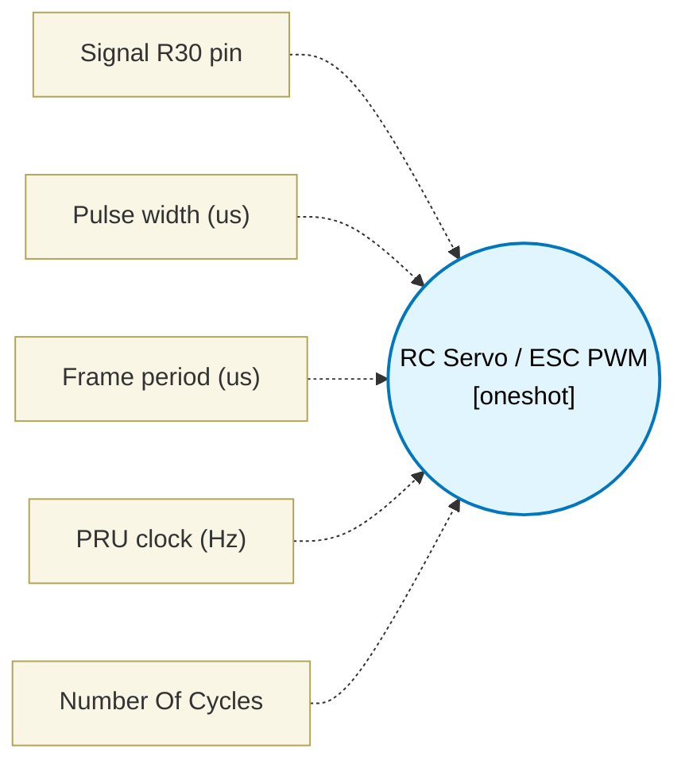

# RC Servo / ESC PWM (`servo_block`) — Design Document

> Generated by `build_block_docs.js` from `.metadata/sysconfig/.meta/pru_blocks/pru_io_blocks/servo_block.syscfg.js`. Do not edit by hand; re-run `node build_block_docs.js`.

## Purpose

Produces a single cycle-exact pulse and waits the remainder of the frame period.

## Block Diagram




## Classification

- **Block id:** `servo_block`
- **Category:** I/O & Protocol
- **Execution model (inferred):** `oneshot`
- **Macro / opcode:** `m_servo_pulse`
- **Data ports:** 0 in / 1 out · **Cycles:** `1`

## Parameter schema

| Parameter | Display name | Default | Options |
|---|---|---|---|
| `signalPin` | Signal R30 pin | `8` | `0`, `1`, `2`, `3`, `4`, `5`, `6`, `7`, `8`, `9`, `10`, `11`, `12`, `13`, `14`, `15`, `16`, `17`, `18`, `19` |
| `pulseUs` | Pulse width (us) | `1500` | — |
| `frameUs` | Frame period (us) | `20000` | — |
| `clkHz` | PRU clock (Hz) | `200000000` | — |
| `noOfCycles` | Number Of Cycles | `1` | — |

## Ports

| Port | Type |
|---|---|
| `output1` | `output32` |
| `prev` | `IO_PREV` |
| `next` | `IO_NEXT` |

## Validation rules

- pulseUs must be 500..2500
- frameUs must be > 0
- pulseUs must be < frameUs
- clkHz must be > 0

## Generated macro (`.xdt` equivalent)

```asm
m_servo_pulse .macro RES, PIN, HIGH_CYC, LOW_CYC
    set R30, R30, PIN
    ldi32 TEMP_REG1, HIGH_CYC
    lsr TEMP_REG1, TEMP_REG1, 1
svh?:
    sub TEMP_REG1, TEMP_REG1, 1
    qbne svh?, TEMP_REG1, 0
    clr R30, R30, PIN
    ldi32 TEMP_REG1, LOW_CYC
    lsr TEMP_REG1, TEMP_REG1, 1
svl?:
    sub TEMP_REG1, TEMP_REG1, 1
    qbne svl?, TEMP_REG1, 0
    .endm
```

## Device portability

> **Source of truth:** `.metadata/sysconfig/.meta/pru_blocks/common/pru_device_caps.js` (TRM SPRUIM2J §6.4.1.1 / SPRUJB6 §7.3.1.1). Regenerated by `node build_block_docs.js` — do not edit by hand.

- **Required widget(s):** _(none)_
- **Validator:** `pru_blocks_static_module` raises a SysConfig **ERROR** naming both widget and device when a required widget is absent.

| Device (SoC) | Supported |
|---|---|
| `am243x` | ✅ |
| `am261x` | ✅ |
| `am263px` | ✅ |
| `am263x` | ✅ |
| `am64x` | ✅ |

## Outstanding TODO / VERIFY items

- None flagged in source.
