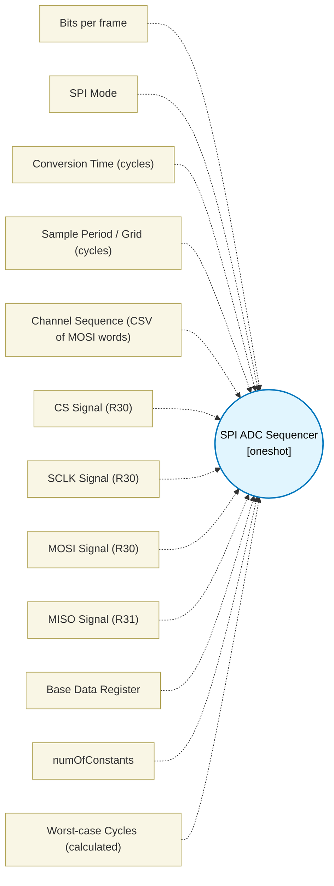

# SPI ADC Sequencer (`spi_adc_sequencer_block`) — Design Document

> Generated by `build_block_docs.js` from `.metadata/sysconfig/.meta/pru_blocks/pru_io_blocks/spi_adc_sequencer_block.syscfg.js`. Do not edit by hand; re-run `node build_block_docs.js`.

## Purpose

Executes a sequence of SPI conversions with fixed deadlines and t_conv waits.

## Block Diagram




## Classification

- **Block id:** `spi_adc_sequencer_block`
- **Category:** I/O & Protocol
- **Execution model (inferred):** `oneshot`
- **Macro / opcode:** `m_spi_adc_seq`
- **Data ports:** 0 in / 1 out · **Cycles:** `1`

## Parameter schema

| Parameter | Display name | Default | Options |
|---|---|---|---|
| `bits_per_frame` | Bits per frame | `16` | — |
| `spi_mode` | SPI Mode | `MODE0` | `MODE0` |
| `t_conv` | Conversion Time (cycles) | `200` | — |
| `sample_period` | Sample Period / Grid (cycles) | `5000` | — |
| `channel_sequence` | Channel Sequence (CSV of MOSI words) | `0xA500` | — |
| `cs_pin` | CS Signal (R30) | `3` | `0`, `1`, `2`, `3`, `4`, `5`, `6`, `7`, `8`, `9`, `10`, `11`, `12`, `13`, `14`, `15`, `16`, `17`, `18`, `19` |
| `sclk_pin` | SCLK Signal (R30) | `0` | `0`, `1`, `2`, `3`, `4`, `5`, `6`, `7`, `8`, `9`, `10`, `11`, `12`, `13`, `14`, `15`, `16`, `17`, `18`, `19` |
| `mosi_pin` | MOSI Signal (R30) | `2` | `0`, `1`, `2`, `3`, `4`, `5`, `6`, `7`, `8`, `9`, `10`, `11`, `12`, `13`, `14`, `15`, `16`, `17`, `18`, `19` |
| `miso_pin` | MISO Signal (R31) | `1` | `0`, `1`, `2`, `3`, `4`, `5`, `6`, `7`, `8`, `9`, `10`, `11`, `12`, `13`, `14`, `15`, `16`, `17`, `18`, `19` |
| `base_data_reg` | Base Data Register | `R4` | — |
| `numOfConstants` | — | `8` | — |
| `noOfCycles` | Worst-case Cycles (calculated) | `1` | — |

## Ports

| Port | Type |
|---|---|
| `output1` | `output32` |
| `prev` | `IO_PREV` |
| `next` | `IO_NEXT` |

## Validation rules

- channel_sequence must contain 1..25 integer MOSI words
- Only MODE0 is supported by this block
- CS, SCLK, MOSI, and MISO pins must be distinct
- Sequence takes <value> cycles, but sample_period is <value>. Cannot fit sequence in period.

## Generated macro (`.xdt` equivalent)

```asm
m_spi_adc_seq .macro RES0, CS_PIN, SCLK_PIN, MOSI_PIN, MISO_PIN, T_CONV, BITS, CMD0, PAD_CYCLES
    clr R30, R30, CS_PIN
    .loop T_CONV
    nop
    .endloop
    ldi TEMP_REG2.b0, BITS
    sub TEMP_REG2.b0, TEMP_REG2.b0, 1
    ldi32 TEMP_REG1, CMD0
    ldi32 TEMP_REG3, 0
ch0_bit_loop?:
    qbbc ch0_mosi_zero?, TEMP_REG1, TEMP_REG2.b0
    set R30, R30, MOSI_PIN
    qba ch0_mosi_done?
ch0_mosi_zero?:
    clr R30, R30, MOSI_PIN
    nop
    nop
ch0_mosi_done?:
    lsl TEMP_REG3, TEMP_REG3, 1
    qbbc ch0_miso_zero?, R31, MISO_PIN
    add TEMP_REG3, TEMP_REG3, 1
    qba ch0_miso_done?
ch0_miso_zero?:
    nop
    nop
    nop
ch0_miso_done?:
    set R30, R30, SCLK_PIN
    nop
    nop
    nop
    clr R30, R30, SCLK_PIN
    sub TEMP_REG2.b0, TEMP_REG2.b0, 1
    qbne ch0_bit_loop?, TEMP_REG2.b0, 0xFF
    mov RES0, TEMP_REG3
    set R30, R30, CS_PIN
    nop
    nop
    nop
    nop
    ldi32 TEMP_REG1, PAD_CYCLES
pad_loop?:
    sub TEMP_REG1, TEMP_REG1, 1
    qbne pad_loop?, TEMP_REG1, 0
    .endm
```

## Device portability

> **Source of truth:** `.metadata/sysconfig/.meta/pru_blocks/common/pru_device_caps.js` (TRM SPRUIM2J §6.4.1.1 / SPRUJB6 §7.3.1.1). Regenerated by `node build_block_docs.js` — do not edit by hand.

- **Required widget(s):** _(none)_
- **Validator:** `pru_blocks_static_module` raises a SysConfig **ERROR** naming both widget and device when a required widget is absent.

| Device (SoC) | Supported |
|---|---|
| `am243x` | ✅ |
| `am261x` | ✅ |
| `am263px` | ✅ |
| `am263x` | ✅ |
| `am64x` | ✅ |

## Outstanding TODO / VERIFY items

- None flagged in source.
