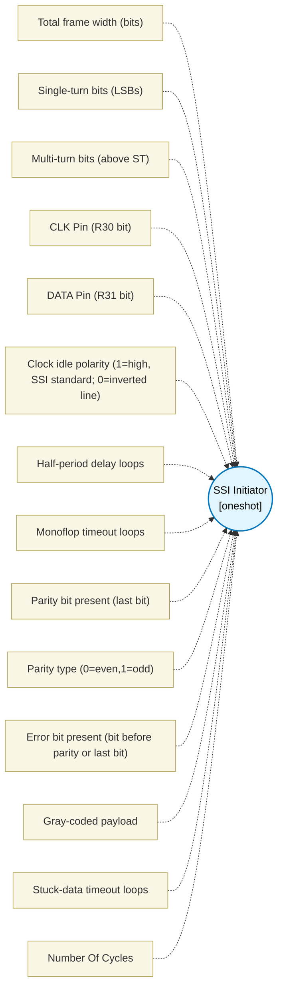

# SSI Initiator (`ssi_initiator_block`) — Design Document

> Generated by `build_block_docs.js` on 2026-10-21 from `.metadata/sysconfig/.meta/pru_blocks/application_specific/ssi_initiator_block.syscfg.js`. Do not edit by hand; re-run `node build_block_docs.js`.

## Purpose

Generic synchronous SSI initiator with configurable frame width (8-32), single-turn/multi-turn extraction, clock polarity/rate, optional parity and error bits, gray/binary decode, and timeout.

Peripheral resources: bit-bangs one R30 clock output and one R31 data input; no PRU peripherals (IEP/MAC/SPAD) required. Pinmux: clock and data must be on distinct PRU R30/R31 bits routed through PRU-ICSSG pinmux (AM64x/AM243x/AM261x). Isolation: single PRU slice owns both pins during transfer; concurrent workloads must not drive the same R30 bit and must avoid R31 contention. Deterministic timing: each clock half-period uses halfPeriodCycles delay-loop iterations, each costing two PRU cycles; monoTimeCycles likewise counts two-cycle idle iterations. The per-bit clock path costs about 4*halfPeriodCycles plus instruction overhead. TIMEOUT_CYCLES is reserved and does not run a delay loop. BOM: RS-422/RS-485 transceiver required for differential SSI (e.g. AM26C31/32); no BOM change for single-ended test. Simulator validates logical shift, gray decode, parity and extraction; physical propagation delay, transceiver skew and monoflop timing require silicon validation.

## Block Diagram




## Classification

- **Block id:** `ssi_initiator_block`
- **Category:** Application-Specific
- **Execution model (inferred):** `oneshot`
- **Macro / opcode:** `m_ssi_read`
- **Data ports:** 0 in / 0 out · **Cycles:** `1345`

## Parameter schema

| Parameter | Display name | Default | Options |
|---|---|---|---|
| `totalWidth` | Total frame width (bits) | `25` | — |
| `singleTurnBits` | Single-turn bits (LSBs) | `13` | — |
| `multiTurnBits` | Multi-turn bits (above ST) | `12` | — |
| `clkPin` | CLK Pin (R30 bit) | `0` | — |
| `dataPin` | DATA Pin (R31 bit) | `1` | — |
| `clockPolarity` | Clock idle polarity (1=high, SSI standard; 0=inverted line) | `1` | — |
| `halfPeriodCycles` | Half-period delay loops | `10` | — |
| `monoTimeCycles` | Monoflop timeout loops | `20` | — |
| `parityEnable` | Parity bit present (last bit) | `false` | — |
| `parityType` | Parity type (0=even,1=odd) | `0` | — |
| `errorBitEnable` | Error bit present (bit before parity or last bit) | `false` | — |
| `grayCode` | Gray-coded payload | `true` | — |
| `timeoutCycles` | Stuck-data timeout loops | `100` | — |
| `noOfCycles` | Number Of Cycles | `1345` | — |

## Ports

| Port | Type |
|---|---|
| `prev` | `IO_PREV` |
| `next` | `IO_NEXT` |
| `output1` | `output32` |

## Validation rules

- totalWidth must be 8..32
- singleTurnBits must be 1..32
- multiTurnBits must be 0..32
- singleTurnBits + multiTurnBits must be <= totalWidth
- clkPin and dataPin must differ
- clkPin must be 0..15
- dataPin must be 0..15
- halfPeriodCycles too small (min 2)

## Generated macro (`.xdt` equivalent)

```asm
m_ssi_read .macro RES, TOTAL_WIDTH, ST_BITS, MT_BITS, CLK_PIN, DATA_PIN, CPOL, HALF_PERIOD, MONO_CYCLES, PARITY_EN, PARITY_TYPE, ERR_EN, GRAY_EN, TIMEOUT_CYCLES
    ; --- SSI Initiator (generic synchronous) ---
    ; RES = shifted frame (TOTAL_WIDTH bits, MSB first); with GRAY_EN the position payload is converted to binary
    ; Caller extracts ST/MT via shifts/masks; parity/error checked -> STATUS in TEMP_REG2.b0 (0=ok,1=parity err,2=timeout,4=error bit)
    ; Frame (SSI datasheet convention, CPOL=1): CLK idles high. The first falling
    ; edge latches the position; each rising edge shifts out the next bit, MSB first;
    ; DATA is sampled in the high phase, before the next falling edge. A frame is
    ; n+1 pulses for n bits: the falling edge after the LSB ends the word (encoder
    ; drives DATA low for its monoflop time). clockPolarity 0 inverts every clock level.
    ; Parity: if enabled, last bit is parity over preceding bits
    ; Error bit: if enabled, bit before parity (or last) is active-low error flag
    ldi   RES, 0
    ldi   TEMP_REG1, 0               ; bit counter copy
    ldi   TEMP_REG2, 0               ; status = 0
    ; init clock to idle
    .if CPOL == 1
    set   R30, R30, CLK_PIN
    .else
    clr   R30, R30, CLK_PIN
    .endif
    ; hold idle for a half period so the first pulse is full width
    ldi   TEMP_REG3.w0, HALF_PERIOD
m_ssi_hp0?:
    sub   TEMP_REG3.w0, TEMP_REG3.w0, 1
    qbne  m_ssi_hp0?, TEMP_REG3.w0, 0
    ; bit loop counter = TOTAL_WIDTH
    ldi   TEMP_REG1.b0, TOTAL_WIDTH
m_ssi_bitloop?:
    ; drive clock to active (invert CPOL)
    .if CPOL == 1
    clr   R30, R30, CLK_PIN
    .else
    set   R30, R30, CLK_PIN
    .endif
    ; half-period delay 1
    ldi   TEMP_REG3.w0, HALF_PERIOD
m_ssi_hp1?:
    sub   TEMP_REG3.w0, TEMP_REG3.w0, 1
    qbne  m_ssi_hp1?, TEMP_REG3.w0, 0
    ; drive clock back to idle
    .if CPOL == 1
    set   R30, R30, CLK_PIN
    .else
    clr   R30, R30, CLK_PIN
    .endif
    ; half-period delay 2
    ldi   TEMP_REG3.w0, HALF_PERIOD
m_ssi_hp2?:
    sub   TEMP_REG3.w0, TEMP_REG3.w0, 1
    qbne  m_ssi_hp2?, TEMP_REG3.w0, 0
    ; sample DATA in the idle phase, after the shift edge and before the next active edge
    lsl   RES, RES, 1
    qbbc  m_ssi_zero?, R31, DATA_PIN
    or    RES, RES, 1
m_ssi_zero?:
    sub   TEMP_REG1.b0, TEMP_REG1.b0, 1
    qbne  m_ssi_bitloop?, TEMP_REG1.b0, 0
    ; end-of-frame pulse (n+1): its active edge ends the word, encoder starts its monoflop
    .if CPOL == 1
    clr   R30, R30, CLK_PIN
    .else
    set   R30, R30, CLK_PIN
    .endif
    ldi   TEMP_REG3.w0, HALF_PERIOD
m_ssi_hp3?:
    sub   TEMP_REG3.w0, TEMP_REG3.w0, 1
    qbne  m_ssi_hp3?, TEMP_REG3.w0, 0
    .if CPOL == 1
    set   R30, R30, CLK_PIN
    .else
    clr   R30, R30, CLK_PIN
    .endif
    ; monoflop idle delay: monoTimeCycles must cover the encoder's monoflop time
    ; before the next read, or the encoder sees the next frame as overclocking
    ldi   TEMP_REG3.w0, MONO_CYCLES
m_ssi_mono?:
    sub   TEMP_REG3.w0, TEMP_REG3.w0, 1
    qbne  m_ssi_mono?, TEMP_REG3.w0, 0
    ; --- parity check (if enabled) : last bit is parity ---
    .if PARITY_EN == 1
    ; compute even parity of bits TOTAL_WIDTH-1..0 excluding last
    mov   TEMP_REG3, RES
    and   TEMP_REG3, TEMP_REG3, 1        ; parity bit
    lsr   TEMP_REG1, RES, 1              ; data without parity
    ; xor-fold to 1 bit (popcount parity)
    lsr   TEMP_REG4, TEMP_REG1, 16
    xor   TEMP_REG1, TEMP_REG1, TEMP_REG4
    lsr   TEMP_REG4, TEMP_REG1, 8
    xor   TEMP_REG1, TEMP_REG1, TEMP_REG4
    lsr   TEMP_REG4, TEMP_REG1, 4
    xor   TEMP_REG1, TEMP_REG1, TEMP_REG4
    lsr   TEMP_REG4, TEMP_REG1, 2
    xor   TEMP_REG1, TEMP_REG1, TEMP_REG4
    lsr   TEMP_REG4, TEMP_REG1, 1
    xor   TEMP_REG1, TEMP_REG1, TEMP_REG4
    and   TEMP_REG1, TEMP_REG1, 1        ; computed even parity
    .if PARITY_TYPE == 1
    xor   TEMP_REG1, TEMP_REG1, 1        ; invert for odd
    .endif
    qbeq  m_ssi_parity_ok?, TEMP_REG1, TEMP_REG3
    or    TEMP_REG2.b0, TEMP_REG2.b0, 1  ; parity error
m_ssi_parity_ok?:
    .endif
    ; --- error bit check (if enabled) ---
    .if ERR_EN == 1
    .if PARITY_EN == 1
    ; error bit is bit 1 (second last)
    lsr   TEMP_REG1, RES, 1
    and   TEMP_REG1, TEMP_REG1, 1
    .else
    and   TEMP_REG1, RES, 1
    .endif
    qbne  m_ssi_err_ok?, TEMP_REG1, 0   ; error bit active low => 0 means error? spec varies; treat 0 as error here? we treat 1=ok,0=error for low-active
    ; Actually SSI error is often 0 = error, so if bit==0 -> flag
    ; So invert: if TEMP_REG1==0 => error
    or    TEMP_REG2.b0, TEMP_REG2.b0, 4
m_ssi_err_ok?:
    .endif
    ; --- Gray -> binary on the position payload (after parity: parity covers the raw bits) ---
    ; Payload sits above the error/parity bits; prefix-XOR folds reflected Gray to binary.
    .if GRAY_EN == 1
    lsr   TEMP_REG1, RES, (PARITY_EN + ERR_EN)
    lsr   TEMP_REG4, TEMP_REG1, 1
    xor   TEMP_REG1, TEMP_REG1, TEMP_REG4
    lsr   TEMP_REG4, TEMP_REG1, 2
    xor   TEMP_REG1, TEMP_REG1, TEMP_REG4
    lsr   TEMP_REG4, TEMP_REG1, 4
    xor   TEMP_REG1, TEMP_REG1, TEMP_REG4
    lsr   TEMP_REG4, TEMP_REG1, 8
    xor   TEMP_REG1, TEMP_REG1, TEMP_REG4
    lsr   TEMP_REG4, TEMP_REG1, 16
    xor   TEMP_REG1, TEMP_REG1, TEMP_REG4
    lsl   TEMP_REG1, TEMP_REG1, (PARITY_EN + ERR_EN)
    and   RES, RES, ((1 << (PARITY_EN + ERR_EN)) - 1)
    or    RES, RES, TEMP_REG1
    .endif
    ; Caller can test TEMP_REG2.b0 for nonzero to detect fault
    .endm
```

## Device portability

> **Source of truth:** `.metadata/sysconfig/.meta/pru_blocks/common/pru_device_caps.js` (TRM SPRUIM2J §6.4.1.1 / SPRUJB6 §7.3.1.1). Regenerated by `node build_block_docs.js` — do not edit by hand.

- **Required widget(s):** _(none)_
- **Validator:** `pru_blocks_static_module` raises a SysConfig **ERROR** naming both widget and device when a required widget is absent.

| Device (SoC) | Supported |
|---|---|
| `am243x` | ✅ |
| `am261x` | ✅ |
| `am263px` | ✅ |
| `am263x` | ✅ |
| `am64x` | ✅ |

## Outstanding TODO / VERIFY items

- None flagged in source.
