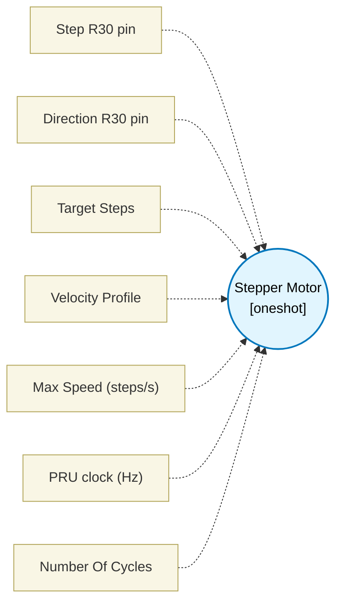

# Stepper Motor (`stepper_block`) — Design Document

> Generated by `build_block_docs.js` on 2026-10-21 from `.metadata/sysconfig/.meta/pru_blocks/pru_io_blocks/stepper_block.syscfg.js`. Do not edit by hand; re-run `node build_block_docs.js`.

## Purpose

Emits a parameterized STEP/DIR pulse train for a stepper motor. The generated delay subtracts the macro's fixed 13-cycle per-step overhead, so consecutive STEP rising edges equal round(clkHz / maxSpeedSps) with a residual window of -1 to 0 PRU cycles: 0 when the rounded period is odd, -1 when it is even (the two delay loops each count in 2-cycle steps). The minimum representable requested period is 17 PRU cycles (maxSpeedSps <= clkHz / 17); this leaves at least one iteration in both high and low delay loops.

## Block Diagram




## Classification

- **Block id:** `stepper_block`
- **Category:** I/O & Protocol
- **Execution model (inferred):** `oneshot`
- **Macro / opcode:** `m_stepper_run`
- **Data ports:** 0 in / 0 out · **Cycles:** `1`

## Parameter schema

| Parameter | Display name | Default | Options |
|---|---|---|---|
| `stepPin` | Step R30 pin | `5` | `0`, `1`, `2`, `3`, `4`, `5`, `6`, `7`, `8`, `9`, `10`, `11`, `12`, `13`, `14`, `15`, `16`, `17`, `18`, `19` |
| `dirPin` | Direction R30 pin | `6` | `0`, `1`, `2`, `3`, `4`, `5`, `6`, `7`, `8`, `9`, `10`, `11`, `12`, `13`, `14`, `15`, `16`, `17`, `18`, `19` |
| `numSteps` | Target Steps | `1000` | — |
| `profile` | Velocity Profile | `constant` | `constant`, `linear` |
| `maxSpeedSps` | Max Speed (steps/s) | `1000` | — |
| `clkHz` | PRU clock (Hz) | `200000000` | — |
| `noOfCycles` | Number Of Cycles | `1` | — |

## Ports

| Port | Type |
|---|---|
| `output1` | `output32` |
| `prev` | `IO_PREV` |
| `next` | `IO_NEXT` |

## Validation rules

- stepPin and dirPin must differ
- maxSpeedSps must be > 0
- maxSpeedSps requires a period of at least <value> PRU cycles (maxSpeedSps <= clkHz / <value>)
- numSteps must be > 0
- clkHz must be > 0

## Generated macro (`.xdt` equivalent)

```asm
m_stepper_run .macro RES, STEP_PIN, DIR_PIN, STEPS, MIN_DELAY_CYCLES, PULSE_HIGH_CYCLES
    clr   R30, R30, STEP_PIN
    set   R30, R30, DIR_PIN
    ldi TEMP_REG2.w0, STEPS
st_l?:
    set   R30, R30, STEP_PIN
    ldi32 TEMP_REG1, PULSE_HIGH_CYCLES
    lsr   TEMP_REG1, TEMP_REG1, 1
st_h?:
    sub   TEMP_REG1, TEMP_REG1, 1
    qbne  st_h?, TEMP_REG1, 0
    clr   R30, R30, STEP_PIN
    ldi32 TEMP_REG1, MIN_DELAY_CYCLES
    ldi32 TEMP_REG3, PULSE_HIGH_CYCLES
    sub   TEMP_REG1, TEMP_REG1, TEMP_REG3
    lsr   TEMP_REG1, TEMP_REG1, 1
st_d?:
    sub   TEMP_REG1, TEMP_REG1, 1
    qbne  st_d?, TEMP_REG1, 0
    sub   TEMP_REG2.w0, TEMP_REG2.w0, 1
    qbne  st_l?, TEMP_REG2.w0, 0
    .endm
```

## Device portability

> **Source of truth:** `.metadata/sysconfig/.meta/pru_blocks/common/pru_device_caps.js` (TRM SPRUIM2J §6.4.1.1 / SPRUJB6 §7.3.1.1). Regenerated by `node build_block_docs.js` — do not edit by hand.

- **Required widget(s):** _(none)_
- **Validator:** `pru_blocks_static_module` raises a SysConfig **ERROR** naming both widget and device when a required widget is absent.

| Device (SoC) | Supported |
|---|---|
| `am243x` | ✅ |
| `am261x` | ✅ |
| `am263px` | ✅ |
| `am263x` | ✅ |
| `am64x` | ✅ |

## Outstanding TODO / VERIFY items

- None flagged in source.
