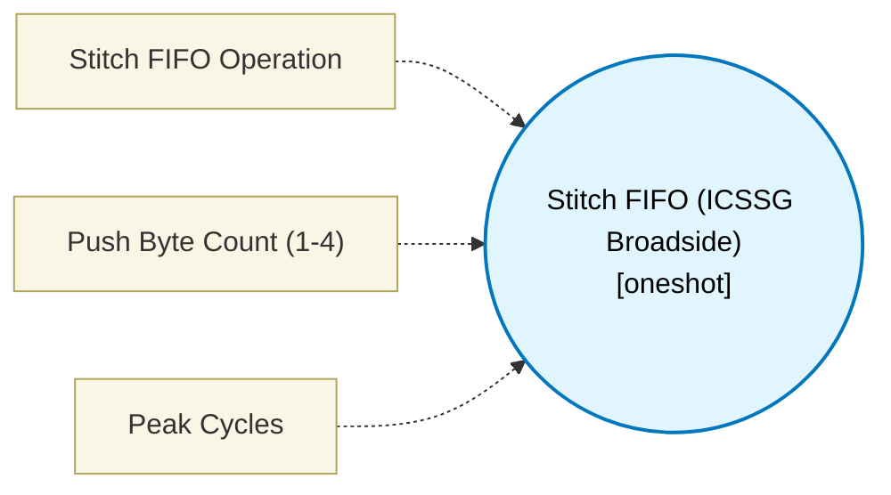

# Stitch FIFO (ICSSG Broadside) (`stitch_fifo_block`) — Design Document

> Generated by `build_block_docs.js` from `.metadata/sysconfig/.meta/pru_blocks/data_handling/stitch_fifo_block.syscfg.js`. Do not edit by hand; re-run `node build_block_docs.js`.

## Purpose

Wraps the ICSSG 2-deep x 32-byte broadside FIFO at device ID 0x08 (SPRUIM2J 6.4.11.2.3.7.5 "Broadside Stitch FIFO", Table 6-134). push (XOUT) packs 1-4 bytes of the block's INPUT into the FIFO LSB-justified; repeated pushes stitch narrow fragments (SENT nibbles, Manchester symbols, DShot frames, ...) into the FIFO without a software shift chain. pop (XIN) reads the 32-byte aligned window back into R2:R9. rewind backs the write pointer off by 4 bytes; reset clears both pointers. SPRUIM2J Table 6-60 (STITCH_FIFO64, ID 08, 2 copies, PRU1/0 ONLY): the block's own validate() rejects RTU_PRU and TX_PRU cores, and it is registered only into the PRU-core module list, never topModules_rtu_tx_pru. R2:R9 and R10 are architectural windows, declared via registerClobbers exactly as bswap_block.syscfg.js declares its fixed 0xA1/0xA2 windows; a design that holds a live value in one of them across a stitch FIFO op is rejected at build time. Maturity is 'assembles': the TI pru-simulator has no device model for ID 0x08, so this block does not claim simulator-tested or higher; it is checked that every emitted macro assembles with clpru and that the emitted text is exactly the documented XFR forms.

## Block Diagram




## Classification

- **Block id:** `stitch_fifo_block`
- **Category:** Data Handling
- **Execution model (inferred):** `oneshot`
- **Macro / opcode:** `m_stitch_push`
- **Data ports:** 1 in / 1 out · **Cycles:** `3`

## Parameter schema

| Parameter | Display name | Default | Options |
|---|---|---|---|
| `operation` | Stitch FIFO Operation | `push` | `push`, `pop`, `rewind`, `reset` |
| `byteCount` | Push Byte Count (1-4) | `4` | — |
| `noOfCycles` | Peak Cycles | `3` | — |

## Ports

| Port | Type |
|---|---|
| `prev` | `IO_PREV` |
| `next` | `IO_NEXT` |
| `input1` | `input32` |
| `output1` | `output32` |

## Validation rules

- Stitch FIFO operation '
- The Broadside Stitch FIFO (device ID 0x08) is reachable from PRU1/0 only (
- Push byte count must be 1-4. This block copies a single 32-bit INPUT register into R2

## Generated macro (`.xdt` equivalent)

```asm
m_stitch_push .macro RES, INPUT, BYTECOUNT
    ; ICSSG Broadside Stitch FIFO push (SPRUIM2J 6.4.11.2.3.7.5 "Broadside Stitch FIFO", Table 6-134).
    ; XOUT source window is fixed at R2 (architectural, like the BSWAP
    ; 4_8/4_16 windows); INPUT is staged there before the transfer.
    mov   R2, INPUT
    xout  8, &R2, BYTECOUNT
    mov   RES, R2
    .endm
```

## Device portability

> **Source of truth:** `.metadata/sysconfig/.meta/pru_blocks/common/pru_device_caps.js` (TRM SPRUIM2J §6.4.1.1 / SPRUJB6 §7.3.1.1). Regenerated by `node build_block_docs.js` — do not edit by hand.

- **Required widget(s):** `stitch_fifo`
- **Validator:** `pru_blocks_static_module` raises a SysConfig **ERROR** naming both widget and device when a required widget is absent.

| Device (SoC) | Supported |
|---|---|
| `am243x` | ✅ |
| `am261x` | ❌ stitch_fifo |
| `am263px` | ❌ stitch_fifo |
| `am263x` | ❌ stitch_fifo |
| `am64x` | ✅ |

## Outstanding TODO / VERIFY items

- None flagged in source.
