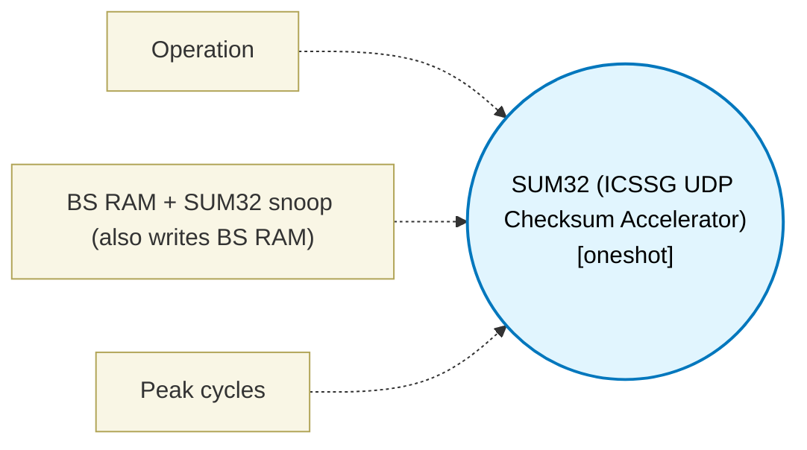

# SUM32 (ICSSG UDP Checksum Accelerator) (`sum32_block`) — Design Document

> Generated by `build_block_docs.js` from `.metadata/sysconfig/.meta/pru_blocks/data_handling/sum32_block.syscfg.js`. Do not edit by hand; re-run `node build_block_docs.js`.

## Purpose

Accumulates a running one's-complement sum over 32-byte DMEM blocks: input1 supplies the 32-bit DMEM byte address of the block, which is LBBO'd into R2-R9 and then XOUT to the accelerator, and reads the sum back (self-clearing) via XIN into R29 (TRM SPRUIM2J 6.4.6.2.6, Tables 6-93/6-94). R2-R9 are reserved across the whole design whenever an accumulate instance is present, so no other block's value can land in that window. PRU-core device IDs only: 47 (SUM32 only) / 49 (BS RAM + SUM32 snoop) for XOUT, 02 for XIN. Available only on ICSSG devices (AM64x/AM243x), on PRU0/PRU1 cores.

## Block Diagram




## Classification

- **Block id:** `sum32_block`
- **Category:** Data Handling
- **Execution model (inferred):** `oneshot`
- **Macro / opcode:** `m_sum32_accumulate_only`
- **Data ports:** 1 in / 0 out · **Cycles:** `12`

## Parameter schema

| Parameter | Display name | Default | Options |
|---|---|---|---|
| `operation` | Operation | `accumulate` | `accumulate`, `read_and_clear` |
| `bsRamSnoop` | BS RAM + SUM32 snoop (also writes BS RAM) | `false` | — |
| `noOfCycles` | Peak cycles | `12` | — |

## Ports

| Port | Type |
|---|---|
| `prev` | `IO_PREV` |
| `next` | `IO_NEXT` |
| `input1` | `input32` |

## Validation rules

- SUM32 operation must be accumulate or read_and_clear.
- BS RAM snoop only applies to the accumulate operation (XOUT device 49/38).
- SUM32 device IDs implemented by this block (47/49 XOUT, 02 XIN) are the PRU-core

## Generated macro (`.xdt` equivalent)

```asm
m_sum32_accumulate_only .macro SRC_ADDR
    ; SUM32 accumulate, SUM32-only device (TRM Table 6-93: 47 / 0x2F on PRU).
    ; Loads the 32-byte block to checksum from DMEM address SRC_ADDR into
    ; R2-R9 (Table 6-94), then writes it to the SUM32 accelerator.
    lbbo  &R2, SRC_ADDR, 0, 32
    xout  47, &R2, 32
    .endm
```

## Device portability

> **Source of truth:** `.metadata/sysconfig/.meta/pru_blocks/common/pru_device_caps.js` (TRM SPRUIM2J §6.4.1.1 / SPRUJB6 §7.3.1.1). Regenerated by `node build_block_docs.js` — do not edit by hand.

- **Required widget(s):** `sum32`
- **Validator:** `pru_blocks_static_module` raises a SysConfig **ERROR** naming both widget and device when a required widget is absent.

| Device (SoC) | Supported |
|---|---|
| `am243x` | ✅ |
| `am261x` | ❌ sum32 |
| `am263px` | ❌ sum32 |
| `am263x` | ❌ sum32 |
| `am64x` | ✅ |

## Outstanding TODO / VERIFY items

- None flagged in source.
