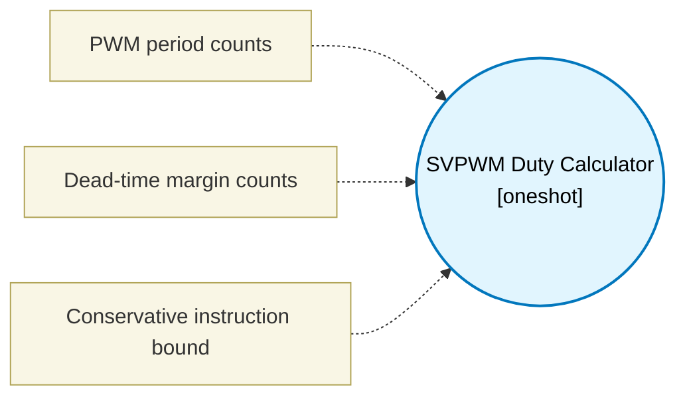

# SVPWM Duty Calculator (`svpwm_block`) — Design Document

> Generated by `build_block_docs.js` from `.metadata/sysconfig/.meta/pru_blocks/data_handling/svpwm_block.syscfg.js`. Do not edit by hand; re-run `node build_block_docs.js`.

## Purpose

Applies zero-sequence/common-mode injection to Q12 alpha/beta commands, returns phase A/B/C duty counts, sector 1..6, and a center-period current-sampling trigger. Duties are clamped to the configured dead-time margins. This block computes the duties only; the Three-phase complementary PWM block emits the six-pin complementary waveform.

## Block Diagram




## Classification

- **Block id:** `svpwm_block`
- **Category:** Data Handling
- **Execution model (inferred):** `oneshot`
- **Macro / opcode:** `m_svpwm_duty`
- **Data ports:** 2 in / 5 out · **Cycles:** `180`

## Parameter schema

| Parameter | Display name | Default | Options |
|---|---|---|---|
| `periodCounts` | PWM period counts | `1000` | — |
| `deadtimeCounts` | Dead-time margin counts | `10` | — |
| `noOfCycles` | Conservative instruction bound | `180` | — |

## Ports

| Port | Type |
|---|---|
| `input1` | `input32` |
| `input2` | `input32` |
| `output1` | `output32` |
| `output2` | `output32` |
| `output3` | `output32` |
| `output4` | `output32` |
| `output5` | `output32` |
| `prev` | `IO_PREV` |
| `next` | `IO_NEXT` |

## Validation rules

- periodCounts must be 32..65535
- deadtimeCounts must be non-negative and less than half the period

## Generated macro (`.xdt` equivalent)

```asm
m_svpwm_duty .macro OUT_A, OUT_B, OUT_C, SECTOR, SAMPLE, ALPHA, BETA, PERIOD, DEADTIME
    ; sqrt(3)*beta, shift/add approximation (no fictitious MULL)
    mov TEMP_REG4,BETA
    qbbc sv_b_abs?,TEMP_REG4,31
    rsb TEMP_REG4,TEMP_REG4,0
sv_b_abs?:
    mov TEMP_REG3,TEMP_REG4
    lsr TEMP_REG2,TEMP_REG4,1
    add TEMP_REG3,TEMP_REG3,TEMP_REG2
    lsr TEMP_REG2,TEMP_REG4,3
    add TEMP_REG3,TEMP_REG3,TEMP_REG2
    lsr TEMP_REG2,TEMP_REG4,4
    add TEMP_REG3,TEMP_REG3,TEMP_REG2
    lsr TEMP_REG2,TEMP_REG4,5
    add TEMP_REG3,TEMP_REG3,TEMP_REG2
    lsr TEMP_REG2,TEMP_REG4,7
    add TEMP_REG3,TEMP_REG3,TEMP_REG2
    lsr TEMP_REG2,TEMP_REG4,8
    add TEMP_REG3,TEMP_REG3,TEMP_REG2
    qbbc sv_b_sign_done?,BETA,31
    rsb TEMP_REG3,TEMP_REG3,0
sv_b_sign_done?:
    ; phase references Va, Vb, Vc
    rsb TEMP_REG2,ALPHA,0
    add TEMP_REG2,TEMP_REG2,TEMP_REG3
    qbbc sv_vb_pos?,TEMP_REG2,31
    lsr TEMP_REG2,TEMP_REG2,1
    set TEMP_REG2,TEMP_REG2,31
    qba sv_vb_done?
sv_vb_pos?:
    lsr TEMP_REG2,TEMP_REG2,1
sv_vb_done?:
    rsb TEMP_REG4,ALPHA,0
    sub TEMP_REG3,TEMP_REG4,TEMP_REG3
    qbbc sv_vc_pos?,TEMP_REG3,31
    lsr TEMP_REG3,TEMP_REG3,1
    set TEMP_REG3,TEMP_REG3,31
    qba sv_vc_done?
sv_vc_pos?:
    lsr TEMP_REG3,TEMP_REG3,1
sv_vc_done?:
    mov TEMP_REG1,ALPHA
    ; sector from phase ordering
    sub TEMP_REG4,TEMP_REG1,TEMP_REG2
    qbbc sv_ab_ge?,TEMP_REG4,31
    sub TEMP_REG4,TEMP_REG1,TEMP_REG3
    qbbc sv_sector2?,TEMP_REG4,31
    sub TEMP_REG4,TEMP_REG2,TEMP_REG3
    qbbc sv_sector3?,TEMP_REG4,31
    ldi SECTOR,4
    qba sv_sector_done?
sv_sector2?:
    ldi SECTOR,2
    qba sv_sector_done?
sv_sector3?:
    ldi SECTOR,3
    qba sv_sector_done?
sv_ab_ge?:
    sub TEMP_REG4,TEMP_REG2,TEMP_REG3
    qbbc sv_sector1?,TEMP_REG4,31
    sub TEMP_REG4,TEMP_REG1,TEMP_REG3
    qbbc sv_sector6?,TEMP_REG4,31
    ldi SECTOR,5
    qba sv_sector_done?
sv_sector1?:
    ldi SECTOR,1
    qba sv_sector_done?
sv_sector6?:
    ldi SECTOR,6
sv_sector_done?:
    ; max phase -> OUT_A, min phase -> OUT_B
    ; SIGNED compares: QBGT/QBLT are UNSIGNED on PRU, and these phase
    ; references are signed, so a negative phase read as ~4e9 was winning
    ; max and losing min. Use the same sub + sign-bit test the sector
    ; decision above already uses.
    mov OUT_A,TEMP_REG1
    sub TEMP_REG4,OUT_A,TEMP_REG2
    qbbs sv_max_b?,TEMP_REG4,31
    qba sv_max_c_check?
sv_max_b?:
    mov OUT_A,TEMP_REG2
sv_max_c_check?:
    sub TEMP_REG4,OUT_A,TEMP_REG3
    qbbs sv_max_c?,TEMP_REG4,31
    qba sv_min_start?
sv_max_c?:
    mov OUT_A,TEMP_REG3
sv_min_start?:
    mov OUT_B,TEMP_REG1
    sub TEMP_REG4,TEMP_REG2,OUT_B
    qbbs sv_min_b?,TEMP_REG4,31
    qba sv_min_c_check?
sv_min_b?:
    mov OUT_B,TEMP_REG2
sv_min_c_check?:
    sub TEMP_REG4,TEMP_REG3,OUT_B
    qbbs sv_min_c?,TEMP_REG4,31
    qba sv_offset?
sv_min_c?:
    mov OUT_B,TEMP_REG3
sv_offset?:
    add TEMP_REG4,OUT_A,OUT_B
    qbbc sv_offset_pos?,TEMP_REG4,31
    lsr TEMP_REG4,TEMP_REG4,1
    set TEMP_REG4,TEMP_REG4,31
    qba sv_offset_negate?
sv_offset_pos?:
    lsr TEMP_REG4,TEMP_REG4,1
sv_offset_negate?:
    rsb TEMP_REG4,TEMP_REG4,0
    add OUT_A,TEMP_REG1,TEMP_REG4
    add OUT_B,TEMP_REG2,TEMP_REG4
    add OUT_C,TEMP_REG3,TEMP_REG4
    ldi32 ALPHA,PERIOD
    ldi32 BETA,DEADTIME
    lsr SAMPLE,ALPHA,1
    ; Q12 phase * PERIOD through real PRU MAC broadside
    ldi32 R25,0
    xout 0,&R25,1
    mov R28,OUT_A
    mov R29,ALPHA
    nop
    xin 0,&TEMP_REG3,4
    qbbc sv_mul_0_pos?,TEMP_REG3,31
    lsr TEMP_REG3,TEMP_REG3,13
    ldi32 TEMP_REG4,0xfff80000
    or TEMP_REG3,TEMP_REG3,TEMP_REG4
    qba sv_mul_0_scaled?
sv_mul_0_pos?:
    lsr TEMP_REG3,TEMP_REG3,13
sv_mul_0_scaled?:
    add OUT_A,SAMPLE,TEMP_REG3
    qbbc sv_duty_0_nonneg?,OUT_A,31
    mov OUT_A,BETA
    qba sv_duty_0_done?
sv_duty_0_nonneg?:
    qblt sv_duty_0_low?,BETA,OUT_A
    sub TEMP_REG4,ALPHA,BETA
    qbgt sv_duty_0_high?,TEMP_REG4,OUT_A
    qba sv_duty_0_done?
sv_duty_0_low?:
    mov OUT_A,BETA
    qba sv_duty_0_done?
sv_duty_0_high?:
    mov OUT_A,TEMP_REG4
sv_duty_0_done?:
    mov R28,OUT_B
    mov R29,ALPHA
    nop
    xin 0,&TEMP_REG3,4
    qbbc sv_mul_1_pos?,TEMP_REG3,31
    lsr TEMP_REG3,TEMP_REG3,13
    ldi32 TEMP_REG4,0xfff80000
    or TEMP_REG3,TEMP_REG3,TEMP_REG4
    qba sv_mul_1_scaled?
sv_mul_1_pos?:
    lsr TEMP_REG3,TEMP_REG3,13
sv_mul_1_scaled?:
    add OUT_B,SAMPLE,TEMP_REG3
    qbbc sv_duty_1_nonneg?,OUT_B,31
    mov OUT_B,BETA
    qba sv_duty_1_done?
sv_duty_1_nonneg?:
    qblt sv_duty_1_low?,BETA,OUT_B
    sub TEMP_REG4,ALPHA,BETA
    qbgt sv_duty_1_high?,TEMP_REG4,OUT_B
    qba sv_duty_1_done?
sv_duty_1_low?:
    mov OUT_B,BETA
    qba sv_duty_1_done?
sv_duty_1_high?:
    mov OUT_B,TEMP_REG4
sv_duty_1_done?:
    mov R28,OUT_C
    mov R29,ALPHA
    nop
    xin 0,&TEMP_REG3,4
    qbbc sv_mul_2_pos?,TEMP_REG3,31
    lsr TEMP_REG3,TEMP_REG3,13
    ldi32 TEMP_REG4,0xfff80000
    or TEMP_REG3,TEMP_REG3,TEMP_REG4
    qba sv_mul_2_scaled?
sv_mul_2_pos?:
    lsr TEMP_REG3,TEMP_REG3,13
sv_mul_2_scaled?:
    add OUT_C,SAMPLE,TEMP_REG3
    qbbc sv_duty_2_nonneg?,OUT_C,31
    mov OUT_C,BETA
    qba sv_duty_2_done?
sv_duty_2_nonneg?:
    qblt sv_duty_2_low?,BETA,OUT_C
    sub TEMP_REG4,ALPHA,BETA
    qbgt sv_duty_2_high?,TEMP_REG4,OUT_C
    qba sv_duty_2_done?
sv_duty_2_low?:
    mov OUT_C,BETA
    qba sv_duty_2_done?
sv_duty_2_high?:
    mov OUT_C,TEMP_REG4
sv_duty_2_done?:
    .endm
```

## Device portability

> **Source of truth:** `.metadata/sysconfig/.meta/pru_blocks/common/pru_device_caps.js` (TRM SPRUIM2J §6.4.1.1 / SPRUJB6 §7.3.1.1). Regenerated by `node build_block_docs.js` — do not edit by hand.

- **Required widget(s):** `mac`
- **Validator:** `pru_blocks_static_module` raises a SysConfig **ERROR** naming both widget and device when a required widget is absent.

| Device (SoC) | Supported |
|---|---|
| `am243x` | ✅ |
| `am261x` | ✅ |
| `am263px` | ✅ |
| `am263x` | ✅ |
| `am64x` | ✅ |

## Outstanding TODO / VERIFY items

- None flagged in source.
