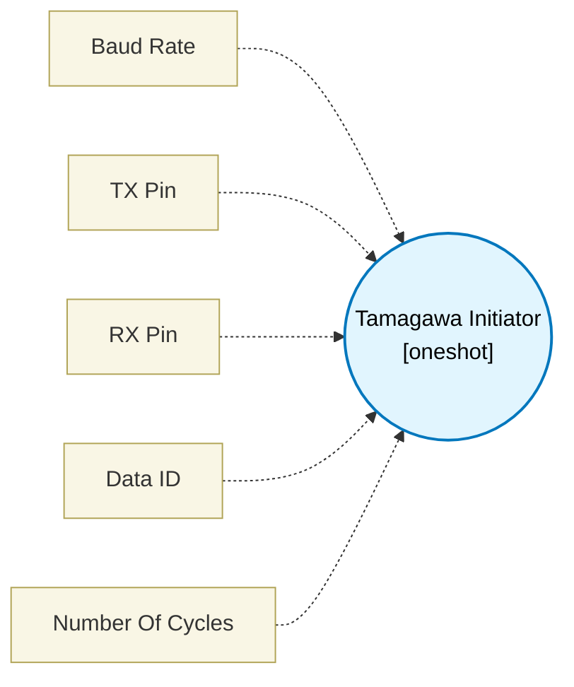

# Tamagawa Initiator (`tamagawa_initiator_block`) — Design Document

> Generated by `build_block_docs.js` on 2026-10-21 from `.metadata/sysconfig/.meta/pru_blocks/application_specific/tamagawa_initiator_block.syscfg.js`. Do not edit by hand; re-run `node build_block_docs.js`.

## Purpose

Interfaces with the Tamagawa encoder via PRU. Simulator only implements payload parsing tests due to UART NRZ timing constraints at 2.5 Mbps.

## Block Diagram




## Classification

- **Block id:** `tamagawa_initiator_block`
- **Category:** Application-Specific
- **Execution model (inferred):** `oneshot`
- **Macro / opcode:** `m_tamagawa_read`
- **Data ports:** 0 in / 0 out · **Cycles:** `500`

## Parameter schema

| Parameter | Display name | Default | Options |
|---|---|---|---|
| `baudRate` | Baud Rate | `2500000` | — |
| `txPin` | TX Pin | `0` | — |
| `rxPin` | RX Pin | `1` | — |
| `dataId` | Data ID | `3` | — |
| `noOfCycles` | Number Of Cycles | `500` | — |

## Ports

| Port | Type |
|---|---|
| `prev` | `IO_PREV` |
| `next` | `IO_NEXT` |
| `output1` | `output32` |

## Validation rules

- _(no explicit validate() rules)_

## Generated macro (`.xdt` equivalent)

```asm
m_tamagawa_read .macro RES
    ; --- Tamagawa Payload Parsing Slice ---
    ; True 2.5 Mbps UART bit-banging cannot be simulated honestly here.
    ; Instead, we parse a deterministic response frame assumed loaded by PRU hardware.
    ; Data ID 0 Response: [CF, SF, ABS0, ABS1, ABS2, ENID, CRC]
    ; For simulator testing, we assume:
    ; TEMP_REG1 = [SF, ABS0, ABS1, ABS2] (bytes in Little-Endian layout)
    
    ; Extract Absolute Position (ABS0, ABS1, ABS2) from TEMP_REG1
    ; Shift right by 8 to drop SF, then mask to 24-bits
    lsr   RES, TEMP_REG1, 8
    ldi32 TEMP_REG2, 0x00FFFFFF
    and   RES, RES, TEMP_REG2
    .endm
```

## Device portability

> **Source of truth:** `.metadata/sysconfig/.meta/pru_blocks/common/pru_device_caps.js` (TRM SPRUIM2J §6.4.1.1 / SPRUJB6 §7.3.1.1). Regenerated by `node build_block_docs.js` — do not edit by hand.

- **Required widget(s):** _(none)_
- **Validator:** `pru_blocks_static_module` raises a SysConfig **ERROR** naming both widget and device when a required widget is absent.

| Device (SoC) | Supported |
|---|---|
| `am243x` | ✅ |
| `am261x` | ✅ |
| `am263px` | ✅ |
| `am263x` | ✅ |
| `am64x` | ✅ |

## Outstanding TODO / VERIFY items

- None flagged in source.
