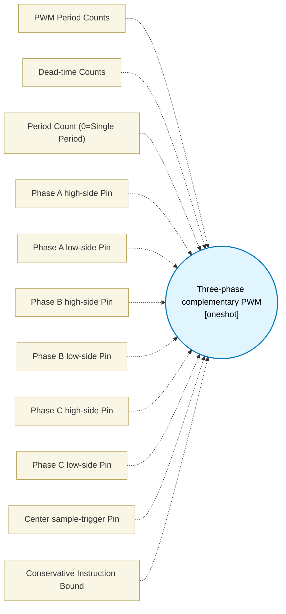

# Three-phase complementary PWM (`three_phase_pwm_block`) — Design Document

> Generated by `build_block_docs.js` from `.metadata/sysconfig/.meta/pru_blocks/pru_io_blocks/three_phase_pwm_block.syscfg.js`. Do not edit by hand; re-run `node build_block_docs.js`.

## Purpose

Consumes phase A/B/C duty counts and emits one edge-aligned PWM period on six R30 pins. Each call sorts its edges once into an event list (the duties are the same for every period of the call); each period then reads the IEP counter once per poll iteration, compares it with the next event time and writes R30 when that time is reached. Edge times in IEP counts from the period start: high sides on at DEADTIME, high-off at min(duty, PERIOD) - DEADTIME, low-on at duty + DEADTIME, the sample strobe at PERIOD/2, all off at PERIOD. A high side stays off when its duty is at or below 2 x DEADTIME (its on-time, duty - 2 x DEADTIME, would be zero or less); a low side stays off when duty >= PERIOD - DEADTIME, and the low side of a leg at duty 0 turns on with the high sides; duties above the period are limited to the period. Dead time is never a busy-wait: it exists only as event times. Nominally both devices of a half bridge are off for 2 x DEADTIME counts, from the ideal high-off (duty - DEADTIME) to the ideal low-on (duty + DEADTIME). The delivered gap can be shorter when a late high-off bunches with an on-time low-on; the smallest gaps observed are about 8 counts at DEADTIME 10 and 16 at DEADTIME 20 (for example duties 424, 424, 444 at PERIOD 800, and 4, 4, 44 at PERIOD 400 with DEADTIME 20). This minimum is an observed value pinned by the scheduling tests, not a guarantee; the two devices are never on together. Edges with the same count change in one R30 write. Timing in cycles (= IEP counts): one poll iteration W = 4 (lbco of CNT + qbgt), counter sample to the R30 write X = 5, write to the next write when that edge is already due X2 = 8. An edge is never early; an isolated edge is late by at most W + X = 9 counts, and the k-th edge of a cluster of single-edge writes by at most W + X + (k-1) x X2. A write that changes several pins at once (coincident edges, clamped legs) goes through an escape token and takes up to 32 cycles to dispatch; the per-kind costs are measured by the scheduling tests. The strobe rises at PERIOD/2 under the same bound and is one poll iteration (4 cycles) wide. DEADTIME is an 8-bit immediate (at most 255). The macro owns IEP GLOBAL_CFG, CMP_CFG, CMP0, CNT and CMP_STATUS for the period (CMP0 flags the period end without resetting the counter, so a late edge is never lost), then disables CMP0 before returning. By default one call emits one period. Set Period count to N (1..2147483647) to emit N periods in one call: each period restarts the IEP counter and is the same waveform, edge for edge, as one single-period call, and compare events are disabled after the last. Consecutive periods are separated by 32 cycles (a back-to-back pair of single-period calls is separated by 182 because each call sorts its edges again and re-programs the IEP); the final return costs 2 cycles more than a single-period call (period decrement and branch), all after the last all-off edge. At small PERIOD with duties near PERIOD the late edges can land after the nominal period end (PERIOD 64, DEADTIME 1: an edge up to 77 counts late, an effective period of about 126 counts). The generated macro is about 985 instructions per inlined instance, roughly a third of a 3072-instruction instruction RAM; the single-period and the counted macro are separate bodies. Conservative instruction bound scales with N.

Timing restrictions: this is a software block and its timing is not hardware-exact. (1) Dead time is nominally 2 x DEADTIME. The delivered minimum measured is about 8 counts at DEADTIME 10 and about 16 at DEADTIME 20, when a late high-off clusters with an on-time low-on. No overlap was seen in about 2000 configurations. It is an observed value pinned by tests, not a guaranteed minimum. (2) Single-edge writes are up to 8 counts late (W + X = 9 bound). Edges written together (coincident edges, clamped legs) are about 10 to 36 counts late in the test cases, against the 12-count budget of the single-edge path; example: PERIOD 800, DEADTIME 10, duties 400/400/400 gives low-ons 31 counts late. (3) This applies to the software block. ICSS-M on AM261x has no PWM module; on AM243x/AM64x the ICSSG hardware PWM module (not covered by this block) is the better fit when dead time must be a guaranteed minimum.

## Block Diagram




## Classification

- **Block id:** `three_phase_pwm_block`
- **Category:** I/O & Protocol
- **Execution model (inferred):** `oneshot`
- **Macro / opcode:** `m_three_phase_pwm_period`
- **Data ports:** 3 in / 1 out · **Cycles:** `1260`

## Parameter schema

| Parameter | Display name | Default | Options |
|---|---|---|---|
| `periodCounts` | PWM Period Counts | `1000` | — |
| `deadtimeCounts` | Dead-time Counts | `10` | — |
| `periodCount` | Period Count (0=Single Period) | `0` | — |
| `phaseAHighPin` | Phase A high-side Pin | `0` | `0`, `1`, `2`, `3`, `4`, `5`, `6`, `7`, `8`, `9`, `10`, `11`, `12`, `13`, `14`, `15`, `16`, `17`, `18`, `19` |
| `phaseALowPin` | Phase A low-side Pin | `1` | `0`, `1`, `2`, `3`, `4`, `5`, `6`, `7`, `8`, `9`, `10`, `11`, `12`, `13`, `14`, `15`, `16`, `17`, `18`, `19` |
| `phaseBHighPin` | Phase B high-side Pin | `2` | `0`, `1`, `2`, `3`, `4`, `5`, `6`, `7`, `8`, `9`, `10`, `11`, `12`, `13`, `14`, `15`, `16`, `17`, `18`, `19` |
| `phaseBLowPin` | Phase B low-side Pin | `3` | `0`, `1`, `2`, `3`, `4`, `5`, `6`, `7`, `8`, `9`, `10`, `11`, `12`, `13`, `14`, `15`, `16`, `17`, `18`, `19` |
| `phaseCHighPin` | Phase C high-side Pin | `4` | `0`, `1`, `2`, `3`, `4`, `5`, `6`, `7`, `8`, `9`, `10`, `11`, `12`, `13`, `14`, `15`, `16`, `17`, `18`, `19` |
| `phaseCLowPin` | Phase C low-side Pin | `5` | `0`, `1`, `2`, `3`, `4`, `5`, `6`, `7`, `8`, `9`, `10`, `11`, `12`, `13`, `14`, `15`, `16`, `17`, `18`, `19` |
| `sampleTriggerPin` | Center sample-trigger Pin | `6` | `0`, `1`, `2`, `3`, `4`, `5`, `6`, `7`, `8`, `9`, `10`, `11`, `12`, `13`, `14`, `15`, `16`, `17`, `18`, `19` |
| `noOfCycles` | Conservative Instruction Bound | `1260` | — |

## Ports

| Port | Type |
|---|---|
| `input1` | `input32` |
| `input2` | `input32` |
| `input3` | `input32` |
| `output1` | `output32` |
| `prev` | `IO_PREV` |
| `next` | `IO_NEXT` |

## Validation rules

- periodCounts must be 64..2147483647
- deadtimeCounts must be positive and less than half the period
- All six gate pins and the sample-trigger pin must be unique
- periodCount must be 0..2147483647

## Generated macro (`.xdt` equivalent)

```asm
m_three_phase_pwm_period .macro STATE, DUTY_A, DUTY_B, DUTY_C, PERIOD, DEADTIME, AH, AL, BH, BL, CH, CL, TRIGGER
    ; Own IEP CMP0 without counter reset: the counter runs past PERIOD, so a late event is never missed.
    ldi TEMP_REG1, 0x11
    sbco  &TEMP_REG1, c26, 0x00, 4
    ldi32 TEMP_REG1, PERIOD
    sbco  &TEMP_REG1, c26, 0x78, 4
    ldi TEMP_REG1, 0x02
    sbco  &TEMP_REG1, c26, 0x70, 4
    clr R30, R30, AH
    clr R30, R30, AL
    clr R30, R30, BH
    clr R30, R30, BL
    clr R30, R30, CH
    clr R30, R30, CL
    clr R30, R30, TRIGGER
    ; Edge order, once per call. TEMP_REG4 byte k describes duty rank k+1: bits 0-1 leg (A=1..C=3),
    ; 2 high side on, 3 clamped, 4 low side on, 5 low-on after the strobe, 6 high-off after it,
    ; 7 one of them at the strobe. Byte 3: equal ranks 1-2, 2-3; rank gap 2-1, 3-1, 3-2 equal to
    ; 2*DEADTIME (a high-off coincides with a low-on); the same gaps below 2*DEADTIME.
    ldi32 STATE, PERIOD
    mov TEMP_REG1, DUTY_A
    qbge tp_ca?, TEMP_REG1, STATE
    mov TEMP_REG1, STATE
tp_ca?:
    mov TEMP_REG2, DUTY_B
    qbge tp_cb?, TEMP_REG2, STATE
    mov TEMP_REG2, STATE
tp_cb?:
    mov TEMP_REG3, DUTY_C
    qbge tp_cc?, TEMP_REG3, STATE
    mov TEMP_REG3, STATE
tp_cc?:
    ldi32 TEMP_REG4, 0x00171615
    qbge tp_s1?, TEMP_REG1, TEMP_REG2
    xor TEMP_REG1, TEMP_REG1, TEMP_REG2
    xor TEMP_REG2, TEMP_REG2, TEMP_REG1
    xor TEMP_REG1, TEMP_REG1, TEMP_REG2
    mov STATE.b0, TEMP_REG4.b0
    mov TEMP_REG4.b0, TEMP_REG4.b1
    mov TEMP_REG4.b1, STATE.b0
tp_s1?:
    qbge tp_s2?, TEMP_REG2, TEMP_REG3
    xor TEMP_REG2, TEMP_REG2, TEMP_REG3
    xor TEMP_REG3, TEMP_REG3, TEMP_REG2
    xor TEMP_REG2, TEMP_REG2, TEMP_REG3
    mov STATE.b0, TEMP_REG4.b1
    mov TEMP_REG4.b1, TEMP_REG4.b2
    mov TEMP_REG4.b2, STATE.b0
tp_s2?:
    qbge tp_s3?, TEMP_REG1, TEMP_REG2
    xor TEMP_REG1, TEMP_REG1, TEMP_REG2
    xor TEMP_REG2, TEMP_REG2, TEMP_REG1
    xor TEMP_REG1, TEMP_REG1, TEMP_REG2
    mov STATE.b0, TEMP_REG4.b0
    mov TEMP_REG4.b0, TEMP_REG4.b1
    mov TEMP_REG4.b1, STATE.b0
tp_s3?:
    ldi STATE, DEADTIME
    add STATE, STATE, DEADTIME
    qblt tp_hk?, TEMP_REG1, STATE
    clr TEMP_REG4, TEMP_REG4, 2
    qblt tp_hk?, TEMP_REG2, STATE
    clr TEMP_REG4, TEMP_REG4, 10
    qblt tp_hk?, TEMP_REG3, STATE
    clr TEMP_REG4, TEMP_REG4, 18
tp_hk?:
    sub TEMP_REG3, TEMP_REG3, TEMP_REG2
    qbgt tp_gel?, TEMP_REG3, STATE
    qbne tp_ged?, TEMP_REG3, STATE
    set TEMP_REG4, TEMP_REG4, 28
tp_ged?:
    add TEMP_REG3, TEMP_REG3, TEMP_REG2
    sub TEMP_REG3, TEMP_REG3, TEMP_REG1
    qbgt tp_gbl?, TEMP_REG3, STATE
    qbne tp_gbd?, TEMP_REG3, STATE
    set TEMP_REG4, TEMP_REG4, 27
tp_gbd?:
    add TEMP_REG3, TEMP_REG3, TEMP_REG1
    sub TEMP_REG2, TEMP_REG2, TEMP_REG1
    qbgt tp_gal?, TEMP_REG2, STATE
    qbne tp_gad?, TEMP_REG2, STATE
    set TEMP_REG4, TEMP_REG4, 26
tp_gad?:
    add TEMP_REG2, TEMP_REG2, TEMP_REG1
    qbne tp_q1?, TEMP_REG1, TEMP_REG2
    set TEMP_REG4, TEMP_REG4, 24
tp_q1?:
    qbne tp_q2?, TEMP_REG2, TEMP_REG3
    set TEMP_REG4, TEMP_REG4, 25
tp_q2?:
    ldi32 STATE, PERIOD
    qbne tp_ck?, TEMP_REG3, STATE
    set TEMP_REG4, TEMP_REG4, 19
    qbne tp_ck?, TEMP_REG2, STATE
    set TEMP_REG4, TEMP_REG4, 11
    qbne tp_ck?, TEMP_REG1, STATE
    set TEMP_REG4, TEMP_REG4, 3
tp_ck?:
    sub STATE, STATE, DEADTIME
    qbgt tp_lk?, TEMP_REG3, STATE
    clr TEMP_REG4, TEMP_REG4, 20
    qbgt tp_lk?, TEMP_REG2, STATE
    clr TEMP_REG4, TEMP_REG4, 12
    qbgt tp_lk?, TEMP_REG1, STATE
    clr TEMP_REG4, TEMP_REG4, 4
tp_lk?:
    qbne tp_zk?, TEMP_REG1, 0
    clr TEMP_REG4, TEMP_REG4, 4
    qbne tp_zk?, TEMP_REG2, 0
    clr TEMP_REG4, TEMP_REG4, 12
    qbne tp_zk?, TEMP_REG3, 0
    clr TEMP_REG4, TEMP_REG4, 20
tp_zk?:
    ldi32 STATE, PERIOD >> 1
    add STATE, STATE, DEADTIME
    qbge tp_sh?, TEMP_REG1, STATE
    set TEMP_REG4, TEMP_REG4, 6
    set TEMP_REG4, TEMP_REG4, 14
    set TEMP_REG4, TEMP_REG4, 22
    qba tp_shd2?
tp_sh?:
    qbge tp_she0?, TEMP_REG1, STATE
    set TEMP_REG4, TEMP_REG4, 6
    qba tp_shd0?
tp_she0?:
    qbne tp_shd0?, TEMP_REG1, STATE
    set TEMP_REG4, TEMP_REG4, 7
tp_shd0?:
    qbge tp_she1?, TEMP_REG2, STATE
    set TEMP_REG4, TEMP_REG4, 14
    qba tp_shd1?
tp_she1?:
    qbne tp_shd1?, TEMP_REG2, STATE
    set TEMP_REG4, TEMP_REG4, 15
tp_shd1?:
    qbge tp_she2?, TEMP_REG3, STATE
    set TEMP_REG4, TEMP_REG4, 22
    qba tp_shd2?
tp_she2?:
    qbne tp_shd2?, TEMP_REG3, STATE
    set TEMP_REG4, TEMP_REG4, 23
tp_shd2?:
    sub STATE, STATE, DEADTIME
    sub STATE, STATE, DEADTIME
    qbge tp_sl?, TEMP_REG1, STATE
    set TEMP_REG4, TEMP_REG4, 5
    set TEMP_REG4, TEMP_REG4, 13
    set TEMP_REG4, TEMP_REG4, 21
    qba tp_sld2?
tp_sl?:
    qbge tp_sle0?, TEMP_REG1, STATE
    set TEMP_REG4, TEMP_REG4, 5
    qba tp_sld0?
tp_sle0?:
    qbne tp_sld0?, TEMP_REG1, STATE
    set TEMP_REG4, TEMP_REG4, 7
tp_sld0?:
    qbge tp_sle1?, TEMP_REG2, STATE
    set TEMP_REG4, TEMP_REG4, 13
    qba tp_sld1?
tp_sle1?:
    qbne tp_sld1?, TEMP_REG2, STATE
    set TEMP_REG4, TEMP_REG4, 15
tp_sld1?:
    qbge tp_sle2?, TEMP_REG3, STATE
    set TEMP_REG4, TEMP_REG4, 21
    qba tp_sld2?
tp_sle2?:
    qbne tp_sld2?, TEMP_REG3, STATE
    set TEMP_REG4, TEMP_REG4, 23
tp_sld2?:
    ldi TEMP_REG2, 1
    ldi STATE, 0
    qbbc tp_il0z?, TEMP_REG4, 20
    qbbc tp_sc1?, TEMP_REG2, 0
    qbbs tp_sc1?, TEMP_REG4, 21
    clr TEMP_REG2, TEMP_REG2, 0
    qbbc tp_sc1e?, TEMP_REG4, 23
    qbbc tp_sc1?, TEMP_REG4, 21
tp_sc1e?:
    lsl STATE, STATE, 4
    or STATE.b0, STATE.b0, 7
tp_sc1?:
    qbbs tp_il0z?, TEMP_REG4, 25
    qbbc tp_il0s?, TEMP_REG4, 23
    qbbc tp_il0g?, TEMP_REG4, 21
tp_il0s?:
    lsl STATE, STATE, 4
    and TEMP_REG1.b0, TEMP_REG4.b2, 3
    add TEMP_REG1.b0, TEMP_REG1.b0, 3
    or STATE.b0, STATE.b0, TEMP_REG1.b0
tp_il0z?:
    qbbc tp_m1?, TEMP_REG4, 31
    qbbc tp_il1z?, TEMP_REG4, 12
    qbbc tp_sc2?, TEMP_REG2, 0
    qbbs tp_sc2?, TEMP_REG4, 13
    clr TEMP_REG2, TEMP_REG2, 0
    qbbc tp_sc2e?, TEMP_REG4, 15
    qbbc tp_sc2?, TEMP_REG4, 13
tp_sc2e?:
    lsl STATE, STATE, 4
    or STATE.b0, STATE.b0, 7
tp_sc2?:
    qbbs tp_il1z?, TEMP_REG4, 24
    qbbs tp_il1g?, TEMP_REG4, 25
    qbbs tp_il1g?, TEMP_REG4, 28
    qbbc tp_il1s?, TEMP_REG4, 15
    qbbc tp_il1g?, TEMP_REG4, 13
tp_il1s?:
    lsl STATE, STATE, 4
    and TEMP_REG1.b0, TEMP_REG4.b1, 3
    add TEMP_REG1.b0, TEMP_REG1.b0, 3
    or STATE.b0, STATE.b0, TEMP_REG1.b0
tp_il1z?:
    qbbc tp_m2?, TEMP_REG4, 30
    qbbc tp_il2z?, TEMP_REG4, 4
    qbbc tp_sc3?, TEMP_REG2, 0
    qbbs tp_sc3?, TEMP_REG4, 5
    clr TEMP_REG2, TEMP_REG2, 0
    qbbc tp_sc3e?, TEMP_REG4, 7
    qbbc tp_sc3?, TEMP_REG4, 5
tp_sc3e?:
    lsl STATE, STATE, 4
    or STATE.b0, STATE.b0, 7
tp_sc3?:
    qbbs tp_il2g?, TEMP_REG4, 24
    qbbs tp_il2g?, TEMP_REG4, 26
    qbbs tp_il2g?, TEMP_REG4, 27
    qbbc tp_il2s?, TEMP_REG4, 7
    qbbc tp_il2g?, TEMP_REG4, 5
tp_il2s?:
    lsl STATE, STATE, 4
    and TEMP_REG1.b0, TEMP_REG4.b0, 3
    add TEMP_REG1.b0, TEMP_REG1.b0, 3
    or STATE.b0, STATE.b0, TEMP_REG1.b0
tp_il2z?:
    qbbc tp_ih3z?, TEMP_REG4, 18
    qbbc tp_sc4?, TEMP_REG2, 0
    qbbs tp_sc4?, TEMP_REG4, 22
    clr TEMP_REG2, TEMP_REG2, 0
    qbbc tp_sc4e?, TEMP_REG4, 23
    qbbs tp_sc4?, TEMP_REG4, 21
tp_sc4e?:
    lsl STATE, STATE, 4
    or STATE.b0, STATE.b0, 7
tp_sc4?:
    qbbs tp_ih3z?, TEMP_REG4, 25
    qbbs tp_ih3z?, TEMP_REG4, 27
    qbbs tp_ih3z?, TEMP_REG4, 28
    qbbs tp_ih3x?, TEMP_REG4, 19
    qbbc tp_ih3s?, TEMP_REG4, 23
    qbbs tp_ih3g?, TEMP_REG4, 21
tp_ih3s?:
    lsl STATE, STATE, 4
    and TEMP_REG1.b0, TEMP_REG4.b2, 3
    or STATE.b0, STATE.b0, TEMP_REG1.b0
tp_ih3z?:
    qba tp_ta1?
tp_m2?:
    qbbc tp_ih4z?, TEMP_REG4, 18
    qbbc tp_sc5?, TEMP_REG2, 0
    qbbs tp_sc5?, TEMP_REG4, 22
    clr TEMP_REG2, TEMP_REG2, 0
    qbbc tp_sc5e?, TEMP_REG4, 23
    qbbs tp_sc5?, TEMP_REG4, 21
tp_sc5e?:
    lsl STATE, STATE, 4
    or STATE.b0, STATE.b0, 7
tp_sc5?:
    qbbs tp_ih4z?, TEMP_REG4, 25
    qbbs tp_ih4z?, TEMP_REG4, 27
    qbbs tp_ih4z?, TEMP_REG4, 28
    qbbs tp_ih4x?, TEMP_REG4, 19
    qbbc tp_ih4s?, TEMP_REG4, 23
    qbbs tp_ih4g?, TEMP_REG4, 21
tp_ih4s?:
    lsl STATE, STATE, 4
    and TEMP_REG1.b0, TEMP_REG4.b2, 3
    or STATE.b0, STATE.b0, TEMP_REG1.b0
tp_ih4z?:
    qbbc tp_tb?, TEMP_REG4, 29
    qba tp_ta?
tp_m1?:
    qbbc tp_ih5z?, TEMP_REG4, 18
    qbbc tp_sc6?, TEMP_REG2, 0
    qbbs tp_sc6?, TEMP_REG4, 22
    clr TEMP_REG2, TEMP_REG2, 0
    qbbc tp_sc6e?, TEMP_REG4, 23
    qbbs tp_sc6?, TEMP_REG4, 21
tp_sc6e?:
    lsl STATE, STATE, 4
    or STATE.b0, STATE.b0, 7
tp_sc6?:
    qbbs tp_ih5z?, TEMP_REG4, 25
    qbbs tp_ih5z?, TEMP_REG4, 27
    qbbs tp_ih5z?, TEMP_REG4, 28
    qbbs tp_ih5x?, TEMP_REG4, 19
    qbbc tp_ih5s?, TEMP_REG4, 23
    qbbs tp_ih5g?, TEMP_REG4, 21
tp_ih5s?:
    lsl STATE, STATE, 4
    and TEMP_REG1.b0, TEMP_REG4.b2, 3
    or STATE.b0, STATE.b0, TEMP_REG1.b0
tp_ih5z?:
    qbbc tp_il6z?, TEMP_REG4, 12
    qbbc tp_sc7?, TEMP_REG2, 0
    qbbs tp_sc7?, TEMP_REG4, 13
    clr TEMP_REG2, TEMP_REG2, 0
    qbbc tp_sc7e?, TEMP_REG4, 15
    qbbc tp_sc7?, TEMP_REG4, 13
tp_sc7e?:
    lsl STATE, STATE, 4
    or STATE.b0, STATE.b0, 7
tp_sc7?:
    qbbs tp_il6z?, TEMP_REG4, 24
    qbbs tp_il6g?, TEMP_REG4, 25
    qbbs tp_il6g?, TEMP_REG4, 28
    qbbc tp_il6s?, TEMP_REG4, 15
    qbbc tp_il6g?, TEMP_REG4, 13
tp_il6s?:
    lsl STATE, STATE, 4
    and TEMP_REG1.b0, TEMP_REG4.b1, 3
    add TEMP_REG1.b0, TEMP_REG1.b0, 3
    or STATE.b0, STATE.b0, TEMP_REG1.b0
tp_il6z?:
    qbbc tp_tb?, TEMP_REG4, 29
tp_ta?:
    qbbc tp_ta1?, TEMP_REG4, 4
    qbbc tp_sc8?, TEMP_REG2, 0
    qbbs tp_sc8?, TEMP_REG4, 5
    clr TEMP_REG2, TEMP_REG2, 0
    qbbc tp_sc8e?, TEMP_REG4, 7
    qbbc tp_sc8?, TEMP_REG4, 5
tp_sc8e?:
    lsl STATE, STATE, 4
    or STATE.b0, STATE.b0, 7
tp_sc8?:
    qbbs tp_il7g?, TEMP_REG4, 24
    qbbs tp_il7g?, TEMP_REG4, 26
    qbbs tp_il7g?, TEMP_REG4, 27
    qbbc tp_il7s?, TEMP_REG4, 7
    qbbc tp_il7g?, TEMP_REG4, 5
tp_il7s?:
    lsl STATE, STATE, 4
    and TEMP_REG1.b0, TEMP_REG4.b0, 3
    add TEMP_REG1.b0, TEMP_REG1.b0, 3
    or STATE.b0, STATE.b0, TEMP_REG1.b0
tp_ta1?:
    qbbc tp_ta2?, TEMP_REG4, 10
    qbbc tp_sc9?, TEMP_REG2, 0
    qbbs tp_sc9?, TEMP_REG4, 14
    clr TEMP_REG2, TEMP_REG2, 0
    qbbc tp_sc9e?, TEMP_REG4, 15
    qbbs tp_sc9?, TEMP_REG4, 13
tp_sc9e?:
    lsl STATE, STATE, 4
    or STATE.b0, STATE.b0, 7
tp_sc9?:
    qbbs tp_ta2?, TEMP_REG4, 24
    qbbs tp_ta2?, TEMP_REG4, 26
    qbbs tp_ih8x?, TEMP_REG4, 11
    qbbs tp_ih8g?, TEMP_REG4, 25
    qbbc tp_ih8s?, TEMP_REG4, 15
    qbbs tp_ih8g?, TEMP_REG4, 13
tp_ih8s?:
    lsl STATE, STATE, 4
    and TEMP_REG1.b0, TEMP_REG4.b1, 3
    or STATE.b0, STATE.b0, TEMP_REG1.b0
tp_ta2?:
    qbbc tp_ih9z?, TEMP_REG4, 2
    qbbc tp_sc10?, TEMP_REG2, 0
    qbbs tp_sc10?, TEMP_REG4, 6
    clr TEMP_REG2, TEMP_REG2, 0
    qbbc tp_sc10e?, TEMP_REG4, 7
    qbbs tp_sc10?, TEMP_REG4, 5
tp_sc10e?:
    lsl STATE, STATE, 4
    or STATE.b0, STATE.b0, 7
tp_sc10?:
    qbbs tp_ih9x?, TEMP_REG4, 3
    qbbs tp_ih9g?, TEMP_REG4, 24
    qbbc tp_ih9s?, TEMP_REG4, 7
    qbbs tp_ih9g?, TEMP_REG4, 5
tp_ih9s?:
    lsl STATE, STATE, 4
    and TEMP_REG1.b0, TEMP_REG4.b0, 3
    or STATE.b0, STATE.b0, TEMP_REG1.b0
tp_ih9z?:
    qbbc tp_mo?, TEMP_REG2, 0
    lsl STATE, STATE, 4
    or STATE.b0, STATE.b0, 7
    qba tp_mo?
tp_tb?:
    qbbc tp_ih10z?, TEMP_REG4, 10
    qbbc tp_sc11?, TEMP_REG2, 0
    qbbs tp_sc11?, TEMP_REG4, 14
    clr TEMP_REG2, TEMP_REG2, 0
    qbbc tp_sc11e?, TEMP_REG4, 15
    qbbs tp_sc11?, TEMP_REG4, 13
tp_sc11e?:
    lsl STATE, STATE, 4
    or STATE.b0, STATE.b0, 7
tp_sc11?:
    qbbs tp_ih10z?, TEMP_REG4, 24
    qbbs tp_ih10z?, TEMP_REG4, 26
    qbbs tp_ih10x?, TEMP_REG4, 11
    qbbs tp_ih10g?, TEMP_REG4, 25
    qbbc tp_ih10s?, TEMP_REG4, 15
    qbbs tp_ih10g?, TEMP_REG4, 13
tp_ih10s?:
    lsl STATE, STATE, 4
    and TEMP_REG1.b0, TEMP_REG4.b1, 3
    or STATE.b0, STATE.b0, TEMP_REG1.b0
tp_ih10z?:
    qbbc tp_il11z?, TEMP_REG4, 4
    qbbc tp_sc12?, TEMP_REG2, 0
    qbbs tp_sc12?, TEMP_REG4, 5
    clr TEMP_REG2, TEMP_REG2, 0
    qbbc tp_sc12e?, TEMP_REG4, 7
    qbbc tp_sc12?, TEMP_REG4, 5
tp_sc12e?:
    lsl STATE, STATE, 4
    or STATE.b0, STATE.b0, 7
tp_sc12?:
    qbbs tp_il11g?, TEMP_REG4, 24
    qbbs tp_il11g?, TEMP_REG4, 26
    qbbs tp_il11g?, TEMP_REG4, 27
    qbbc tp_il11s?, TEMP_REG4, 7
    qbbc tp_il11g?, TEMP_REG4, 5
tp_il11s?:
    lsl STATE, STATE, 4
    and TEMP_REG1.b0, TEMP_REG4.b0, 3
    add TEMP_REG1.b0, TEMP_REG1.b0, 3
    or STATE.b0, STATE.b0, TEMP_REG1.b0
tp_il11z?:
    qba tp_ta2?
tp_gel?:
    set TEMP_REG4, TEMP_REG4, 31
    qba tp_ged?
tp_gbl?:
    set TEMP_REG4, TEMP_REG4, 30
    qba tp_gbd?
tp_gal?:
    set TEMP_REG4, TEMP_REG4, 29
    qba tp_gad?
tp_il0g?:
    lsl STATE, STATE, 8
    and TEMP_REG1.b0, TEMP_REG4.b2, 3
    add TEMP_REG1.b0, TEMP_REG1.b0, 3
    lsl TEMP_REG1.b0, TEMP_REG1.b0, 3
    qbbc tp_il0c?, TEMP_REG4, 23
    qbbs tp_il0c?, TEMP_REG4, 21
    set TEMP_REG1.b0, TEMP_REG1.b0, 6
tp_il0c?:
    qba tp_il0o?
tp_il0y?:
    set TEMP_REG1.b0, TEMP_REG1.b0, 7
tp_il0o?:
    or STATE.b0, STATE.b0, TEMP_REG1.b0
    qba tp_il0z?
tp_il1g?:
    lsl STATE, STATE, 8
    qbbc tp_il1n?, TEMP_REG4, 19
    qbbc tp_il1n?, TEMP_REG4, 28
    qbbs tp_il1x?, TEMP_REG4, 19
tp_il1n?:
    and TEMP_REG1.b0, TEMP_REG4.b1, 3
    add TEMP_REG1.b0, TEMP_REG1.b0, 3
    lsl TEMP_REG1.b0, TEMP_REG1.b0, 3
    qbbc tp_il1c?, TEMP_REG4, 15
    qbbs tp_il1c?, TEMP_REG4, 13
    set TEMP_REG1.b0, TEMP_REG1.b0, 6
tp_il1c?:
    qbbs tp_il1y?, TEMP_REG4, 28
    qba tp_il1o?
tp_il1y?:
    set TEMP_REG1.b0, TEMP_REG1.b0, 7
tp_il1o?:
    or STATE.b0, STATE.b0, TEMP_REG1.b0
    qba tp_il1z?
tp_il1x?:
    and TEMP_REG1.b0, TEMP_REG4.b1, 3
    sub TEMP_REG1.b0, TEMP_REG1.b0, 1
    lsl TEMP_REG1.b0, TEMP_REG1.b0, 6
    or TEMP_REG1.b0, TEMP_REG1.b0, 0x38
    or STATE.b0, STATE.b0, TEMP_REG1.b0
    qba tp_il1z?
tp_il2g?:
    lsl STATE, STATE, 8
    qbbc tp_il2n?, TEMP_REG4, 19
    qbbc tp_il2n0?, TEMP_REG4, 26
    qbbs tp_il2x?, TEMP_REG4, 11
tp_il2n0?:
    qbbc tp_il2n?, TEMP_REG4, 27
    qbbs tp_il2x?, TEMP_REG4, 19
tp_il2n?:
    and TEMP_REG1.b0, TEMP_REG4.b0, 3
    add TEMP_REG1.b0, TEMP_REG1.b0, 3
    lsl TEMP_REG1.b0, TEMP_REG1.b0, 3
    qbbc tp_il2c?, TEMP_REG4, 7
    qbbs tp_il2c?, TEMP_REG4, 5
    set TEMP_REG1.b0, TEMP_REG1.b0, 6
tp_il2c?:
    qbbs tp_il2y?, TEMP_REG4, 26
    qbbs tp_il2y?, TEMP_REG4, 27
    qba tp_il2o?
tp_il2y?:
    set TEMP_REG1.b0, TEMP_REG1.b0, 7
tp_il2o?:
    or STATE.b0, STATE.b0, TEMP_REG1.b0
    qba tp_il2z?
tp_il2x?:
    and TEMP_REG1.b0, TEMP_REG4.b0, 3
    sub TEMP_REG1.b0, TEMP_REG1.b0, 1
    lsl TEMP_REG1.b0, TEMP_REG1.b0, 6
    or TEMP_REG1.b0, TEMP_REG1.b0, 0x38
    or STATE.b0, STATE.b0, TEMP_REG1.b0
    qba tp_il2z?
tp_ih3x?:
    lsl STATE, STATE, 8
    and TEMP_REG1.b0, TEMP_REG4.b2, 3
    lsl TEMP_REG1.b0, TEMP_REG1.b0, 3
    or TEMP_REG1.b0, TEMP_REG1.b0, 0x80
    or STATE.b0, STATE.b0, TEMP_REG1.b0
    qba tp_ih3z?
tp_ih3g?:
    lsl STATE, STATE, 8
    and TEMP_REG1.b0, TEMP_REG4.b2, 3
    lsl TEMP_REG1.b0, TEMP_REG1.b0, 3
    qbbc tp_ih3h?, TEMP_REG4, 23
    qbbc tp_ih3h?, TEMP_REG4, 21
    set TEMP_REG1.b0, TEMP_REG1.b0, 6
tp_ih3h?:
    or STATE.b0, STATE.b0, TEMP_REG1.b0
    qba tp_ih3z?
tp_ih4x?:
    lsl STATE, STATE, 8
    and TEMP_REG1.b0, TEMP_REG4.b2, 3
    lsl TEMP_REG1.b0, TEMP_REG1.b0, 3
    or TEMP_REG1.b0, TEMP_REG1.b0, 0x80
    or STATE.b0, STATE.b0, TEMP_REG1.b0
    qba tp_ih4z?
tp_ih4g?:
    lsl STATE, STATE, 8
    and TEMP_REG1.b0, TEMP_REG4.b2, 3
    lsl TEMP_REG1.b0, TEMP_REG1.b0, 3
    qbbc tp_ih4h?, TEMP_REG4, 23
    qbbc tp_ih4h?, TEMP_REG4, 21
    set TEMP_REG1.b0, TEMP_REG1.b0, 6
tp_ih4h?:
    or STATE.b0, STATE.b0, TEMP_REG1.b0
    qba tp_ih4z?
tp_ih5x?:
    lsl STATE, STATE, 8
    and TEMP_REG1.b0, TEMP_REG4.b2, 3
    lsl TEMP_REG1.b0, TEMP_REG1.b0, 3
    or TEMP_REG1.b0, TEMP_REG1.b0, 0x80
    or STATE.b0, STATE.b0, TEMP_REG1.b0
    qba tp_ih5z?
tp_ih5g?:
    lsl STATE, STATE, 8
    and TEMP_REG1.b0, TEMP_REG4.b2, 3
    lsl TEMP_REG1.b0, TEMP_REG1.b0, 3
    qbbc tp_ih5h?, TEMP_REG4, 23
    qbbc tp_ih5h?, TEMP_REG4, 21
    set TEMP_REG1.b0, TEMP_REG1.b0, 6
tp_ih5h?:
    or STATE.b0, STATE.b0, TEMP_REG1.b0
    qba tp_ih5z?
tp_il6g?:
    lsl STATE, STATE, 8
    qbbc tp_il6n?, TEMP_REG4, 19
    qbbc tp_il6n?, TEMP_REG4, 28
    qbbs tp_il6x?, TEMP_REG4, 19
tp_il6n?:
    and TEMP_REG1.b0, TEMP_REG4.b1, 3
    add TEMP_REG1.b0, TEMP_REG1.b0, 3
    lsl TEMP_REG1.b0, TEMP_REG1.b0, 3
    qbbc tp_il6c?, TEMP_REG4, 15
    qbbs tp_il6c?, TEMP_REG4, 13
    set TEMP_REG1.b0, TEMP_REG1.b0, 6
tp_il6c?:
    qbbs tp_il6y?, TEMP_REG4, 28
    qba tp_il6o?
tp_il6y?:
    set TEMP_REG1.b0, TEMP_REG1.b0, 7
tp_il6o?:
    or STATE.b0, STATE.b0, TEMP_REG1.b0
    qba tp_il6z?
tp_il6x?:
    and TEMP_REG1.b0, TEMP_REG4.b1, 3
    sub TEMP_REG1.b0, TEMP_REG1.b0, 1
    lsl TEMP_REG1.b0, TEMP_REG1.b0, 6
    or TEMP_REG1.b0, TEMP_REG1.b0, 0x38
    or STATE.b0, STATE.b0, TEMP_REG1.b0
    qba tp_il6z?
tp_il7g?:
    lsl STATE, STATE, 8
    qbbc tp_il7n?, TEMP_REG4, 19
    qbbc tp_il7n0?, TEMP_REG4, 26
    qbbs tp_il7x?, TEMP_REG4, 11
tp_il7n0?:
    qbbc tp_il7n?, TEMP_REG4, 27
    qbbs tp_il7x?, TEMP_REG4, 19
tp_il7n?:
    and TEMP_REG1.b0, TEMP_REG4.b0, 3
    add TEMP_REG1.b0, TEMP_REG1.b0, 3
    lsl TEMP_REG1.b0, TEMP_REG1.b0, 3
    qbbc tp_il7c?, TEMP_REG4, 7
    qbbs tp_il7c?, TEMP_REG4, 5
    set TEMP_REG1.b0, TEMP_REG1.b0, 6
tp_il7c?:
    qbbs tp_il7y?, TEMP_REG4, 26
    qbbs tp_il7y?, TEMP_REG4, 27
    qba tp_il7o?
tp_il7y?:
    set TEMP_REG1.b0, TEMP_REG1.b0, 7
tp_il7o?:
    or STATE.b0, STATE.b0, TEMP_REG1.b0
    qba tp_ta1?
tp_il7x?:
    and TEMP_REG1.b0, TEMP_REG4.b0, 3
    sub TEMP_REG1.b0, TEMP_REG1.b0, 1
    lsl TEMP_REG1.b0, TEMP_REG1.b0, 6
    or TEMP_REG1.b0, TEMP_REG1.b0, 0x38
    or STATE.b0, STATE.b0, TEMP_REG1.b0
    qba tp_ta1?
tp_ih8x?:
    lsl STATE, STATE, 8
    and TEMP_REG1.b0, TEMP_REG4.b0, 3
    lsl TEMP_REG1.b0, TEMP_REG1.b0, 6
    or STATE.b0, STATE.b0, TEMP_REG1.b0
    qba tp_ta2?
tp_ih8g?:
    lsl STATE, STATE, 8
    and TEMP_REG1.b0, TEMP_REG4.b1, 3
    lsl TEMP_REG1.b0, TEMP_REG1.b0, 3
    qbbc tp_ih8h?, TEMP_REG4, 15
    qbbc tp_ih8h?, TEMP_REG4, 13
    set TEMP_REG1.b0, TEMP_REG1.b0, 6
tp_ih8h?:
    or STATE.b0, STATE.b0, TEMP_REG1.b0
    qba tp_ta2?
tp_ih9x?:
    lsl STATE, STATE, 8
    ldi TEMP_REG1.b0, 0xf8
    or STATE.b0, STATE.b0, TEMP_REG1.b0
    qba tp_ih9z?
tp_ih9g?:
    lsl STATE, STATE, 8
    and TEMP_REG1.b0, TEMP_REG4.b0, 3
    lsl TEMP_REG1.b0, TEMP_REG1.b0, 3
    qbbc tp_ih9h?, TEMP_REG4, 7
    qbbc tp_ih9h?, TEMP_REG4, 5
    set TEMP_REG1.b0, TEMP_REG1.b0, 6
tp_ih9h?:
    or STATE.b0, STATE.b0, TEMP_REG1.b0
    qba tp_ih9z?
tp_ih10x?:
    lsl STATE, STATE, 8
    and TEMP_REG1.b0, TEMP_REG4.b0, 3
    lsl TEMP_REG1.b0, TEMP_REG1.b0, 6
    or STATE.b0, STATE.b0, TEMP_REG1.b0
    qba tp_ih10z?
tp_ih10g?:
    lsl STATE, STATE, 8
    and TEMP_REG1.b0, TEMP_REG4.b1, 3
    lsl TEMP_REG1.b0, TEMP_REG1.b0, 3
    qbbc tp_ih10h?, TEMP_REG4, 15
    qbbc tp_ih10h?, TEMP_REG4, 13
    set TEMP_REG1.b0, TEMP_REG1.b0, 6
tp_ih10h?:
    or STATE.b0, STATE.b0, TEMP_REG1.b0
    qba tp_ih10z?
tp_il11g?:
    lsl STATE, STATE, 8
    qbbc tp_il11n?, TEMP_REG4, 19
    qbbc tp_il11n0?, TEMP_REG4, 26
    qbbs tp_il11x?, TEMP_REG4, 11
tp_il11n0?:
    qbbc tp_il11n?, TEMP_REG4, 27
    qbbs tp_il11x?, TEMP_REG4, 19
tp_il11n?:
    and TEMP_REG1.b0, TEMP_REG4.b0, 3
    add TEMP_REG1.b0, TEMP_REG1.b0, 3
    lsl TEMP_REG1.b0, TEMP_REG1.b0, 3
    qbbc tp_il11c?, TEMP_REG4, 7
    qbbs tp_il11c?, TEMP_REG4, 5
    set TEMP_REG1.b0, TEMP_REG1.b0, 6
tp_il11c?:
    qbbs tp_il11y?, TEMP_REG4, 26
    qbbs tp_il11y?, TEMP_REG4, 27
    qba tp_il11o?
tp_il11y?:
    set TEMP_REG1.b0, TEMP_REG1.b0, 7
tp_il11o?:
    or STATE.b0, STATE.b0, TEMP_REG1.b0
    qba tp_il11z?
tp_il11x?:
    and TEMP_REG1.b0, TEMP_REG4.b0, 3
    sub TEMP_REG1.b0, TEMP_REG1.b0, 1
    lsl TEMP_REG1.b0, TEMP_REG1.b0, 6
    or TEMP_REG1.b0, TEMP_REG1.b0, 0x38
    or STATE.b0, STATE.b0, TEMP_REG1.b0
    qba tp_il11z?
tp_mo?:
    mov TEMP_REG3, STATE
tp_period?:
    ; Every period, the first included, restarts the counter so each period is the same
    ; waveform as one m_three_phase_pwm_period call. High sides on at DEADTIME, with the low
    ; side of any leg at duty 0, in one write.
    mov STATE, TEMP_REG3
    mov TEMP_REG2, R30
    ldi TEMP_REG1, DEADTIME
    add TEMP_REG1, TEMP_REG1, DEADTIME
    qbge tp_oa?, DUTY_A, TEMP_REG1
    set TEMP_REG2, TEMP_REG2, AH
tp_pa?:
    qbge tp_ob?, DUTY_B, TEMP_REG1
    set TEMP_REG2, TEMP_REG2, BH
tp_pb?:
    qbge tp_oc?, DUTY_C, TEMP_REG1
    set TEMP_REG2, TEMP_REG2, CH
tp_pc?:
    qba tp_r0?
tp_oa?:
    qbne tp_pa?, DUTY_A, 0
    set TEMP_REG2, TEMP_REG2, AL
    qba tp_pa?
tp_ob?:
    qbne tp_pb?, DUTY_B, 0
    set TEMP_REG2, TEMP_REG2, BL
    qba tp_pb?
tp_oc?:
    qbne tp_pc?, DUTY_C, 0
    set TEMP_REG2, TEMP_REG2, CL
    qba tp_pc?
tp_r0?:
    ldi TEMP_REG1, 0
    sbco  &TEMP_REG1, c26, 0x10, 4
    ldi TEMP_REG1, 1
    sbco  &TEMP_REG1, c26, 0x74, 4
tp_p0?:
    lbco &TEMP_REG1, c26, 0x10, 4
    qbgt tp_p0?, TEMP_REG1, DEADTIME
    mov R30, TEMP_REG2
    qbbs tp_n1?, STATE, 0
    qbbs tp_n01?, STATE, 1
    qbbs tp_la?, STATE, 2
    clr R30, R30, TRIGGER
    qba tp_esc?
tp_n1?:
    qbbs tp_n11?, STATE, 1
    qbbs tp_lb?, STATE, 2
tp_ha?:
    clr R30, R30, TRIGGER
    lsr STATE, STATE, 4
    sub TEMP_REG2, DUTY_A, DEADTIME
    qbge tp_wha?, TEMP_REG2, TEMP_REG1
tp_qha?:
    lbco &TEMP_REG1, c26, 0x10, 4
    qbgt tp_qha?, TEMP_REG1, TEMP_REG2
tp_wha?:
    clr R30, R30, AH
    qbbs tp_n1?, STATE, 0
    qbbs tp_n01?, STATE, 1
    qbbs tp_la?, STATE, 2
    clr R30, R30, TRIGGER
    qba tp_esc?
tp_n11?:
    qbbs tp_s?, STATE, 2
tp_hc?:
    clr R30, R30, TRIGGER
    lsr STATE, STATE, 4
    sub TEMP_REG2, DUTY_C, DEADTIME
    qbge tp_whc?, TEMP_REG2, TEMP_REG1
tp_qhc?:
    lbco &TEMP_REG1, c26, 0x10, 4
    qbgt tp_qhc?, TEMP_REG1, TEMP_REG2
tp_whc?:
    clr R30, R30, CH
    qbbs tp_n1?, STATE, 0
    qbbs tp_n01?, STATE, 1
    qbbs tp_la?, STATE, 2
    clr R30, R30, TRIGGER
    qba tp_esc?
tp_n01?:
    qbbs tp_lc?, STATE, 2
tp_hb?:
    clr R30, R30, TRIGGER
    lsr STATE, STATE, 4
    sub TEMP_REG2, DUTY_B, DEADTIME
    qbge tp_whb?, TEMP_REG2, TEMP_REG1
tp_qhb?:
    lbco &TEMP_REG1, c26, 0x10, 4
    qbgt tp_qhb?, TEMP_REG1, TEMP_REG2
tp_whb?:
    clr R30, R30, BH
    qbbs tp_n1?, STATE, 0
    qbbs tp_n01?, STATE, 1
    qbbs tp_la?, STATE, 2
    clr R30, R30, TRIGGER
    qba tp_esc?
tp_la?:
    clr R30, R30, TRIGGER
    lsr STATE, STATE, 4
    add TEMP_REG2, DUTY_A, DEADTIME
    qbge tp_wla?, TEMP_REG2, TEMP_REG1
tp_qla?:
    lbco &TEMP_REG1, c26, 0x10, 4
    qbgt tp_qla?, TEMP_REG1, TEMP_REG2
tp_wla?:
    set R30, R30, AL
    qbbs tp_n1?, STATE, 0
    qbbs tp_n01?, STATE, 1
    qbbs tp_la?, STATE, 2
    clr R30, R30, TRIGGER
    qba tp_esc?
tp_lb?:
    clr R30, R30, TRIGGER
    lsr STATE, STATE, 4
    add TEMP_REG2, DUTY_B, DEADTIME
    qbge tp_wlb?, TEMP_REG2, TEMP_REG1
tp_qlb?:
    lbco &TEMP_REG1, c26, 0x10, 4
    qbgt tp_qlb?, TEMP_REG1, TEMP_REG2
tp_wlb?:
    set R30, R30, BL
    qbbs tp_n1?, STATE, 0
    qbbs tp_n01?, STATE, 1
    qbbs tp_la?, STATE, 2
    clr R30, R30, TRIGGER
    qba tp_esc?
tp_lc?:
    clr R30, R30, TRIGGER
    lsr STATE, STATE, 4
    add TEMP_REG2, DUTY_C, DEADTIME
    qbge tp_wlc?, TEMP_REG2, TEMP_REG1
tp_qlc?:
    lbco &TEMP_REG1, c26, 0x10, 4
    qbgt tp_qlc?, TEMP_REG1, TEMP_REG2
tp_wlc?:
    set R30, R30, CL
    qbbs tp_n1?, STATE, 0
    qbbs tp_n01?, STATE, 1
    qbbs tp_la?, STATE, 2
    clr R30, R30, TRIGGER
    qba tp_esc?
tp_s?:
    lsr STATE, STATE, 4
    ldi32 TEMP_REG2, PERIOD >> 1
    qbge tp_ws?, TEMP_REG2, TEMP_REG1
tp_qs?:
    lbco &TEMP_REG1, c26, 0x10, 4
    qbgt tp_qs?, TEMP_REG1, TEMP_REG2
tp_ws?:
    set R30, R30, TRIGGER
tp_dec?:
    qbbs tp_n1?, STATE, 0
    qbbs tp_n01?, STATE, 1
    qbbs tp_la?, STATE, 2
    clr R30, R30, TRIGGER
    qba tp_esc?
tp_esc?:
    qbeq tp_end?, STATE, 0
    qbbs tp_e1?, STATE, 3
    qbbs tp_e2?, STATE, 4
    qbbs tp_gla?, STATE, 5
    qbbs tp_x2a?, STATE, 6
    qba tp_x2b?
tp_e1?:
    qbbs tp_e3?, STATE, 4
    qbbs tp_glb?, STATE, 5
    qba tp_gha?
tp_e3?:
    qbbs tp_g7?, STATE, 5
    qba tp_ghc?
tp_e2?:
    qbbs tp_glc?, STATE, 5
    qba tp_ghb?
tp_gha?:
    qbbs tp_x1a?, STATE, 7
    mov TEMP_REG2, R30
    clr TEMP_REG2, TEMP_REG2, AH
    qbne tp_ghab?, DUTY_B, DUTY_A
    clr TEMP_REG2, TEMP_REG2, BH
tp_ghab?:
    qbne tp_ghac?, DUTY_C, DUTY_A
    clr TEMP_REG2, TEMP_REG2, CH
tp_ghac?:
    qbbc tp_ghas?, STATE, 6
    set TEMP_REG2, TEMP_REG2, TRIGGER
tp_ghas?:
    lsr STATE, STATE, 8
    add TEMP_REG1, TEMP_REG1, DEADTIME
    qbge tp_ghwa?, DUTY_A, TEMP_REG1
tp_ghpa?:
    lbco &TEMP_REG1, c26, 0x10, 4
    add TEMP_REG1, TEMP_REG1, DEADTIME
    qbgt tp_ghpa?, TEMP_REG1, DUTY_A
tp_ghwa?:
    sub TEMP_REG1, TEMP_REG1, DEADTIME
    mov R30, TEMP_REG2
    qbbs tp_n1?, STATE, 0
    qbbs tp_n01?, STATE, 1
    qbbs tp_la?, STATE, 2
    clr R30, R30, TRIGGER
    qba tp_esc?
tp_x1a?:
    lsr STATE, STATE, 8
    ldi32 TEMP_REG2, PERIOD - DEADTIME
    qbge tp_x1aw?, TEMP_REG2, TEMP_REG1
tp_x1aq?:
    lbco &TEMP_REG1, c26, 0x10, 4
    qbgt tp_x1aq?, TEMP_REG1, TEMP_REG2
tp_x1aw?:
    clr R30, R30, AH
    qba tp_dec?
tp_ghb?:
    qbbs tp_x1b?, STATE, 7
    mov TEMP_REG2, R30
    clr TEMP_REG2, TEMP_REG2, BH
    qbne tp_ghba?, DUTY_A, DUTY_B
    clr TEMP_REG2, TEMP_REG2, AH
tp_ghba?:
    qbne tp_ghbc?, DUTY_C, DUTY_B
    clr TEMP_REG2, TEMP_REG2, CH
tp_ghbc?:
    qbbc tp_ghbs?, STATE, 6
    set TEMP_REG2, TEMP_REG2, TRIGGER
tp_ghbs?:
    lsr STATE, STATE, 8
    add TEMP_REG1, TEMP_REG1, DEADTIME
    qbge tp_ghwb?, DUTY_B, TEMP_REG1
tp_ghpb?:
    lbco &TEMP_REG1, c26, 0x10, 4
    add TEMP_REG1, TEMP_REG1, DEADTIME
    qbgt tp_ghpb?, TEMP_REG1, DUTY_B
tp_ghwb?:
    sub TEMP_REG1, TEMP_REG1, DEADTIME
    mov R30, TEMP_REG2
    qbbs tp_n1?, STATE, 0
    qbbs tp_n01?, STATE, 1
    qbbs tp_la?, STATE, 2
    clr R30, R30, TRIGGER
    qba tp_esc?
tp_x1b?:
    lsr STATE, STATE, 8
    ldi32 TEMP_REG2, PERIOD - DEADTIME
    qbge tp_x1bw?, TEMP_REG2, TEMP_REG1
tp_x1bq?:
    lbco &TEMP_REG1, c26, 0x10, 4
    qbgt tp_x1bq?, TEMP_REG1, TEMP_REG2
tp_x1bw?:
    clr R30, R30, BH
    qba tp_dec?
tp_ghc?:
    qbbs tp_x1c?, STATE, 7
    mov TEMP_REG2, R30
    clr TEMP_REG2, TEMP_REG2, CH
    qbne tp_ghca?, DUTY_A, DUTY_C
    clr TEMP_REG2, TEMP_REG2, AH
tp_ghca?:
    qbne tp_ghcb?, DUTY_B, DUTY_C
    clr TEMP_REG2, TEMP_REG2, BH
tp_ghcb?:
    qbbc tp_ghcs?, STATE, 6
    set TEMP_REG2, TEMP_REG2, TRIGGER
tp_ghcs?:
    lsr STATE, STATE, 8
    add TEMP_REG1, TEMP_REG1, DEADTIME
    qbge tp_ghwc?, DUTY_C, TEMP_REG1
tp_ghpc?:
    lbco &TEMP_REG1, c26, 0x10, 4
    add TEMP_REG1, TEMP_REG1, DEADTIME
    qbgt tp_ghpc?, TEMP_REG1, DUTY_C
tp_ghwc?:
    sub TEMP_REG1, TEMP_REG1, DEADTIME
    mov R30, TEMP_REG2
    qbbs tp_n1?, STATE, 0
    qbbs tp_n01?, STATE, 1
    qbbs tp_la?, STATE, 2
    clr R30, R30, TRIGGER
    qba tp_esc?
tp_x1c?:
    lsr STATE, STATE, 8
    ldi32 TEMP_REG2, PERIOD - DEADTIME
    qbge tp_x1cw?, TEMP_REG2, TEMP_REG1
tp_x1cq?:
    lbco &TEMP_REG1, c26, 0x10, 4
    qbgt tp_x1cq?, TEMP_REG1, TEMP_REG2
tp_x1cw?:
    clr R30, R30, CH
    qba tp_dec?
tp_gla?:
    mov TEMP_REG2, R30
    set TEMP_REG2, TEMP_REG2, AL
    qbne tp_glab?, DUTY_B, DUTY_A
    set TEMP_REG2, TEMP_REG2, BL
tp_glab?:
    qbne tp_glac?, DUTY_C, DUTY_A
    set TEMP_REG2, TEMP_REG2, CL
tp_glac?:
    qbbc tp_glas?, STATE, 6
    set TEMP_REG2, TEMP_REG2, TRIGGER
tp_glas?:
    qbbs tp_glay?, STATE, 7
    lsr STATE, STATE, 8
    sub TEMP_REG1, TEMP_REG1, DEADTIME
    qbge tp_glwa?, DUTY_A, TEMP_REG1
    qba tp_glpa?
tp_glay?:
    add TEMP_REG1, DUTY_A, DEADTIME
    add TEMP_REG1, TEMP_REG1, DEADTIME
    qbne tp_glayb?, DUTY_B, TEMP_REG1
    clr TEMP_REG2, TEMP_REG2, BH
tp_glayb?:
    qbne tp_glayc?, DUTY_C, TEMP_REG1
    clr TEMP_REG2, TEMP_REG2, CH
tp_glayc?:
    lsr STATE, STATE, 8
tp_glpa?:
    lbco &TEMP_REG1, c26, 0x10, 4
    sub TEMP_REG1, TEMP_REG1, DEADTIME
    qbgt tp_glpa?, TEMP_REG1, DUTY_A
tp_glwa?:
    add TEMP_REG1, TEMP_REG1, DEADTIME
    mov R30, TEMP_REG2
    qbbs tp_n1?, STATE, 0
    qbbs tp_n01?, STATE, 1
    qbbs tp_la?, STATE, 2
    clr R30, R30, TRIGGER
    qba tp_esc?
tp_glb?:
    mov TEMP_REG2, R30
    set TEMP_REG2, TEMP_REG2, BL
    qbne tp_glba?, DUTY_A, DUTY_B
    set TEMP_REG2, TEMP_REG2, AL
tp_glba?:
    qbne tp_glbc?, DUTY_C, DUTY_B
    set TEMP_REG2, TEMP_REG2, CL
tp_glbc?:
    qbbc tp_glbs?, STATE, 6
    set TEMP_REG2, TEMP_REG2, TRIGGER
tp_glbs?:
    qbbs tp_glby?, STATE, 7
    lsr STATE, STATE, 8
    sub TEMP_REG1, TEMP_REG1, DEADTIME
    qbge tp_glwb?, DUTY_B, TEMP_REG1
    qba tp_glpb?
tp_glby?:
    add TEMP_REG1, DUTY_B, DEADTIME
    add TEMP_REG1, TEMP_REG1, DEADTIME
    qbne tp_glbya?, DUTY_A, TEMP_REG1
    clr TEMP_REG2, TEMP_REG2, AH
tp_glbya?:
    qbne tp_glbyc?, DUTY_C, TEMP_REG1
    clr TEMP_REG2, TEMP_REG2, CH
tp_glbyc?:
    lsr STATE, STATE, 8
tp_glpb?:
    lbco &TEMP_REG1, c26, 0x10, 4
    sub TEMP_REG1, TEMP_REG1, DEADTIME
    qbgt tp_glpb?, TEMP_REG1, DUTY_B
tp_glwb?:
    add TEMP_REG1, TEMP_REG1, DEADTIME
    mov R30, TEMP_REG2
    qbbs tp_n1?, STATE, 0
    qbbs tp_n01?, STATE, 1
    qbbs tp_la?, STATE, 2
    clr R30, R30, TRIGGER
    qba tp_esc?
tp_glc?:
    mov TEMP_REG2, R30
    set TEMP_REG2, TEMP_REG2, CL
    qbne tp_glca?, DUTY_A, DUTY_C
    set TEMP_REG2, TEMP_REG2, AL
tp_glca?:
    qbne tp_glcb?, DUTY_B, DUTY_C
    set TEMP_REG2, TEMP_REG2, BL
tp_glcb?:
    qbbc tp_glcs?, STATE, 6
    set TEMP_REG2, TEMP_REG2, TRIGGER
tp_glcs?:
    qbbs tp_glcy?, STATE, 7
    lsr STATE, STATE, 8
    sub TEMP_REG1, TEMP_REG1, DEADTIME
    qbge tp_glwc?, DUTY_C, TEMP_REG1
    qba tp_glpc?
tp_glcy?:
    add TEMP_REG1, DUTY_C, DEADTIME
    add TEMP_REG1, TEMP_REG1, DEADTIME
    qbne tp_glcya?, DUTY_A, TEMP_REG1
    clr TEMP_REG2, TEMP_REG2, AH
tp_glcya?:
    qbne tp_glcyb?, DUTY_B, TEMP_REG1
    clr TEMP_REG2, TEMP_REG2, BH
tp_glcyb?:
    lsr STATE, STATE, 8
tp_glpc?:
    lbco &TEMP_REG1, c26, 0x10, 4
    sub TEMP_REG1, TEMP_REG1, DEADTIME
    qbgt tp_glpc?, TEMP_REG1, DUTY_C
tp_glwc?:
    add TEMP_REG1, TEMP_REG1, DEADTIME
    mov R30, TEMP_REG2
    qbbs tp_n1?, STATE, 0
    qbbs tp_n01?, STATE, 1
    qbbs tp_la?, STATE, 2
    clr R30, R30, TRIGGER
    qba tp_esc?
tp_g7?:
    qbbs tp_g7b?, STATE, 6
    qbbs tp_g7c?, STATE, 7
    qba tp_g7a?
tp_g7b?:
    qbbs tp_x3?, STATE, 7
    qba tp_g7bb?
tp_g7a?:
    mov TEMP_REG2, R30
    set TEMP_REG2, TEMP_REG2, AL
    qbne tp_gxab?, DUTY_B, DUTY_A
    set TEMP_REG2, TEMP_REG2, BL
tp_gxab?:
    qbne tp_gxac?, DUTY_C, DUTY_A
    set TEMP_REG2, TEMP_REG2, CL
tp_gxac?:
    clr TEMP_REG2, TEMP_REG2, AH
    clr TEMP_REG2, TEMP_REG2, BH
    clr TEMP_REG2, TEMP_REG2, CH
    lsr STATE, STATE, 8
    sub TEMP_REG1, TEMP_REG1, DEADTIME
    qbge tp_gxwa?, DUTY_A, TEMP_REG1
tp_gxpa?:
    lbco &TEMP_REG1, c26, 0x10, 4
    sub TEMP_REG1, TEMP_REG1, DEADTIME
    qbgt tp_gxpa?, TEMP_REG1, DUTY_A
tp_gxwa?:
    add TEMP_REG1, TEMP_REG1, DEADTIME
    mov R30, TEMP_REG2
    qba tp_dec?
tp_g7bb?:
    mov TEMP_REG2, R30
    set TEMP_REG2, TEMP_REG2, BL
    qbne tp_gxba?, DUTY_A, DUTY_B
    set TEMP_REG2, TEMP_REG2, AL
tp_gxba?:
    qbne tp_gxbc?, DUTY_C, DUTY_B
    set TEMP_REG2, TEMP_REG2, CL
tp_gxbc?:
    clr TEMP_REG2, TEMP_REG2, AH
    clr TEMP_REG2, TEMP_REG2, BH
    clr TEMP_REG2, TEMP_REG2, CH
    lsr STATE, STATE, 8
    sub TEMP_REG1, TEMP_REG1, DEADTIME
    qbge tp_gxwb?, DUTY_B, TEMP_REG1
tp_gxpb?:
    lbco &TEMP_REG1, c26, 0x10, 4
    sub TEMP_REG1, TEMP_REG1, DEADTIME
    qbgt tp_gxpb?, TEMP_REG1, DUTY_B
tp_gxwb?:
    add TEMP_REG1, TEMP_REG1, DEADTIME
    mov R30, TEMP_REG2
    qba tp_dec?
tp_g7c?:
    mov TEMP_REG2, R30
    set TEMP_REG2, TEMP_REG2, CL
    qbne tp_gxca?, DUTY_A, DUTY_C
    set TEMP_REG2, TEMP_REG2, AL
tp_gxca?:
    qbne tp_gxcb?, DUTY_B, DUTY_C
    set TEMP_REG2, TEMP_REG2, BL
tp_gxcb?:
    clr TEMP_REG2, TEMP_REG2, AH
    clr TEMP_REG2, TEMP_REG2, BH
    clr TEMP_REG2, TEMP_REG2, CH
    lsr STATE, STATE, 8
    sub TEMP_REG1, TEMP_REG1, DEADTIME
    qbge tp_gxwc?, DUTY_C, TEMP_REG1
tp_gxpc?:
    lbco &TEMP_REG1, c26, 0x10, 4
    sub TEMP_REG1, TEMP_REG1, DEADTIME
    qbgt tp_gxpc?, TEMP_REG1, DUTY_C
tp_gxwc?:
    add TEMP_REG1, TEMP_REG1, DEADTIME
    mov R30, TEMP_REG2
    qba tp_dec?
tp_x2a?:
    qbbs tp_x2c?, STATE, 7
    lsr STATE, STATE, 8
    ldi32 TEMP_REG2, PERIOD - DEADTIME
    qbge tp_x2a1w?, TEMP_REG2, TEMP_REG1
tp_x2a1q?:
    lbco &TEMP_REG1, c26, 0x10, 4
    qbgt tp_x2a1q?, TEMP_REG1, TEMP_REG2
tp_x2a1w?:
    mov TEMP_REG2, R30
    clr TEMP_REG2, TEMP_REG2, BH
    clr TEMP_REG2, TEMP_REG2, CH
    mov R30, TEMP_REG2
    qba tp_dec?
tp_x2b?:
    lsr STATE, STATE, 8
    ldi32 TEMP_REG2, PERIOD - DEADTIME
    qbge tp_x2bw?, TEMP_REG2, TEMP_REG1
tp_x2bq?:
    lbco &TEMP_REG1, c26, 0x10, 4
    qbgt tp_x2bq?, TEMP_REG1, TEMP_REG2
tp_x2bw?:
    mov TEMP_REG2, R30
    clr TEMP_REG2, TEMP_REG2, AH
    clr TEMP_REG2, TEMP_REG2, CH
    mov R30, TEMP_REG2
    qba tp_dec?
tp_x2c?:
    lsr STATE, STATE, 8
    ldi32 TEMP_REG2, PERIOD - DEADTIME
    qbge tp_x2cw?, TEMP_REG2, TEMP_REG1
tp_x2cq?:
    lbco &TEMP_REG1, c26, 0x10, 4
    qbgt tp_x2cq?, TEMP_REG1, TEMP_REG2
tp_x2cw?:
    mov TEMP_REG2, R30
    clr TEMP_REG2, TEMP_REG2, AH
    clr TEMP_REG2, TEMP_REG2, BH
    mov R30, TEMP_REG2
    qba tp_dec?
tp_x3?:
    mov TEMP_REG2, R30
    clr TEMP_REG2, TEMP_REG2, AH
    clr TEMP_REG2, TEMP_REG2, BH
    clr TEMP_REG2, TEMP_REG2, CH
    ldi32 STATE, PERIOD - DEADTIME
    qbge tp_x3w?, STATE, TEMP_REG1
tp_x3q?:
    lbco &TEMP_REG1, c26, 0x10, 4
    qbgt tp_x3q?, TEMP_REG1, STATE
tp_x3w?:
    mov R30, TEMP_REG2
tp_end?:
    mov STATE, R30
    clr STATE, STATE, AL
    clr STATE, STATE, BL
    clr STATE, STATE, CL
tp_qe?:
    lbco &TEMP_REG1, c26, 0x74, 4
    qbbc tp_qe?, TEMP_REG1, 0
    mov R30, STATE
    ldi TEMP_REG1, 1
    sbco &TEMP_REG1, c26, 0x74, 4
    ldi TEMP_REG1, 0
    sbco &TEMP_REG1, c26, 0x70, 4
    .endm
```

## Device portability

> **Source of truth:** `.metadata/sysconfig/.meta/pru_blocks/common/pru_device_caps.js` (TRM SPRUIM2J §6.4.1.1 / SPRUJB6 §7.3.1.1). Regenerated by `node build_block_docs.js` — do not edit by hand.

- **Required widget(s):** _(none)_
- **Validator:** `pru_blocks_static_module` raises a SysConfig **ERROR** naming both widget and device when a required widget is absent.

| Device (SoC) | Supported |
|---|---|
| `am243x` | ✅ |
| `am261x` | ✅ |
| `am263px` | ✅ |
| `am263x` | ✅ |
| `am64x` | ✅ |

## Outstanding TODO / VERIFY items

- None flagged in source.
