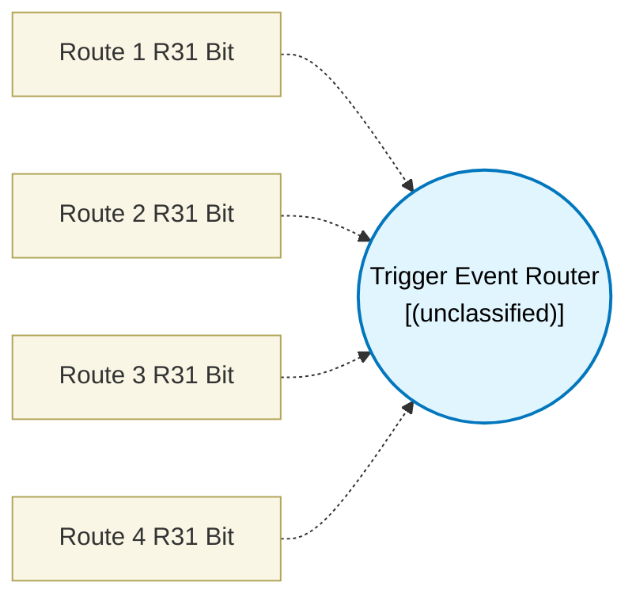

# Trigger Event Router (`trigger_router_block`) — Design Document

> Generated by `build_block_docs.js` from `.metadata/sysconfig/.meta/pru_blocks/data_handling/trigger_router_block.syscfg.js`. Do not edit by hand; re-run `node build_block_docs.js`.

## Purpose

_(no description in module)_

## Block Diagram




## Classification

- **Block id:** `trigger_router_block`
- **Category:** Data Handling
- **Execution model (inferred):** `(unclassified)`
- **Macro / opcode:** `m_trigger_router_block`
- **Data ports:** 0 in / 0 out · **Cycles:** `100`

## Parameter schema

| Parameter | Display name | Default | Options |
|---|---|---|---|
| `route1` | Route 1 R31 Bit | `255` | — |
| `route2` | Route 2 R31 Bit | `255` | — |
| `route3` | Route 3 R31 Bit | `255` | — |
| `route4` | Route 4 R31 Bit | `255` | — |

## Ports

| Port | Type |
|---|---|
| `prev` | `PREV` |

## Validation rules

- route1 must be 0..31 or 255
- route2 must be 0..31 or 255
- route3 must be 0..31 or 255
- route4 must be 0..31 or 255

## Generated macro (`.xdt` equivalent)

```asm
m_trigger_router_block	.macro RES, route1, route2, route3, route4
    ; Parameters: route1..4 (255 means unused)

trigger_router_loop?:
    .if (route1 < 32)
    qbbc  no_route_1?, R31, route1
    .if (route1 == 30)
    jal R29.w0, trigger_handler_30_start
    .elseif (route1 == 31)
    jal R29.w0, trigger_handler_31_start
    .endif
no_route_1?:
    .endif

    .if (route2 < 32)
    qbbc  no_route_2?, R31, route2
    .if (route2 == 30)
    jal R29.w0, trigger_handler_30_start
    .elseif (route2 == 31)
    jal R29.w0, trigger_handler_31_start
    .endif
no_route_2?:
    .endif

    .if (route3 < 32)
    qbbc  no_route_3?, R31, route3
    .if (route3 == 30)
    jal R29.w0, trigger_handler_30_start
    .elseif (route3 == 31)
    jal R29.w0, trigger_handler_31_start
    .endif
no_route_3?:
    .endif

    .if (route4 < 32)
    qbbc  no_route_4?, R31, route4
    .if (route4 == 30)
    jal R29.w0, trigger_handler_30_start
    .elseif (route4 == 31)
    jal R29.w0, trigger_handler_31_start
    .endif
no_route_4?:
    .endif

    ; Short delay between polling checks
    ldi   R0, 100
evaluation_delay?:
    sub   R0, R0, 1
    qbne  evaluation_delay?, R0, 0
    qba   trigger_router_loop?

    .endm
```

## Device portability

> **Source of truth:** `.metadata/sysconfig/.meta/pru_blocks/common/pru_device_caps.js` (TRM SPRUIM2J §6.4.1.1 / SPRUJB6 §7.3.1.1). Regenerated by `node build_block_docs.js` — do not edit by hand.

- **Required widget(s):** _(none)_
- **Validator:** `pru_blocks_static_module` raises a SysConfig **ERROR** naming both widget and device when a required widget is absent.

| Device (SoC) | Supported |
|---|---|
| `am243x` | ✅ |
| `am261x` | ✅ |
| `am263px` | ✅ |
| `am263x` | ✅ |
| `am64x` | ✅ |

## Outstanding TODO / VERIFY items

- None flagged in source.
