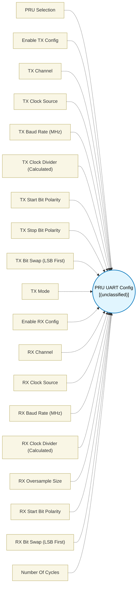

# PRU UART Config (`uart_config`) — Design Document

> Generated by `build_block_docs.js` on 2026-10-21 from `.metadata/sysconfig/.meta/pru_blocks/pru_io_blocks/uart_config.syscfg.js`. Do not edit by hand; re-run `node build_block_docs.js`.

## Purpose


## UART Config (Combined TX + RX Hardware Configuration)

### Purpose
Configures the PRU-ICSS ENDAT peripheral for UART TX, RX, or both. Run this block
**once at init**. A single Global Reinit covers both TX and RX setup.

Use the **UART TX Op** block for per-transmission operations and the
**UART RX Op** block for per-reception operations.

### Enable Checkboxes
- **Enable TX Config**: Show and apply TX configuration parameters
- **Enable RX Config**: Show and apply RX configuration parameters
- At least one must be enabled.

### Generated Sequence
1. Global Reinit (r31 bit 19) FIRST — flushes FIFO and state machines (TRM-mandated order)
2. Poll busy bit — deterministic wait for reinit completion
3. De-assert rx_en AFTER reinit — handles stuck rx_en from a previous run
4. GPCFG write — enable peripheral interface mode (once, shared by TX and RX)
5. *(if TX enabled)* TXCFG write, TX CH_CFG0 write, r30.w2 channel select + clk_mode=1
6. *(if RX enabled)* RXCFG write, RX CH_CFG0 write

### Notes
- TX and RX can use **different channels** (e.g. TX on CH0, RX on CH2)
- Only one instance of this block is allowed per design (`maxInstances: 1`)
- GPCFG is written once regardless of whether TX-only, RX-only, or both are enabled


## Block Diagram




## Classification

- **Block id:** `uart_config`
- **Category:** I/O & Protocol
- **Execution model (inferred):** `(unclassified)`
- **Macro / opcode:** `m_uart_config`
- **Data ports:** 0 in / 0 out · **Cycles:** `20`

## Parameter schema

| Parameter | Display name | Default | Options |
|---|---|---|---|
| `pruSelect` | PRU Selection | `NaN` | `0`, `1` |
| `enableTX` | Enable TX Config | `true` | — |
| `txChannel` | TX Channel | `0` | `0`, `1`, `2` |
| `txClockSource` | TX Clock Source | `0` | `0`, `1` |
| `txBaudRate` | TX Baud Rate (MHz) | `12` | — |
| `txClockDivider` | TX Clock Divider (Calculated) | `15` | — |
| `txStartBitPolarity` | TX Start Bit Polarity | `1` | `0`, `1` |
| `txStopBitPolarity` | TX Stop Bit Polarity | `0` | `0`, `1` |
| `txBitSwap` | TX Bit Swap (LSB First) | `true` | — |
| `txMode` | TX Mode | `Single-shot` | — |
| `enableRX` | Enable RX Config | `true` | — |
| `rxChannel` | RX Channel | `2` | `0`, `1`, `2` |
| `rxClockSource` | RX Clock Source | `0` | `0`, `1` |
| `rxBaudRate` | RX Baud Rate (MHz) | `12` | — |
| `rxClockDivider` | RX Clock Divider (Calculated) | `1` | — |
| `rxOversampleSize` | RX Oversample Size | `7` | `0`, `1`, `3`, `7` |
| `rxStartBitPolarity` | RX Start Bit Polarity | `1` | `0`, `1` |
| `rxBitSwap` | RX Bit Swap (LSB First) | `true` | — |
| `noOfCycles` | Number Of Cycles | `20` | — |

## Ports

| Port | Type |
|---|---|
| `prev` | `PREV` |
| `next` | `NEXT` |

## Validation rules

- At least one of TX Config or RX Config must be enabled.
- TX: Clock (<value> MHz) is not divisible by baudRate = <value> MHz.
- TX: Calculated clock divider (<value>) is out of range (0-65535).
- RX: Clock (<value> MHz) is not divisible by (baudRate * oversample) = <value>.
- RX: Calculated clock divider (<value>) is out of range (0-65535).

## Generated macro (`.xdt` equivalent)

```asm
; ========== ICSS CFG register definitions (auto-generated, guarded) ==========
    .if !$isdefed("ICSS_CFG")
    .asg    c4,     ICSS_CFG
    .endif
    .if !$isdefed("ICSS_CFG_GPCFG0")
ICSS_CFG_GPCFG0                 .set    0x0008
    .endif
    .if !$isdefed("ICSS_CFG_GPCFG1")
ICSS_CFG_GPCFG1                 .set    0x000C
    .endif
    .if !$isdefed("ICSS_CFG_PRU0_ENDAT_TXCFG")
ICSS_CFG_PRU0_ENDAT_TXCFG       .set    0x00E4
    .endif
    .if !$isdefed("ICSS_CFG_PRU1_ENDAT_TXCFG")
ICSS_CFG_PRU1_ENDAT_TXCFG       .set    0x0104
    .endif
    .if !$isdefed("ICSS_CFG_PRU0_ENDAT_RXCFG")
ICSS_CFG_PRU0_ENDAT_RXCFG       .set    0x00E0
    .endif
    .if !$isdefed("ICSS_CFG_PRU1_ENDAT_RXCFG")
ICSS_CFG_PRU1_ENDAT_RXCFG       .set    0x0100
    .endif
    .if !$isdefed("ICSS_CFG_PRU0_ENDAT_CH0_CFG0")
ICSS_CFG_PRU0_ENDAT_CH0_CFG0    .set    0x00E8
    .endif
    .if !$isdefed("ICSS_CFG_PRU0_ENDAT_CH1_CFG0")
ICSS_CFG_PRU0_ENDAT_CH1_CFG0    .set    0x00F0
    .endif
    .if !$isdefed("ICSS_CFG_PRU0_ENDAT_CH2_CFG0")
ICSS_CFG_PRU0_ENDAT_CH2_CFG0    .set    0x00F8
    .endif
    .if !$isdefed("ICSS_CFG_PRU1_ENDAT_CH0_CFG0")
ICSS_CFG_PRU1_ENDAT_CH0_CFG0    .set    0x0108
    .endif
    .if !$isdefed("ICSS_CFG_PRU1_ENDAT_CH1_CFG0")
ICSS_CFG_PRU1_ENDAT_CH1_CFG0    .set    0x0110
    .endif
    .if !$isdefed("ICSS_CFG_PRU1_ENDAT_CH2_CFG0")
ICSS_CFG_PRU1_ENDAT_CH2_CFG0    .set    0x0118
    .endif
; ============================================================================
m_uart_config	.macro  
	; UART Combined Config — PRU1

	; ========== Step 1: Global Reinit (TRM-mandated order: reinit BEFORE de-asserting rx_en) ==========
	; If rx_en was left HIGH by a previous stuck RX, reinit resets the RX state machine first.
	set     r31, r31, 19                       ; 1. Global Reinit — clears FIFO and state machines

	; ========== Step 2: Poll Reinit Busy Bit (channel 0) ==========
wait_reinit?:
	qbbs    wait_reinit?, r31, 5
	ldi     r30.b3, 0x00                       ; 3. De-assert rx_en AFTER reinit confirmed complete

	; ========== Step 3: GPCFG — Enable Peripheral Mode for PRU1 ==========
	ldi32   TEMP_REG1, 0x04000000
	ldi     TEMP_REG2.w0, ICSS_CFG_GPCFG1
	sbco    &TEMP_REG1, ICSS_CFG, TEMP_REG2.w0, 4

 .endm
```

## Device portability

> **Source of truth:** `.metadata/sysconfig/.meta/pru_blocks/common/pru_device_caps.js` (TRM SPRUIM2J §6.4.1.1 / SPRUJB6 §7.3.1.1). Regenerated by `node build_block_docs.js` — do not edit by hand.

- **Required widget(s):** _(none)_
- **Validator:** `pru_blocks_static_module` raises a SysConfig **ERROR** naming both widget and device when a required widget is absent.

| Device (SoC) | Supported |
|---|---|
| `am243x` | ✅ |
| `am261x` | ✅ |
| `am263px` | ✅ |
| `am263x` | ✅ |
| `am64x` | ✅ |

## Outstanding TODO / VERIFY items

- None flagged in source.
