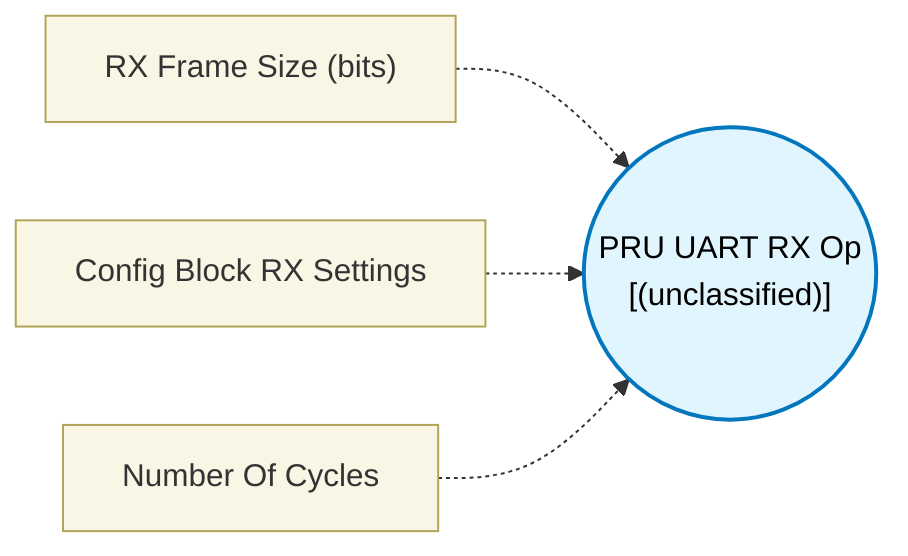

# PRU UART RX Op (`uart_rx_op`) — Design Document

> Generated by `build_block_docs.js` on 2026-10-21 from `.metadata/sysconfig/.meta/pru_blocks/pru_io_blocks/uart_rx_op.syscfg.js`. Do not edit by hand; re-run `node build_block_docs.js`.

## Purpose


## UART RX Op (Per-Reception Operation)

### Purpose
Receives one UART frame using the ENDAT peripheral. This block handles only the
per-reception work: assert rx_en, poll and accumulate all frameSize bits,
extract data, de-assert rx_en. **The `UART Config` block (with RX Config enabled)
must appear earlier in the control flow** to set up the peripheral registers before
this block is called.

### Generated Sequence
1. Assert rx_en for the configured channel (R30[26/25/24] for CH2/CH1/CH0)
2. Loop frameSize times: poll valid flag (R31[26/25/24]), read middle oversample bit from R31 byte, clear flag, accumulate into output register
3. Extract data — shift to align, remove start and stop bits, mask to data width
4. De-assert rx_en (R30.b3 = 0x00)

### No Peripheral Register Writes
No GPCFG, RXCFG, or CH_CFG0 writes — those are handled once by `UART Config`.
This means the op block is fast and suitable for repeated calls in a loop.

### Output Port
The output register size depends on the configured RX Frame Size:

| Frame Size | Data Bits | Output Port Type | Register(s) |
|------------|-----------|------------------|-------------|
| 3–32 bits  | 1–30 bits | **32-bit** (output32) | 1 register (Rx) |
| 33–64 bits | 31–62 bits | **64-bit** (output64) | 2 registers (Rx:Rx+1) |

- **output1** (32-bit mode): received data word in a single dynamically allocated register
- **output1** (64-bit mode): received data in two consecutive registers — lower 32 bits in the allocated register, upper bits in the next register

### Configuration
All parameters are automatically read from the paired `UART Config` block — no
duplicate settings needed here. Only `RX Frame Size` is set on this block directly,
since it determines the output port type (32-bit vs 64-bit) which the register
allocator needs to know at design time.

### RX Frame Size
- Total bits per frame = data bits + 2 (start bit + stop bit)
- Standard UART 8-bit: frameSize = 10
- 16-bit payload: frameSize = 18
- frameSize > 32 activates extended mode (two output registers, 64-bit output port)

### Calculation Example
- UART Config: 192 MHz clock, 12 MHz baud, 8x oversample
- RX Clock = 192 / (clockDiv+1) = 192 / 2 = 96 MHz
- Baud Rate = 96 MHz / 8 = 12 MHz ✓
- frameSize = 18 → 16 data bits → 32-bit output port (fits in one register)

### Terminology
- **Valid Flag**: R31 status bit set by hardware when an oversampled bit is ready to read
- **Middle Sample**: For 8x oversample the middle sample is bit 4 of the 8-sample window — most noise-immune point
- **Extended Mode**: frameSize ≥ 33 → data bits ≥ 31 → requires two consecutive output registers
- **rx_en**: R30[26:24] — enables reception on the selected channel; asserting it starts the hardware

---


## Block Diagram




## Classification

- **Block id:** `uart_rx_op`
- **Category:** I/O & Protocol
- **Execution model (inferred):** `(unclassified)`
- **Macro / opcode:** `m_uart_rx_op`
- **Data ports:** 0 in / 0 out · **Cycles:** `60`

## Parameter schema

| Parameter | Display name | Default | Options |
|---|---|---|---|
| `rxFrameSize` | RX Frame Size (bits) | `10` | — |
| `configInfo` | Config Block RX Settings | `No config block found` | — |
| `noOfCycles` | Number Of Cycles | `60` | — |

## Ports

| Port | Type |
|---|---|
| `output1` | `output32` |
| `prev` | `PREV` |
| `next` | `NEXT` |

## Validation rules

- A UART Config block is required before using UART RX Op.
- The UART Config block does not have RX Config enabled.
- All UART RX Op blocks must have the same RX Frame Size value.

## Generated macro (`.xdt` equivalent)

```asm
m_uart_rx_op	.macro  dataByteRegLo, channel, clockDiv, rxClkSel, oversample, startBitPol, frameSize, bitSwap
	; UART RX Op — no peripheral config writes
	; uart_config block must be called before this block

	; ========== Enable RX for selected channel ==========
	.if channel == 0
	ldi     r30.b3, 0x01                       ; rx_en0 (bit24)
	.elseif channel == 1
	ldi     r30.b3, 0x02                       ; rx_en1 (bit25)
	.else
	ldi     r30.b3, 0x04                       ; rx_en2 (bit26)
	.endif

	ldi     TEMP_REG1, 0
	ldi     TEMP_REG2.b0, 0

rx_bit_loop?:
	; Poll valid flag for selected channel
	.if channel == 0
	qbbc    rx_bit_loop?, r31, 24              ; val0 — CH0
	mov     TEMP_REG2.b1, r31.b0           ; rx_data_out0
	set     r31, r31, 24                       ; clear val0
	.elseif channel == 1
	qbbc    rx_bit_loop?, r31, 25              ; val1 — CH1
	mov     TEMP_REG2.b1, r31.b1           ; rx_data_out1
	set     r31, r31, 25                       ; clear val1
	.else
	qbbc    rx_bit_loop?, r31, 26              ; val2 — CH2
	mov     TEMP_REG2.b1, r31.b2           ; rx_data_out2
	set     r31, r31, 26                       ; clear val2
	.endif

	qbbs    set_bit?, TEMP_REG2.b1, 4
	lsl     TEMP_REG1, TEMP_REG1, 1
	qba     next_bit?
set_bit?:
	lsl     TEMP_REG1, TEMP_REG1, 1
	set     TEMP_REG1, TEMP_REG1, 0
next_bit?:
	add     TEMP_REG2.b0, TEMP_REG2.b0, 1
	qbgt    rx_bit_loop?, TEMP_REG2.b0, frameSize

	; Extract data (standard MSB): remove stop bit, mask data bits
	lsr     dataByteRegLo, TEMP_REG1, 1
	ldi     TEMP_REG2, 1
	lsl     TEMP_REG2, TEMP_REG2, (frameSize - 2)
	sub     TEMP_REG2, TEMP_REG2, 1
	and     dataByteRegLo, dataByteRegLo, TEMP_REG2

	; ========== Disable rx_en ==========
	ldi     r30.b3, 0x00

 .endm
```

## Device portability

> **Source of truth:** `.metadata/sysconfig/.meta/pru_blocks/common/pru_device_caps.js` (TRM SPRUIM2J §6.4.1.1 / SPRUJB6 §7.3.1.1). Regenerated by `node build_block_docs.js` — do not edit by hand.

- **Required widget(s):** _(none)_
- **Validator:** `pru_blocks_static_module` raises a SysConfig **ERROR** naming both widget and device when a required widget is absent.

| Device (SoC) | Supported |
|---|---|
| `am243x` | ✅ |
| `am261x` | ✅ |
| `am263px` | ✅ |
| `am263x` | ✅ |
| `am64x` | ✅ |

## Outstanding TODO / VERIFY items

- None flagged in source.
