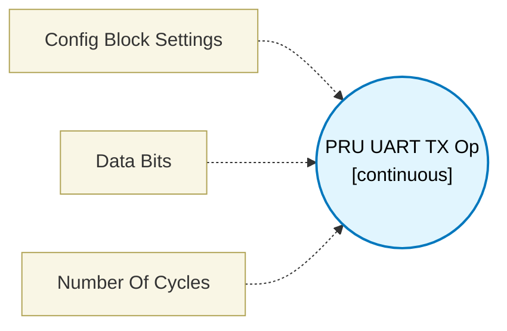

# PRU UART TX Op (`uart_tx_op`) — Design Document

> Generated by `build_block_docs.js` from `.metadata/sysconfig/.meta/pru_blocks/pru_io_blocks/uart_tx_op.syscfg.js`. Do not edit by hand; re-run `node build_block_docs.js`.

## Purpose


## UART TX Op (Per-Transmission Operation)

### Purpose
Transmits one UART frame using the ENDAT peripheral. This block handles only the
per-transmission work: frame construction, FIFO loading, start trigger, and wait for
TX complete. **The `UART Config` block (with TX Config enabled) must appear earlier in
the control flow** to set up the peripheral registers before this block is called.

### Generated Sequence
1. Per-command reinit (R31 bit 19) — clears FIFO and state machines (TRM-mandated order: reinit before de-asserting rx_en)
2. Poll reinit busy bit (R31[5/13/21] for CH0/CH1/CH2)
3. De-assert rx_en (R30.b3 = 0x00)
4. Channel select + clk_mode write to R30.w2
5. Frame construction — insert start bit, shift data bits, insert stop bit (LSB or MSB order)
6. FIFO load — 1–4 bytes for single-shot (dataBits ≤ 29); 4 bytes + continuous polling for dataBits 30–32; 4 bytes + byte 5 polling for dataBits 33–62
7. Start transmission (R31 bit 18 = tx_channel_go)
8. Wait for TX complete (poll R31[5/13/21] busy bit)

### No Peripheral Register Writes
No GPCFG, TXCFG, or CH_CFG0 writes — those are handled once by `UART Config`.
This means the op block is suitable for repeated calls in a loop with minimal overhead.

### Input Port
The input register size depends on the configured Data Bits:

| Data Bits | Input Port Type | Register(s) |
|-----------|-----------------|-------------|
| 1–32 bits | **32-bit** (input32) | 1 register (Rx) |
| 33–62 bits | **64-bit** (input64) | 2 consecutive registers (Rx:Rx+1) |

- **input1** (32-bit mode): data word to transmit in a single register
- **input1** (64-bit mode): data in two consecutive registers — lower 32 bits in the allocated register, upper bits in the next register

### Configuration
All TX parameters (channel, baud rate, bit order, start/stop polarity) are automatically
read from the paired `UART Config` block. Only `Data Bits` is set on this block directly,
since it determines the input port type (32-bit vs 64-bit) which the register allocator
needs to know at design time.

### Data Bits
- Number of payload bits to transmit (excluding start and stop bits)
- Range: 1–62
- dataBits ≤ 29: single-shot mode, 1–4 FIFO bytes
- dataBits 30–32: specific-bit mode, 4–5 FIFO bytes
- dataBits 33–62: continuous mode, 5+ FIFO bytes with polling

### Calculation Example
- UART Config: 192 MHz clock, 12 MHz baud, LSB first, start=1, stop=0
- Data Bits: 16 → frame = start(1) + 16 data bits + stop(0) = 18 bits → 3 FIFO bytes
- Frame size written to CH_CFG0 by config block: 18 (dataBits + 2)

### Terminology
- **Per-command Reinit**: Reinit triggered before every TX to clear FIFO and reset state machines
- **FIFO**: 32-bit TX FIFO in the ENDAT peripheral — data bytes pushed via R30[7:0]
- **tx_channel_go**: R31 bit 18 — triggers transmission of the loaded FIFO content
- **Busy bit**: R31[5/13/21] — 1 = last bit still on wire, 0 = TX complete
- **Single-shot**: TX_FRAME_SIZE set in CH_CFG0 — hardware stops after exactly that many bits
- **Continuous mode**: TX_FRAME_SIZE = 0 — hardware transmits until FIFO is empty

---


## Block Diagram




## Classification

- **Block id:** `uart_tx_op`
- **Category:** I/O & Protocol
- **Execution model (inferred):** `continuous`
- **Macro / opcode:** `m_uart_tx_op`
- **Data ports:** 1 in / 0 out · **Cycles:** `9`

## Parameter schema

| Parameter | Display name | Default | Options |
|---|---|---|---|
| `configInfo` | Config Block Settings | `No config block found` | — |
| `dataBits` | Data Bits | `8` | — |
| `noOfCycles` | Number Of Cycles | `9` | — |

## Ports

| Port | Type |
|---|---|
| `input1` | `input32` |
| `prev` | `PREV` |
| `next` | `NEXT` |

## Validation rules

- A UART Config block is required before using UART TX Op.
- The UART Config block does not have TX Config enabled.
- All UART TX Op blocks must have the same Data Bits value.

## Generated macro (`.xdt` equivalent)

```asm
m_uart_tx_op	.macro  dataRegLo, channel, dataBits
	; Parameters:
	;   dataRegLo       - Register containing data (up to 29 bits)
	;   channel         - ENDAT channel (0, 1, or 2) - must match uart_tx_config channel
	;   dataBits        - Number of data bits to transmit (1-29)
	; Configuration: MSB first, start bit=0, stop bit=1
	; Mode: Single-shot (frame size <= 31 bits), FIFO loads: 2 bytes
	; NOTE: uart_tx_config block must be called before this block to set up the peripheral

	; ========== Per-command Reinit (reinit BEFORE de-asserting rx_en — TRM order) ==========
	; Clears FIFO, resets state machines, handles stuck rx_en from a previous incomplete RX.
	set     r31, r31, 19                       ; 1. Global Reinit FIRST
	.if channel == 0
wait_reinit?:
	qbbs    wait_reinit?, r31, 5               ; 2. Wait — CH0 busy bit
	.elseif channel == 1
wait_reinit?:
	qbbs    wait_reinit?, r31, 13              ; 2. Wait — CH1 busy bit
	.else
wait_reinit?:
	qbbs    wait_reinit?, r31, 21              ; 2. Wait — CH2 busy bit
	.endif
	ldi     r30.b3, 0x00                       ; 3. De-assert rx_en AFTER reinit

	; ========== Select Channel + clk_mode=1 ==========
	; clk_mode=1: free-running, stops HIGH after last RX frame.
	; Keeps clock running after TX so the encoder can clock its response back.
	.if channel == 0
	ldi     r30.w2, 0x0008                    ; clk_mode=1 (bits[20:19]=0b01), ch=0
	.elseif channel == 1
	ldi     r30.w2, 0x0009                    ; clk_mode=1, ch=1
	.else
	ldi     r30.w2, 0x000A                    ; clk_mode=1, ch=2
	.endif

	; ========== Construct Frame ==========
	mov     TEMP_REG1, dataRegLo
	lsl     TEMP_REG1, TEMP_REG1, (31 - dataBits)  ; Align data to MSB
	clr     TEMP_REG1, TEMP_REG1, 31             ; Clear start bit at position 31
	set     TEMP_REG1, TEMP_REG1, (31 - dataBits - 1)  ; Set stop bit

	; ========== Load FIFO ==========
	mov     r30.b0, TEMP_REG1.b3
	mov     r30.b0, TEMP_REG1.b2

	; ========== Start Transmission ==========
	set     r31, r31, 18

	; ========== Wait for TX Complete ==========
	.if channel == 0
wait_tx_done?:
	qbbs    wait_tx_done?, r31, 5
	.elseif channel == 1
wait_tx_done?:
	qbbs    wait_tx_done?, r31, 13
	.else
wait_tx_done?:
	qbbs    wait_tx_done?, r31, 21
	.endif

 .endm
```

## Device portability

> **Source of truth:** `.metadata/sysconfig/.meta/pru_blocks/common/pru_device_caps.js` (TRM SPRUIM2J §6.4.1.1 / SPRUJB6 §7.3.1.1). Regenerated by `node build_block_docs.js` — do not edit by hand.

- **Required widget(s):** _(none)_
- **Validator:** `pru_blocks_static_module` raises a SysConfig **ERROR** naming both widget and device when a required widget is absent.

| Device (SoC) | Supported |
|---|---|
| `am243x` | ✅ |
| `am261x` | ✅ |
| `am263px` | ✅ |
| `am263x` | ✅ |
| `am64x` | ✅ |

## Outstanding TODO / VERIFY items

- None flagged in source.
