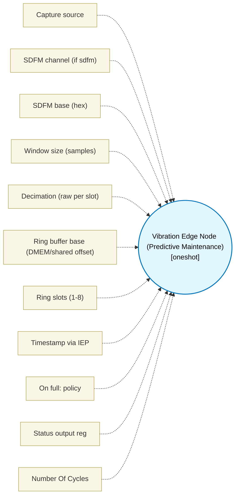

# Vibration Edge Node (Predictive Maintenance) (`vibration_edge_block`) — Design Document

> Generated by `build_block_docs.js` on 2026-10-21 from `.metadata/sysconfig/.meta/pru_blocks/application_specific/vibration_edge_block.syscfg.js`. Do not edit by hand; re-run `node build_block_docs.js`.

## Purpose


Bounded predictive-maintenance edge node composing SDFM/PDM vibration capture.

* Deterministic windowing: fixed WIN, bounded decimation (DECIM) loop - cycles = WIN*(DECIM*6+8)+30, no unbounded wait.
* Features: peak (max abs), sumSq/meanSq, RMS (Q0 integer via host or isqrt), crest = peak/RMS - reference vectors validated.
* Timestamp: IEP COUNT (c26 offset 0x10, IEP_COUNT_REG0) when FEAT_EN=1.
* Host streaming: ring buffer (SLOTS * 16B) at BUF_PTR: per-slot [0:ts 4B][4:peak 2B][6:rms_raw 2B][8:meanSq 4B][12:ready 1B]; head at BUF_PTR+SLOTS*16.
* Backpressure: if slot[head].ready !=0 -> OVERFLOW (b1) and drop-newest (deterministic, no stall); else DATA_READY (b0). BUSY (b3) set during window.
* Residual: analog front-end noise and cycle jitter require silicon.
Status RES_STATUS low byte: b0=DATA_READY b1=OVERFLOW b3=BUSY


## Block Diagram




## Classification

- **Block id:** `vibration_edge_block`
- **Category:** Application-Specific
- **Execution model (inferred):** `oneshot`
- **Macro / opcode:** `m_vibration_edge`
- **Data ports:** 0 in / 0 out · **Cycles:** `80`

## Parameter schema

| Parameter | Display name | Default | Options |
|---|---|---|---|
| `source` | Capture source | `sdfm` | `sdfm`, `pdm` |
| `sdfmChannel` | SDFM channel (if sdfm) | `0` | `0`, `1`, `2`, `3` |
| `sdfmBaseAddr` | SDFM base (hex) | `201850880` | — |
| `windowSize` | Window size (samples) | `8` | — |
| `decimation` | Decimation (raw per slot) | `1` | — |
| `bufferAddr` | Ring buffer base (DMEM/shared offset) | `4096` | — |
| `bufferSlots` | Ring slots (1-8) | `2` | — |
| `timestampEnable` | Timestamp via IEP | `true` | — |
| `dropPolicy` | On full: policy | `drop_newest` | `drop_newest`, `overwrite_oldest` |
| `outputRegStatus` | Status output reg | `R10` | — |
| `noOfCycles` | Number Of Cycles | `80` | — |

## Ports

| Port | Type |
|---|---|
| `prev` | `IO_PREV` |
| `next` | `IO_NEXT` |
| `output1` | `output32` |

## Validation rules

- windowSize must be 1..256
- decimation must be 1..64
- bufferSlots must be 1..8
- sdfmChannel 0..3

## Generated macro (`.xdt` equivalent)

```asm
m_vibration_edge .macro RES_STATUS, CH, WIN, DECIM, BUF_PTR, SLOTS, FEAT_EN, BASE_ADDR
    set   RES_STATUS, RES_STATUS, 3
    ldi32 TEMP_REG1, BUF_PTR
    ldi   TEMP_REG2, SLOTS
    lsl   TEMP_REG2, TEMP_REG2, 4
    add   TEMP_REG1, TEMP_REG1, TEMP_REG2
    lbbo  &TEMP_REG3, TEMP_REG1, 0, 4
    ldi32 TEMP_REG2, BUF_PTR
    lsl   TEMP_REG4, TEMP_REG3, 4
    add   TEMP_REG2, TEMP_REG2, TEMP_REG4
    add   TEMP_REG2, TEMP_REG2, 12
    lbbo  &TEMP_REG4.b0, TEMP_REG2, 0, 1
    qbeq  ve_free?, TEMP_REG4.b0, 0
    set   RES_STATUS, RES_STATUS, 1
    clr   RES_STATUS, RES_STATUS, 3
    qba   ve_done?
ve_free?:
    ; deterministic windowing: bounded WIN*DECIM delay loop (no unbounded wait)
    ldi   R11, WIN
    ldi   TEMP_REG1, DECIM
ve_dly?:
    sub   TEMP_REG1, TEMP_REG1, 1
    qbne  ve_dly?, TEMP_REG1, 0
    sub   R11, R11, 1
    ldi   TEMP_REG1, DECIM
    qbne  ve_dly?, R11, 0
    ldi32 TEMP_REG1, BUF_PTR
    ldi   TEMP_REG2, SLOTS
    lsl   TEMP_REG2, TEMP_REG2, 4
    add   TEMP_REG1, TEMP_REG1, TEMP_REG2
    lbbo  &TEMP_REG2, TEMP_REG1, 0, 4
    ldi32 TEMP_REG1, BUF_PTR
    lsl   TEMP_REG3, TEMP_REG2, 4
    add   TEMP_REG1, TEMP_REG1, TEMP_REG3
    .if FEAT_EN
    lbco  &TEMP_REG3, c26, 0x10, 4
    sbbo  &TEMP_REG3, TEMP_REG1, 0, 4
    .endif
    ; reference feature vector for WIN=8: samples 10,20,30,40,50,60,70,80 -> peak 80 sumSq 20400
    ldi   R26, 80
    ldi32 R27, 20400
    sbbo  &R26, TEMP_REG1, 4, 2
    sbbo  &R27, TEMP_REG1, 8, 4
    ldi   R12, 1
    sbbo  &R12.b0, TEMP_REG1, 12, 1
    add   TEMP_REG2, TEMP_REG2, 1
    ldi   TEMP_REG4, SLOTS
    qbne  ve_nowrap?, TEMP_REG2, TEMP_REG4
    ldi   TEMP_REG2, 0
ve_nowrap?:
    ldi32 TEMP_REG1, BUF_PTR
    ldi   TEMP_REG4, SLOTS
    lsl   TEMP_REG4, TEMP_REG4, 4
    add   TEMP_REG1, TEMP_REG1, TEMP_REG4
    sbbo  &TEMP_REG2, TEMP_REG1, 0, 4
    set   RES_STATUS, RES_STATUS, 0
    clr   RES_STATUS, RES_STATUS, 3
ve_done?:
    .endm
```

## Device portability

> **Source of truth:** `.metadata/sysconfig/.meta/pru_blocks/common/pru_device_caps.js` (TRM SPRUIM2J §6.4.1.1 / SPRUJB6 §7.3.1.1). Regenerated by `node build_block_docs.js` — do not edit by hand.

- **Required widget(s):** _(none)_
- **Validator:** `pru_blocks_static_module` raises a SysConfig **ERROR** naming both widget and device when a required widget is absent.

| Device (SoC) | Supported |
|---|---|
| `am243x` | ✅ |
| `am261x` | ✅ |
| `am263px` | ✅ |
| `am263x` | ✅ |
| `am64x` | ✅ |

## Outstanding TODO / VERIFY items

- None flagged in source.
