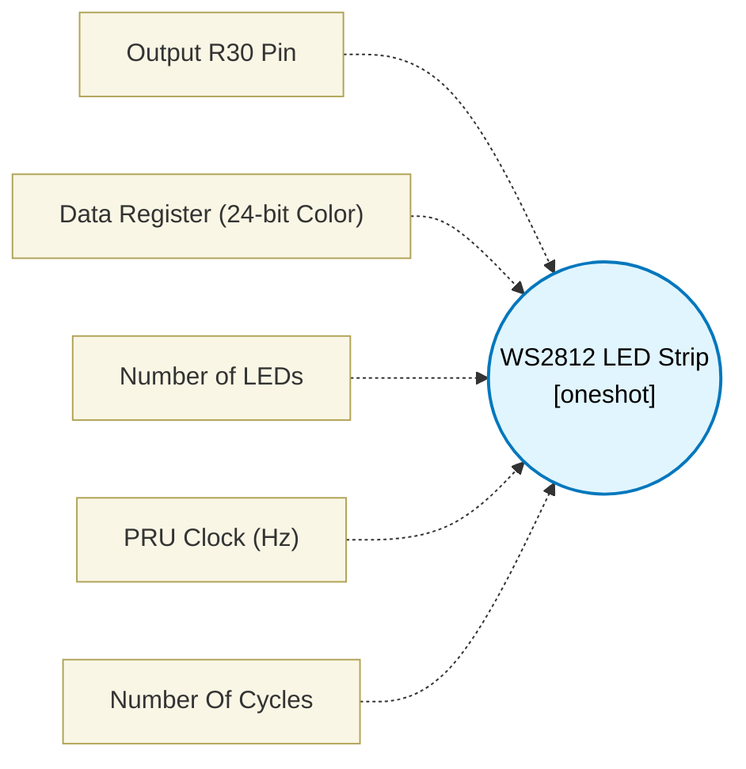

# WS2812 LED Strip (`ws2812_block`) — Design Document

> Generated by `build_block_docs.js` from `.metadata/sysconfig/.meta/pru_blocks/pru_io_blocks/ws2812_block.syscfg.js`. Do not edit by hand; re-run `node build_block_docs.js`.

## Purpose

Emits precise cycle-timed bit-banging assembly for WS2812 LEDs. The 24-bit color register is sent bit 23 first in GRB packing (bits 23-16 green, bits 15-8 red, bits 7-0 blue).

## Block Diagram




## Classification

- **Block id:** `ws2812_block`
- **Category:** I/O & Protocol
- **Execution model (inferred):** `oneshot`
- **Macro / opcode:** `m_ws2812_tx`
- **Data ports:** 0 in / 1 out · **Cycles:** `1`

## Parameter schema

| Parameter | Display name | Default | Options |
|---|---|---|---|
| `pinId` | Output R30 Pin | `5` | `0`, `1`, `2`, `3`, `4`, `5`, `6`, `7`, `8`, `9`, `10`, `11`, `12`, `13`, `14`, `15`, `16`, `17`, `18`, `19` |
| `dataRegister` | Data Register (24-bit Color) | `R0` | — |
| `numLeds` | Number of LEDs | `10` | — |
| `clkHz` | PRU Clock (Hz) | `200000000` | — |
| `noOfCycles` | Number Of Cycles | `1` | — |

## Ports

| Port | Type |
|---|---|
| `output1` | `output32` |
| `prev` | `IO_PREV` |
| `next` | `IO_NEXT` |

## Validation rules

- numLeds must be > 0
- clkHz must be > 0

## Generated macro (`.xdt` equivalent)

```asm
m_ws2812_tx .macro RES, PIN, DATA_REG, NUM_LEDS, T0H_CYC, T0L_CYC, T1H_CYC, T1L_CYC, TRESET_CYC
    clr   R30, R30, PIN
    ldi32 TEMP_REG1, TRESET_CYC
ws_rs?:
    sub   TEMP_REG1, TEMP_REG1, 1
    qbne  ws_rs?, TEMP_REG1, 0
    lsl   DATA_REG, DATA_REG, 1
    ldi   TEMP_REG2.w0, NUM_LEDS
ws_ll?:
    ldi   TEMP_REG2.b2, 24
ws_bl?:
    lsr   TEMP_REG1, DATA_REG, TEMP_REG2.b2
    and   TEMP_REG1, TEMP_REG1, 1
    qbeq  ws_z?, TEMP_REG1, 0
    set   R30, R30, PIN
    ldi32 TEMP_REG1, T1H_CYC
ws_1h?:
    sub   TEMP_REG1, TEMP_REG1, 1
    qbne  ws_1h?, TEMP_REG1, 0
    clr   R30, R30, PIN
    ldi32 TEMP_REG1, T1L_CYC
ws_1l?:
    sub   TEMP_REG1, TEMP_REG1, 1
    qbne  ws_1l?, TEMP_REG1, 0
    qba   ws_bd?
ws_z?:
    set   R30, R30, PIN
    ldi32 TEMP_REG1, T0H_CYC
ws_0h?:
    sub   TEMP_REG1, TEMP_REG1, 1
    qbne  ws_0h?, TEMP_REG1, 0
    clr   R30, R30, PIN
    ldi32 TEMP_REG1, T0L_CYC
ws_0l?:
    sub   TEMP_REG1, TEMP_REG1, 1
    qbne  ws_0l?, TEMP_REG1, 0
ws_bd?:
    mov   TEMP_REG1, TEMP_REG1
    sub   TEMP_REG2.b2, TEMP_REG2.b2, 1
    qbne  ws_bl?, TEMP_REG2.b2, 0
    sub   TEMP_REG2.w0, TEMP_REG2.w0, 1
    qbne  ws_ll?, TEMP_REG2.w0, 0
    lsr   DATA_REG, DATA_REG, 1
    .endm
```

## Device portability

> **Source of truth:** `.metadata/sysconfig/.meta/pru_blocks/common/pru_device_caps.js` (TRM SPRUIM2J §6.4.1.1 / SPRUJB6 §7.3.1.1). Regenerated by `node build_block_docs.js` — do not edit by hand.

- **Required widget(s):** _(none)_
- **Validator:** `pru_blocks_static_module` raises a SysConfig **ERROR** naming both widget and device when a required widget is absent.

| Device (SoC) | Supported |
|---|---|
| `am243x` | ✅ |
| `am261x` | ✅ |
| `am263px` | ✅ |
| `am263x` | ✅ |
| `am64x` | ✅ |

## Outstanding TODO / VERIFY items

- None flagged in source.
