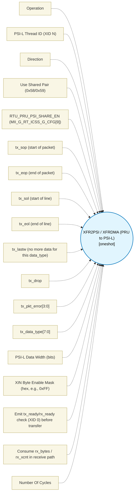

# XFR2PSI / XFRDMA (PRU to PSI-L) (`xfr2psi_block`) — Design Document

> Generated by `build_block_docs.js` on 2026-10-21 from `.metadata/sysconfig/.meta/pru_blocks/pru_io_blocks/xfr2psi_block.syscfg.js`. Do not edit by hand; re-run `node build_block_docs.js`.

## Purpose

Translates between XFR bus and PSI-L busses (SPRUIM2J 6.4.6.3.2). XID 0 is status; XID N selects PSI-L thread N. Up to 32 threads, width 64/128/256 bits. Table 6-60 broadside IDs 0x50-0x53 (four copies, RTU_PRU1/0+PRU1/0) plus shared pair 0x58/0x59 (RTU only, needs RTU_PRU_PSI_SHARE_EN).

## Block Diagram




## Classification

- **Block id:** `xfr2psi_block`
- **Category:** I/O & Protocol
- **Execution model (inferred):** `oneshot`
- **Macro / opcode:** `m_xfr2psi_run`
- **Data ports:** 0 in / 0 out · **Cycles:** `3`

## Parameter schema

| Parameter | Display name | Default | Options |
|---|---|---|---|
| `operation` | Operation | `send` | `configure`, `send`, `receive`, `status` |
| `threadId` | PSI-L Thread ID (XID N) | `0` | — |
| `direction` | Direction | `tx` | `tx`, `rx` |
| `useSharedPair` | Use Shared Pair (0x58/0x59) | `false` | — |
| `rtuPruPsiShareEn` | RTU_PRU_PSI_SHARE_EN (MII_G_RT_ICSS_G_CFG[9]) | `false` | — |
| `txSop` | tx_sop (start of packet) | `false` | — |
| `txEop` | tx_eop (end of packet) | `false` | — |
| `txSol` | tx_sol (start of line) | `false` | — |
| `txEol` | tx_eol (end of line) | `false` | — |
| `txLastw` | tx_lastw (no more data for this data_type) | `false` | — |
| `txDrop` | tx_drop | `false` | — |
| `txPktError` | tx_pkt_error[3:0] | `0` | — |
| `txDataType` | tx_data_type[7:0] | `0` | — |
| `dataWidth` | PSI-L Data Width (bits) | `64` | `64`, `128`, `256` |
| `xinByteEnableMask` | XIN Byte Enable Mask (hex, e.g., 0xFF) | `0xFF` | — |
| `checkReady` | Emit tx_ready/rx_ready check (XID 0) before transfer | `true` | — |
| `consumeRxBytes` | Consume rx_bytes / rx_xcnt in receive path | `true` | — |
| `noOfCycles` | Number Of Cycles | `3` | — |

## Ports

| Port | Type |
|---|---|
| `input1` | `input32` |
| `output1` | `output32` |
| `prev` | `IO_PREV` |
| `next` | `IO_NEXT` |

## Validation rules

- threadId <value> is outside the valid range 0..31 for PSI-L thread N (XID N)
- Shared pair 0x58/0x59 is reachable from RTU_PRU only (Table 6-60), but placed core is '<value>'
- Shared pair 0x58/0x59 selected but RTU_PRU_PSI_SHARE_EN (MII_G_RT_ICSS_G_CFG[9]) is not asserted — access will be a silent no-op
- txPktError must be 0..15 (4-bit field, bits 11:8)
- txDataType must be 0..255 (8-bit field, bits 23:16)
- xinByteEnableMask must be a non-negative integer mask (e.g., 0xFF)
- XIN byte enables must be contiguous — mask <value> has gaps. The XFRDMA does not account for gaps (SPRUIM2J 6.4.6.3.2.1.4.1)
- XIN byte enable count (<value>) exceeds configured dataWidth <value> bits (<value> bytes)
- Receive path must consume rx_bytes/rx_xcnt — an XIN from an empty FIFO returns ALL ZEROS with rx_bytes=0 and signals nothing else (SPRUIM2J 6.4.6.3.2.3.1)
- XOUT to a full TX FIFO STALLS until PSI-L drains — generator must either emit tx_ready/rx_ready check (XID 0) before transfer or declare stall in cycle model (noOfCycles=-1). checkReady=false with fixed noOfCycles=<value> ignores backpressure

## Generated macro (`.xdt` equivalent)

```asm
m_xfr2psi_run .macro RES, PAYLOAD, THREAD_ID, IS_TX, TX_SOP, TX_EOP, TX_SOL, TX_EOL, TX_LASTW, TX_DROP, TX_PKT_ERR, TX_DATA_TYPE, USE_SHARED, SHARE_EN, BYTE_MASK, CHECK_READY, CONSUME_RX
    ; XFR2PSI — PRU to PSI-L via XFRDMA (SPRUIM2J 6.4.6.3.2). R5:R1 is xfr_psi_wdata/rdata; bs_addr[7:4]=0x5. XID 0=status, XID N=thread N. Table 6-109 header word0 bit0 tx_sop bit1 tx_eop bit2 tx_sol bit3 tx_eol bit4 tx_lastw bit5 tx_drop bits11:8 tx_pkt_error bits23:16 tx_data_type. Big-endian, byte enables must be contiguous, XOUT stalls if FIFO full, XIN returns zeros with rx_bytes=0 if empty.
    .endm
```

## Device portability

> **Source of truth:** `.metadata/sysconfig/.meta/pru_blocks/common/pru_device_caps.js` (TRM SPRUIM2J §6.4.1.1 / SPRUJB6 §7.3.1.1). Regenerated by `node build_block_docs.js` — do not edit by hand.

- **Required widget(s):** `xfr2psi`
- **Validator:** `pru_blocks_static_module` raises a SysConfig **ERROR** naming both widget and device when a required widget is absent.

| Device (SoC) | Supported |
|---|---|
| `am243x` | ✅ |
| `am261x` | ❌ xfr2psi |
| `am263px` | ❌ xfr2psi |
| `am263x` | ❌ xfr2psi |
| `am64x` | ✅ |

## Outstanding TODO / VERIFY items

- None flagged in source.
