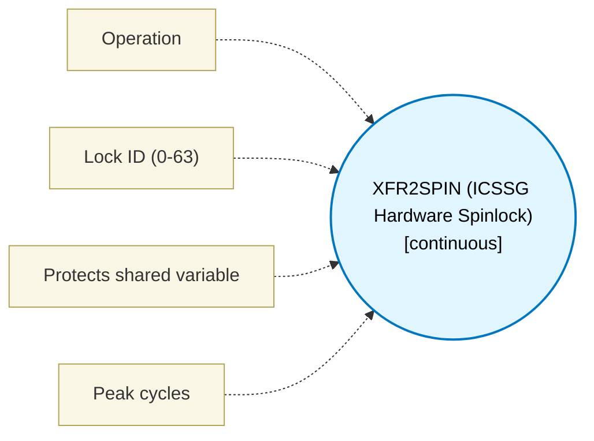

# XFR2SPIN (ICSSG Hardware Spinlock) (`xfr2spin_block`) — Design Document

> Generated by `build_block_docs.js` from `.metadata/sysconfig/.meta/pru_blocks/pru_io_blocks/xfr2spin_block.syscfg.js`. Do not edit by hand; re-run `node build_block_docs.js`.

## Purpose

Takes and drops one of the 64 ICSSG ownership flags through the internal spinlock broadside port (SPRUIM2J Table 6-60: XFR2SPIN 0x90, one copy per PRU_ICSSG subsystem; 6.4.6.2.9: 64 flags shared by SLICE0 and SLICE1, reachable by all six PRU cores). Directions follow Table 6-98's INT_SPIN_ID rows exactly: the flag is selected by writing R1.b0[5:0] (continuously snooped - never XOUT'd), an XIN against 0x90 raises the arbitration event and returns ownership in R1.b3[0], and an XOUT against 0x90 clears the flag. An XOUT is therefore a RELEASE on this device, never a request - the opposite convention to the external spinlock IDs 0x91/0x92. 'acquire' spins until it wins and reports its cycle budget as unknown, because the wait is set by another core; 'try_acquire' makes one attempt and returns the ownership bit. Arbitration is fixed-priority, not fair. This is an ICSSG widget: ICSSM (AM261x/AM263Px) has no spinlock and there is no software fallback, which requiresWidget states. Maturity is 'assembles': the emitted macros are assembled by clpru from genuinely SysConfig-generated output and executed against a TRM-derived 0x90 model in scripts/simulator.js. That model and this block were both written from SPRUIM2J, so the simulator arm is not an independent oracle and makes no silicon claim.

## Block Diagram




## Classification

- **Block id:** `xfr2spin_block`
- **Category:** I/O & Protocol
- **Execution model (inferred):** `continuous`
- **Macro / opcode:** `m_xfr2spin_acquire`
- **Data ports:** 0 in / 1 out · **Cycles:** `-1`

## Parameter schema

| Parameter | Display name | Default | Options |
|---|---|---|---|
| `operation` | Operation | `acquire` | `acquire`, `try_acquire`, `release` |
| `lockId` | Lock ID (0-63) | `0` | — |
| `protectsVariable` | Protects shared variable | `` | — |
| `noOfCycles` | Peak cycles | `-1` | — |

## Ports

| Port | Type |
|---|---|
| `prev` | `IO_PREV` |
| `next` | `IO_NEXT` |
| `output1` | `output32` |

## Validation rules

- XFR2SPIN operation '
- Lock ID must be an integer in 0..

## Generated macro (`.xdt` equivalent)

```asm
m_xfr2spin_acquire .macro RES, LOCK_ID
    ; ICSSG Spinlock ACQUIRE (blocking) - SPRUIM2J 6.4.6.2.9.1 Table 6-98, 0x90.
    ; Select the flag once; R1.b0 is continuously snooped so it does not need to
    ; be rewritten on every retry.
    ldi   R1.b0, LOCK_ID
xs_spin?:
    ; Each XIN is a fresh arbitration event. While another core holds the flag,
    ; own_req_status comes back 0 and this loop does not fall through - that is
    ; the mutual exclusion, and it is what makes a second core block here.
    xin   144, &R1.b3, 1
    qbbc  xs_spin?, R1.b3, 0
    ; Won. Publish the ownership BIT, masked to bit 0 so the output is boolean.
    and   RES, R1.b3, 1
    .endm
```

## Device portability

> **Source of truth:** `.metadata/sysconfig/.meta/pru_blocks/common/pru_device_caps.js` (TRM SPRUIM2J §6.4.1.1 / SPRUJB6 §7.3.1.1). Regenerated by `node build_block_docs.js` — do not edit by hand.

- **Required widget(s):** `xfr2spin`
- **Validator:** `pru_blocks_static_module` raises a SysConfig **ERROR** naming both widget and device when a required widget is absent.

| Device (SoC) | Supported |
|---|---|
| `am243x` | ✅ |
| `am261x` | ❌ xfr2spin |
| `am263px` | ❌ xfr2spin |
| `am263x` | ❌ xfr2spin |
| `am64x` | ✅ |

## Outstanding TODO / VERIFY items

- None flagged in source.
