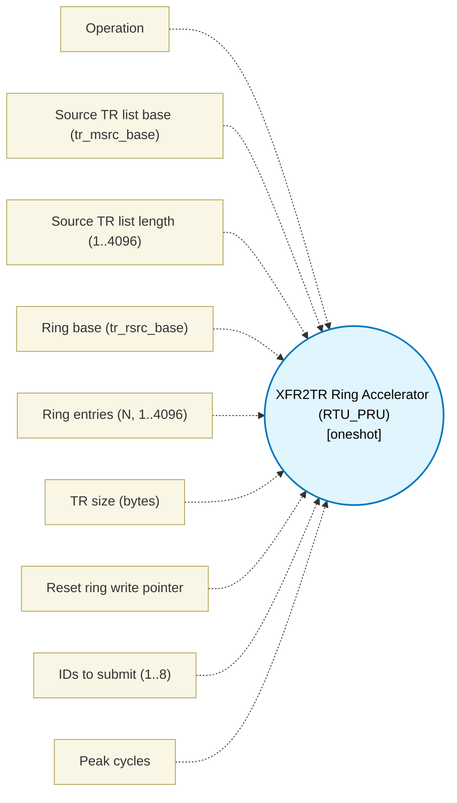

# XFR2TR Ring Accelerator (RTU_PRU) (`xfr2tr_block`) — Design Document

> Generated by `build_block_docs.js` on 2026-10-21 from `.metadata/sysconfig/.meta/pru_blocks/pru_io_blocks/xfr2tr_block.syscfg.js`. Do not edit by hand; re-run `node build_block_docs.js`.

## Purpose

Local Data RAM2 copy accelerator attached to each RTU_PRU core (SPRUIM2J 6.4.6.3.3). 'configure' XOUTs BS ID 0x70 (source TR list base + TR size) then BS ID 0x71 (ring base, ring size - 1, reset). 'submit' XOUTs up to 8 packed TR IDs to BS ID 0x72 through four real input ports (R2:R5); ID 0 is a valid TR ID, not a hole. 'status' XINs BS ID 0x71 for busy/FIFO-occupancy/write-pointer. Each operation declares only the R-register window Table 6-112 says it touches, and a design holding a live value in that window across the call is rejected at build time (same pattern as BSWAP). The submit FIFO is 8 levels deep (Table 6-112); scripts/simulator.js models that capacity, so a submit beyond capacity holds without replaying the XOUT side effect until the ring drains. No doorbell: Table 6-112 lists no doorbell register; submission is the XOUT 0x72 itself. No hardware ring completion: hardware does not issue an interrupt or a self-clearing done bit on wrap; firmware must poll busy/fifo_occ/wrt_ptr via the status XIN. Bases are R6[17:0] (18 bits, 0..0x3FFFF) and must lie inside PRU_ICSSG Shared RAM / Data RAM2 (0x00010000-0x0001FFFF local; SPRACJ8), aligned to trSize, with base+extent inside the window, disjoint source/ring, and sourceTrCount*trSize <=4096 (4 KB source-TR ceiling; independent of ringEntries, which may be up to 4096 on its own). Maturity is simulator-tested only: the device model was written from the same TRM section as this block and is not an independent oracle, and there is no hardware-correlation claim.

## Block Diagram




## Classification

- **Block id:** `xfr2tr_block`
- **Category:** I/O & Protocol
- **Execution model (inferred):** `oneshot`
- **Macro / opcode:** `m_xfr2tr_configure`
- **Data ports:** 0 in / 0 out · **Cycles:** `7`

## Parameter schema

| Parameter | Display name | Default | Options |
|---|---|---|---|
| `operation` | Operation | `configure` | `configure`, `submit`, `status` |
| `sourceBase` | Source TR list base (tr_msrc_base) | `65536` | — |
| `sourceTrCount` | Source TR list length (1..4096) | `16` | — |
| `ringBase` | Ring base (tr_rsrc_base) | `67584` | — |
| `ringEntries` | Ring entries (N, 1..4096) | `16` | — |
| `trSize` | TR size (bytes) | `8` | `8`, `64` |
| `reset` | Reset ring write pointer | `false` | — |
| `submitCount` | IDs to submit (1..8) | `1` | — |
| `noOfCycles` | Peak cycles | `7` | — |

## Ports

| Port | Type |
|---|---|
| `prev` | `IO_PREV` |
| `next` | `IO_NEXT` |
| `output1` | `output32` |

## Validation rules

- XFR2TR operation '
- XFR2TR is attached to the RTU_PRU cores only (SPRUIM2J 6.4.6.3.3); placed core is '
- ringEntries must be an integer 1..4096 (Table 6-112 tr_rsrc_nums encodes ring size - 1)
- trSize must be 8 or 64 bytes (Table 6-112 tr_size)
- sourceTrCount must be an integer 1..4096 (number of TR descriptors physically present at sourceBase)
- sourceTrCount*trSize=
- sourceBase 0x
- sourceBase and ringBase must be distinct (both 0x
- submitCount must be an integer 1..8 (Table 6-112: up to 8 IDs per XOUT; ID 0 is a valid TR ID, not a hole)
- submitCount=

## Generated macro (`.xdt` equivalent)

```asm
m_xfr2tr_configure .macro RES, SRC_BASE, TR_SIZE, RING_BASE, RING_NUMS, RESET
    ; Table 6-112 BS ID 0x70 XOUT: R6[17:0]=tr_msrc_base, R7[0]=tr_size (0=8B,1=64B).
    ldi32 R6, SRC_BASE
    ldi32 R7, TR_SIZE
    xout  112, &R6, 8
    ; BS ID 0x71 XOUT: R6[17:0]=tr_rsrc_base, R7[19:8]=tr_rsrc_nums (ring size - 1), R7[1]=tr_rscr_reset.
    ldi32 R6, RING_BASE
    ldi32 R7, ((RING_NUMS << 8) | (RESET << 1))
    xout  113, &R6, 8
    ldi   RES, 1
    .endm
```

## Device portability

> **Source of truth:** `.metadata/sysconfig/.meta/pru_blocks/common/pru_device_caps.js` (TRM SPRUIM2J §6.4.1.1 / SPRUJB6 §7.3.1.1). Regenerated by `node build_block_docs.js` — do not edit by hand.

- **Required widget(s):** `xfr2tr`
- **Validator:** `pru_blocks_static_module` raises a SysConfig **ERROR** naming both widget and device when a required widget is absent.

| Device (SoC) | Supported |
|---|---|
| `am243x` | ✅ |
| `am261x` | ❌ xfr2tr |
| `am263px` | ❌ xfr2tr |
| `am263x` | ❌ xfr2tr |
| `am64x` | ✅ |

## Outstanding TODO / VERIFY items

- None flagged in source.
